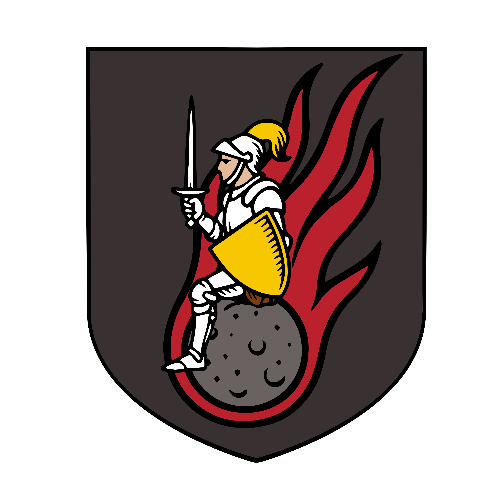

%%
[[Trinicism]]
[[Oresti Pantheon]]
[[Stefano Maldini]]
[[Luminists]]
[[Berengar]]
[[Teggio]]
[[Giuseppe Dimandi]]
[[The Great Schism]]
[[Vorellan War]]
%%

 <h4 class="wiki-header">Fellows of the Dancing Flame</h4>
 

 <strong>Type</strong>
 Knightly order
 

 

 <strong>Leader</strong>
 Great Master <a href="Giuseppe Dimandi" class="internal-link">Giuseppe Dimandi</a>
 

 

 <strong>Seat</strong>
 Fortress Complex of <a href="Teggio" class="internal-link">Teggio</a>
 

 

 <strong>Founded</strong>
 Late 4th century PA, <a href="Cevolis" class="internal-link">Kingdom of Cevolis</a>
 

 

 

 <strong>Faith</strong>
 <a href="Trinicism" class="internal-link">Trinicism</a>, formerly <a href="Gethricism" class="internal-link">High Gethricism</a>
 

 

 <strong>Patron Saint</strong>
 <a href="Berengar" class="internal-link">Berengar</a>
 

 
 <small><i>Banner of the Dancing Flame</i></small>

The Fellows of the Dancing Flame are a Cevolian knightly order and one of the most powerful and influential institutions in <a href="Battvia" class="internal-link">Battvia</a>, where they hold great sway with the Prince and are often employed as an elite fighting force in its military campaigns. The order also seeks to root out heathens and foul monsters throughout the region of <a href="Cevolia" class="internal-link">Cevolia</a>. Its headquarters is the Fortress Complex of <a href="Teggio" class="internal-link">Teggio</a> in eastern Cevolia, a fortress-city that the order has governed since the early 5th century.

<h2>History</h2>

The Fellows were founded in the late 4th century, in the time of the <a href="Cevolis" class="internal-link">Great Kingdom of Cevolis</a>. They grew out of a hardline sect of Gethric priests that sought to purge clerical corruption and the degeneracy of the ruling nobility, much of which still practised the faith of the <a href="Cevolian Pantheon" class="internal-link">ancient Cevoli gods</a>. Saint <a href="Berengar" class="internal-link">Berengar</a> is counted among the founding members of the order and is its patron Saint, and the image of a knight riding a comet, or falling star, that the Fellows use is said to resemble him. From 383PA the order carried the Gethric faith into Cevolis by force.

In the early 5th century the Fellows came to govern Teggio, the city that had grown around their fortress against the foothills of the <a href="Kortopis" class="internal-link">Kortopi Mountains</a>, and over the following centuries the order became one of the greatest landholders in the region. Its vast estates, commercial businesses and military strength made it a power whose cooperation the Princes of Battvia, the Greater Merchants of the coast and the Ducs of Jeledo have always found it prudent to cultivate. The independence of Teggio from Battvian authority is a matter of practical reality rather than formal treaty, as no one has seriously attempted to subordinate the fortress-city since the early years of the successor states.

The order fought in almost all Cevoli wars, with the notable exceptions of the <a href="Battvian Civil War" class="internal-link">Battvian Civil War</a> of 792 to 800PA and the <a href="Vorellan War" class="internal-link">Vorellan Wars</a> of 910 to 919PA. By the time of the civil war the Fellows already disagreed with Battvian policy but did not dare to move against it, and they took the war as a convenient way to stay out of the conflict while they amassed power in the lands around their headquarters. The Vorellan Wars are viewed by some as having been instigated in part by a group of neo-Cevoli power players, among them <a href="Stefano Maldini" class="internal-link">Stefano Maldini</a> and elements within the Fellows, and the order emerged from them as the de facto strongest military force in the eastern regions of Cevolia. Its absence from both wars has cast a shade of mistrust on the Fellows at the court of Battvia.

<h2>Organisation</h2>

The Fellows are organised in Dicasta, the equivalent of the chapters of other orders. Each Dicasta is led by a Master and around four Knight-Captains, and their numbers vary greatly from one Dicasta to the next. Together the Dicasta make up the order, and all their Masters answer to the Great Master. The Masters sit with the Great Master in the Consulta, the great council of the order, which elects a new Great Master for life when the office falls vacant. The Great Master is served by the great officers of the order, among them the Maresciallo, who commands its forces in the field, and the Gran Tesoriere, who keeps its treasury and oversees its businesses.

The knights of the order are supported by the Serventi d'Arme, men-at-arms who serve the Fellows without being knighted, and by the Cappellani, the priests who keep the chapels of the order and say the rites in its houses and on campaign.

<h3>Lands</h3>

Like the great lords of Cevolia, the order rules the land it holds and the people who live on it. Each Dicasta draws its income and its men from its share of the lands of the order, which are organised in masserie, fortified estates that are each run by a fattore, a steward appointed by the Dicasta. The massari, the peasants and tenants who work the masserie, owe their rents, labour and levies to the order rather than to a noble lord. Teggio itself is governed directly by the Great Master.

<h2>Faith and Politics</h2>

The knights practise Trinicist ideals and are critics of the institutional power of the clergy, although over the centuries the Fellows have become an almost worldly power themselves, holding vast lands, riches and businesses within the region, and today they are widely regarded as more worldly than spiritual. Founded to spread the Gethric faith by the sword, the order moved its allegiance to <a href="Trinicism" class="internal-link">Trinicism</a> over the centuries that followed the <a href="The Great Schism" class="internal-link">Great Schism</a>, and its critics hold that it did so without deepening its commitment to either denomination. The Fellows hailed Saint <a href="Luca" class="internal-link">Luca</a> as a hero of Cevolia despite his having never raised a weapon, a contradiction that Luca himself reportedly found amusing.

<h2>The Fellows Today</h2>

In recent times the Fellows have joined a political coalition with the <a href="Luminists" class="internal-link">Luminist movement</a> under <a href="Viccolo di Pora" class="internal-link">Viccolo di Pora</a> and the <a href="Trinicism" class="internal-link">trinic Conclave of Cevolia</a> under <a href="Stefano Maldini" class="internal-link">Bishop Stefano Maldini</a>, who is rumoured to have been backed entirely by the order when he was chosen Bishop of the Velasangra in 921PA. Under Great Master <a href="Giuseppe Dimandi" class="internal-link">Giuseppe Dimandi</a>, called "Capellianci" or "White-Hair" for the flowing hair of the Nereid Queen Igista he is said to have slain, the Fellows are more politically active than they have been in generations. The coalition has begun to exert greater control over academia, the ruling nobility and the Cevoli clergy, with the aim of ushering in a new age and ending the current, self-declared "Age of Decadence and Decline" of the once proud Cevoli peoples. This has renewed both the influence of the order and the suspicion with which the Battvian court regards its ambitions.

<h2>People of Interest</h2>

<a href="Giuseppe Dimandi" class="internal-link">Giuseppe Dimandi</a>, Great Master of the Dancing Flame <a href="Berengar" class="internal-link">Saint Berengar Starknife</a>, founding member and patron Saint of the order
