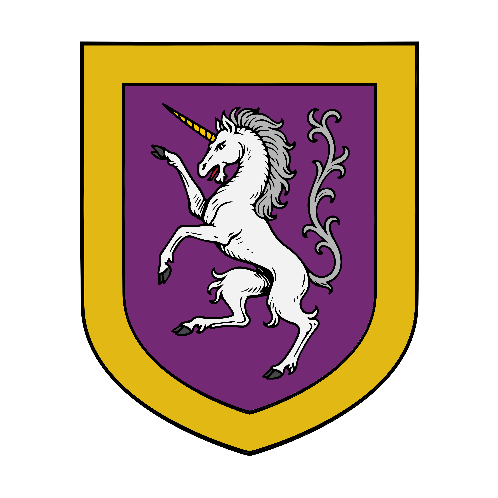

%%
[[Vihr]]
[[Garmish Succession Crisis]]
[[Jakub Ralpia]]
[[Andre]]
[[Trydlew]]
[[War of Horn and Fang]]
%%

 <h4 class="wiki-header">Knights of the Unicorn</h4>
 

 <strong>Type</strong>
 Knightly order
 

 

 <strong>Leader</strong>
 Kurzęk Dorman of the White Sea
 

 

 <strong>Seat</strong>
 Fortress of Madzar, <a href="Trydlew" class="internal-link">Trydlew</a>
 

 

 <strong>Founded</strong>
 869PA, by Saint <a href="Andre" class="internal-link">Andre</a>
 

 

 

 <strong>Faith</strong>
 <a href="Gethricism" class="internal-link">High Gethricism</a>
 

 

 <strong>Patron Saint</strong>
 <a href="Andre" class="internal-link">Andre</a>
 

 

 <strong>Allegiance</strong>
 Throne of <a href="Vihr" class="internal-link">Vihr</a>
 

 
 <small><i>Banner of the Knights of the Unicorn</i></small>

The Knights of the Unicorn are a prestigious and influential knightly order of <a href="Vihr" class="internal-link">Vihr</a>, founded in 869PA by Saint <a href="Andre" class="internal-link">Andre of Trydlew</a>, the eponymous "Unicorn Knight", who is also its patron Saint. The order is deeply entrenched within the Vihri aristocracy, and few of its members hail from anywhere else. Its headquarters is the Fortress of Madzar on the outskirts of <a href="Trydlew" class="internal-link">Trydlew</a>.

<h2>History</h2>

Andre, the defining Vihri commander of the <a href="War of Horn and Fang" class="internal-link">War of Horn and Fang</a>, founded the order at Madzar in 869PA, three years after the <a href="Treaty of Uhl" class="internal-link">Treaty of Uhl</a> had ended the war, and its founding reflected the legacy of Vihri aristocratic military pride that the war had left behind. After his canonisation at the Conclave of 876PA, the Fortress of Madzar was given a royal charter that makes the order answerable to the Ras alone. Nobody objected, since it was seen as the will of the new Saint.

<h2>Membership and Customs</h2>

The head of the order bears the title of Kurzęk. Its full knights and members are known as Lancers, and its servants are the Privihr, who are often teenage boys sent to the order by noble houses to serve as pages. The members of the order include dignitaries and the higher and lesser nobility who uphold Vihrmen tradition and purist Gethric values, and members of the royal family and the court have classically been among its most prominent knights.

As its name implies, the symbol of the order is the unicorn, the national animal of Vihr, and a majority of its knights ride the animal into battle and on parade. The great horse tournaments held beneath the walls of Trydlew are the largest in the realm, and the Knights of the Unicorn, mounted on their great unicorns, open the lists.

The Fortress of Madzar acts as a paramilitary base of its own, and although the order is strictly devoted to the Vihri Throne by name, it keeps its own counsel there. The order spends its substantial finances at Madzar and in the city around it. Its founder is well liked by autocrats and lords, while Trinic bishops reject him as a symbol of the corruption of Iztaw.

<h2>The Garmish Succession Crisis</h2>

The order recently caused a great uproar when it committed its substantial finances and elite forces to the <a href="Garmish Succession Crisis" class="internal-link">Garmish Civil War</a>, following the call to arms of <a href="Jakub Ralpia" class="internal-link">Prince Jakub of Ralpia</a>, the second son of Ras <a href="Vormil III" class="internal-link">Vormil III</a>, second in line to the throne of Vihr and a captain of the order, against the expressed wishes of his father. Kurzęk Dorman of the White Sea backs Jakub and has been in many ways a second father to him, and the knights seem to back him entirely. The order is rooted in the same aristocracy that fills the benches of the <a href="Honoured Assembly" class="internal-link">Honoured Assembly</a>, and the war has put the loyalties of the Assembly to the test.

In the war the knights fight on the side of the Green Banner League and have ridden with the knights of <a href="Eldmar" class="internal-link">Eldmar</a> in the raids and terror campaign of Prince Jakub in eastern <a href="Garmeley" class="internal-link">Garmeley</a>. At the Battle of Lanfield even Selizza the Morning Knight, who fought on the same side, was appalled by their conduct and called them perfumed robber barons.

<h2>People of Interest</h2>

Dorman of the White Sea, Kurzęk of the Knights of the Unicorn <a href="Jakub Ralpia" class="internal-link">Jakub of Ralpia</a>, Kis of Vihr, Captain of the Knights of the Unicorn <a href="Andre" class="internal-link">Saint Andre of Trydlew</a>, founder and patron Saint of the order
