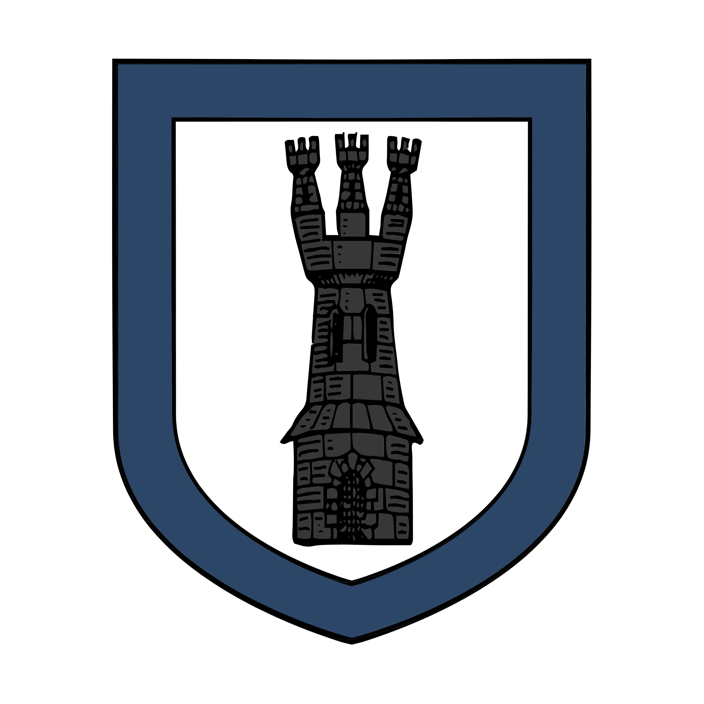

%%
[[Trinicism]]
[[Order of the Silver Wheel]]
[[The Great Schism]]
[[Gisvale]]
[[Jera]]
[[Trinvale]]
[[Garmish Succession Crisis]]
%%

 <h4 class="wiki-header">Order of the Iron Tower</h4>
 

 <strong>Type</strong>
 Knightly order
 

 

 <strong>Leader</strong>
 Großmeister Pater Lucien Cybel
 

 

 <strong>Headquarters</strong>
 Abbey of the Even Touch Roof of Grace, <a href="Jera" class="internal-link">Jera</a> Tatterskeep, Calmbrook
 

 

 <strong>Founded</strong>
 764PA, Trinfurt
 

 

 

 <strong>Faith</strong>
 <a href="Trinicism" class="internal-link">Trinicism</a>
 

 

 <strong>Patrons</strong>
 Monks of the Abbey of the Even Touch
 

 
 <small><i>Banner of the Iron Tower</i></small>

The Order of the Iron Tower is an organisation, often counted among the Gethric knightly orders, that was founded at Trinfurt in 764PA in the aftermath of the <a href="The Great Schism" class="internal-link">Conclave at Trinfurt</a> and seeks to uphold Trinicist values. It is named after the Iron Tower, a castle in the centre of Trinfurt where the militia and heroes of the city held out against the knights of the <a href="Order of the Silver Wheel" class="internal-link">Silver Wheel</a>. The order is decidedly apolitical and advocates for peace in times of war, actively seeking out regions inflamed by wartime suffering to ease the lives of innocent civilians and common folk. It is strongest in the Archduchy of <a href="Gisvale" class="internal-link">Gisvale</a>, to which Trinfurt belongs today.

<h2>History</h2>

In 764PA the Order of the Silver Wheel marched on Trinfurt to dissolve the Conclave by force, and the town held against a short siege. On the steps of Trinfurt Cathedral the two heroes Merten and Fianna fought off dozens of footmen of the Silver Wheel and died there, buying time for the defenders, and the militia of Trinfurt, the heroes of the city and the forces of the Meadi queen then held the Iron Tower against the knights.

In the same year the surviving adventurers and the good men and women who had defended the Conclave founded the order in memory of the defence. They honoured Merten and Fianna, who had given their lives to protect the innocent and defenceless, by regarding them after their deaths as the joint first Großmeisters of the order. The founders also made the classical Meadi custom of egalitarianism, between poor and rich and between men and women, a principle of the order, and it has kept a strong focus on it ever since.

<h2>Organisation</h2>

Unlike many militant or monastic orders that have become strict paramilitary organisations in the modern day, the Iron Tower is a loosely structured and less military group whose members come from all kinds of callings, be they knights and Paladins in shining armour or medicae and clerics in soothing robes. Traditionally, one who seeks to join the order is judged over a period of three years by a Mentor, an experienced member of the order. The merit sought is less that of magical prowess or physical ability and more that of the heart and soul. An applicant who is found worthy and swears to uphold the values of the Iron Tower is welcomed into its ranks.

The patrons of the order are the monks of the Abbey of the Even Touch, north of Trinfurt, and it is there that most applicants join its ranks. The order has two other well-known headquarters. The Roof of Grace in <a href="Jera" class="internal-link">Jera</a> is a great hall of healers and of learning. The Tatterskeep in Calmbrook, in the <a href="Trinvale" class="internal-link">Trinvale</a>, is a partly ruined keep that the order took up as a place of resupply and organisation for its wandering members, and during the ongoing <a href="Garmish Succession Crisis" class="internal-link">Garmish Succession Crisis</a> it has become a massive refugee centre. The current Großmeister and spiritual leader of the order is Pater Lucien Cybel.

<h2>Reputation</h2>

Owing to its decentralised structure and open-minded attitude, the Iron Tower enjoys less favourable treatment from nobles, city keepers, administrators and kings, but it is beloved by the men and women of lower standing, who see its members as true knights rather than feudal enforcers. Its knights travel far beyond Gisvale. In 927PA Hildegard von Giswald, a Meadi knight of the Iron Tower, put herself between the villagers of Varny in eastern <a href="Grachy" class="internal-link">Grachy</a> and the occultist Bersi Hurtfing during <a href="The Tragedy of the Dobrys" class="internal-link">the Tragedy of the Dobrys</a>.

<h2>People of Interest</h2>

Pater Lucien Cybel, Großmeister of the Iron Tower Merten and Fianna, defenders of Trinfurt Cathedral and joint first Großmeisters of the order Dieter vom Stege, Knight of the Iron Tower Hildegard von Giswald, Knight of the Iron Tower
