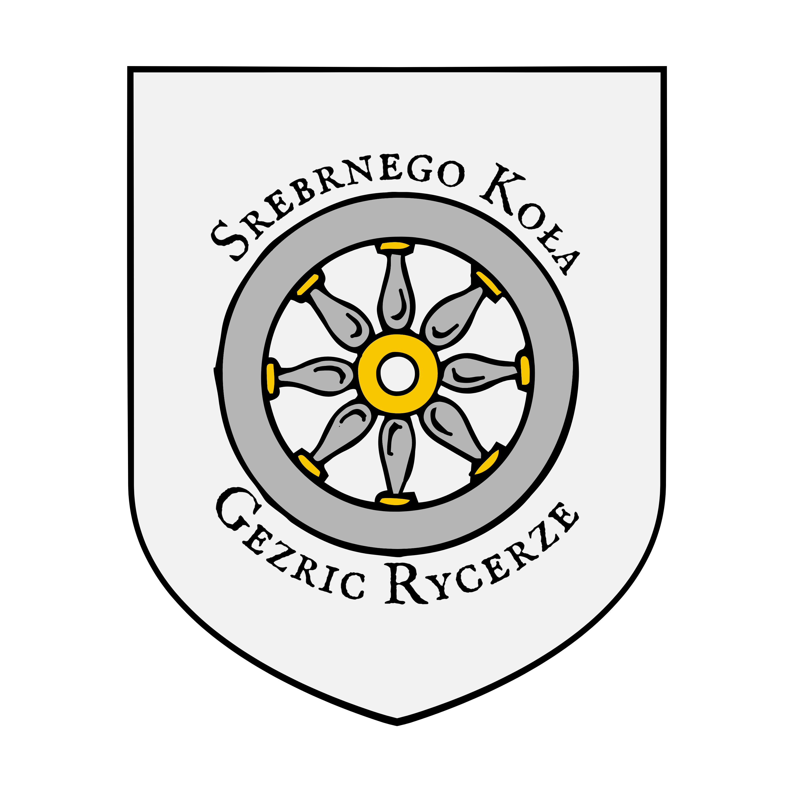

%%
[[Gethricism]]
[[Church of Iztaw]]
[[Wermia]]
[[Nuv Werm]]
[[Lyandra]]
[[Gethric Pogroms]]
[[The Great Schism]]
%%

 <h4 class="wiki-header">Order of the Silver Wheel</h4>
 

 <strong>Type</strong>
 Order of warrior monks
 

 

 <strong>Leader</strong>
 Grand Master Fyor Ziminastrus
 

 

 <strong>Seat</strong>
 The High Castle, Nurk
 

 

 <strong>Founded</strong>
 398PA
 

 

 

 <strong>Faith</strong>
 <a href="Gethricism" class="internal-link">High Gethricism</a>
 

 

 <strong>Allegiance</strong>
 <a href="Church of Iztaw" class="internal-link">Church of Iztaw</a>
 

 

The Order of the Silver Wheel is a paramilitary order founded by <a href="Gethricism" class="internal-link">Gethric</a> monks in 398PA to protect the pilgrimage to <a href="Iztaw" class="internal-link">Iztaw</a> through lost <a href="Wermia" class="internal-link">Wermia</a>. The knights are led by a Grand Master, who usually resides at the High Castle in Nurk, and by four Paladins, the highest-ranking knights of the order.

<h2>History</h2>

In the early days of Gethricism these warrior monks guarded the roads from Urland to Iztaw, their Paladins bearing great silver wheels to smite any daemonic aberration that might still lurk in the Desolation of Wermia. Saint <a href="Lyandra" class="internal-link">Lyandra of Fairriver</a> served as a Knight of the Silver Wheel in the 7th century.

Although the order is independent of the Vihri throne in Zavlech, it is sponsored by and closely tied to the High-Bisop of Iztaw, and in past ages it has raised its banner in political wars such as the Wars of Elbae Aggression, in which it fought on the side of the Gethric Alliance.

Ahead of the <a href="The Great Schism" class="internal-link">Great Schism</a> of 764PA, the order, led by its Grand Master Vaskor zi Myrg, attempted to dissolve the Conclave at Trinfurt by force and was met in arms by local heroes and the forces of the Meadi queen.. Its failure, and the split of the faith that followed, have left the order with far less influence on the world stage in the modern age.

<h2>The Order Today</h2>

The holy mandate of the order is still the protection of the Pilgrims Path through Wermia, but many knights of the Silver Wheel roam the lands of the Ilrakhani and Vihir subcontinents in search of daemons and heretics, and often come into conflict with local authorities and magistrates in doing so.

Racial prejudice and radical Gethricism remain present within the order to this day. Many doubt its self-described holy and good motives and see it as little more than a band of roaming strongmen seeking a way to rebuild their lost power and glory.

<h2>People of Interest</h2>

Fyor Ziminastrus, Grand Master of the Silver Wheel Rekha of Torring, Paladin of the Silver Wheel Talion of Gelm, Paladin of the Silver Wheel Zanislaw of Morset, Paladin of the Silver Wheel Slivomir of Tryd, Paladin of the Silver Wheel <a href="Lyandra" class="internal-link">Saint Lyandra of Fairriver</a>, Knight of the Silver Wheel

