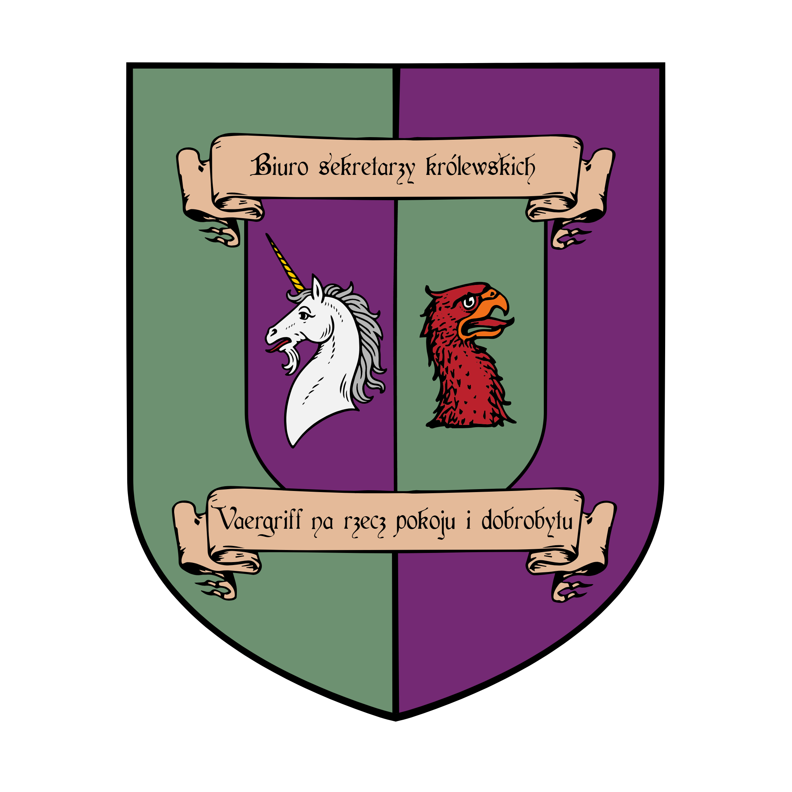

%%  
[[Vihr]]  
[[Tadeuz Pilsud]]  
[[Iron Hole]]  
[[Alana Czery]]  
[[Oleksandr IV]]  
[[Brothers War]]  
[[Szulbod]]  
[[Vormil III]]  
%%  

    
<small><i>Vaergriff Heraldry</i></small>  

  

The Vaergriff, also known as "The Vaergriff Secretariat", is an organisation within <a href="Vihr" class="internal-link">Vihr</a> that acts as a direct agency of the Ras and the Sekretar of Vihr. The full name of the institution is the "Biuro sekretarzy królewskich Vaergriff na rzecz pokoju i dobrobytu", roughly translating from Vihri as "The royal secretaries office of the Vaergriff for peace and prosperity". In essence it acts as an internal and external intelligence service, with agents reporting outside of any other hierarchy of power directly to the Crown and the office of the Sekretar.
  

The Secretariat acts often veiled in shadows and without much announcement, and holds significant authority within the borders of the Rascy. In many ways it is a tool of control and oppression in the hands of the Crown, turned on the people of Vihr and its nobility as well as on the ever powerful and influential clergy. It is feared and hated across the realm, and by none more than the upper and lower nobility, for whom it is, unofficially, one of the only institutions of real accountability. Its current head, the Sekretar of the Realm <a href="Tadeuz Pilsud" class="internal-link">Tadeuz Pilsud</a>, is counted among the most competent and powerful it has ever had.
  
<h2>History</h2>  
<h3>Origins</h3>  

The Vaergriff grew out of an older institution, the office of the royal secretaries, the clerks who kept the correspondence, the seals and the ciphers of the Zav and Szinmo kings. The secretaries had always known more than they were meant to, and the kings had used them for errands that no herald could be trusted with, but they had never been more than a household office. That changed in the reign of Ras Miskomir I at the end of the 6th century. His predecessor, <a href="Zawis I" class="internal-link">Zawis I</a>, had won the throne in nine years of civil war against the Szinmo and the uncontrolled mages they had taken into their ranks, and Miskomir trusted neither the old Szinmo partisans nor the mages, nor many of the lords who had waited to see which way the war would go. He gave the royal secretaries a Sekretar of their own, answerable to the Ras alone, and the Vaergriff was born.
  

Its first Sekretar, Manus Orsaw, had the ruins of Syd Keep on Sydrow Isle rebuilt as the <a href="Iron Hole" class="internal-link">Iron Hole</a> around 599PA, and the Secretariat has kept the prisoners it wants out of the world there ever since.
  
<h3>The Usily Plot</h3>  

The Vaergriff had its part in the last great scandal of the House of Worocek, the Usily Plot of about 686PA, in which House zi Usily, then the lords of <a href="Opuzna" class="internal-link">Opuzna</a>, plotted to kill Zawis III with the help of mages in what was meant to look like an accident. The alchemists of Trazlov who exposed the plot won the royal favour for it, but the Secretariat shared in the work, and the full account of its part has never been told. Some at court held that its men had known of the plot long before it came to light, and had let it ripen until the Usily could be ruined along with it.
  
<h3>The Brothers War</h3>  

The darkest mark on its name abroad is the death of <a href="Oleksandr IV" class="internal-link">Oleksandr IV</a>, the last king of Halgrach, in the <a href="Brothers War" class="internal-link">Brothers War</a>. Oleksandr had turned the war against Vihr and pushed the Vihri armies back across the whole of the peninsula, and in the fall of 834PA, a few weeks after his victory at the Battle of White Bear Crag, he died following a minor engagement at Gorling Vale. It is all but confirmed that the Vaergriff was behind his death, and behind the muddy inheritance that followed it, the rumours of illegitimate children and the uncertain fate of his daughter Olena of Stir, which left the Grachi no clear heir and helped bring about the end of their monarchy. Vihr has never admitted it.
  

Its agents accompanied the royal judge Ignac Wrona, whom Ras Jerziv II sent into Breza to put down the Grain Rising of 854, and they had their part in the Judgements at Atej that followed in 855PA.
  
<h2>Organisation</h2>  

The Vaergriff is headed by the Sekretar of the Realm, who holds the seat of the Throne in the <a href="Honoured Assembly" class="internal-link">Honoured Assembly</a> and keeps the offices of the Secretariat in the palace precinct of <a href="Zavlech" class="internal-link">Zavlech</a>. Below the Sekretar the work is divided between five desks, each under a Secretary:
  

The Desk of the Realm watches the towns, the guilds and the common people of Vihr. The Desk of the Lords watches the Var, the Gri and the knightly orders. The Desk of the Church watches the clergy and the holy cities. The Desk of the Courts watches the courts and envoys of foreign realms and runs the Secretariat's affairs abroad. The Desk of the Iron Hole runs the prison on Sydrow through its Warden.
  

The trained field agents of the Secretariat are known as Quills. Beyond the Quills there are only agents and assets, many of whom never learn whom they truly serve. Most are handled by the desks, but the most important are handled by the Sekretar himself.
  
<h2>Methods</h2>  

The Vaergriff famously loves to employ deniable assets. It recruits from prisons and dungeons, out of people with nothing left to lose, and offers them a pardon or a purpose in exchange for work that the Crown will never acknowledge. It sometimes takes in children who show promise and raises and trains them itself, and some of its best agents, among them <a href="Alana Czery" class="internal-link">Alana Czery</a>, called the Mole, have known no other home.
  

The Secretariat also employs a variety of arcane instruments within the bounds of the Wermian Accords. The most famous are its Whispertwigs, enchanted twigs that a field agent can break to establish contact with his handler. The two can then speak for a few seconds, and the desk gains a broad idea of where the agent is at that moment.
  

Its eyes are everywhere that matters. It values the free city of <a href="Szulbod" class="internal-link">Szulbod</a> more than any other town in Vihr, since every envoy, every foreign merchant and every foreign coin passes through it, and its informers are said to sit in every tavern there.
  
<h2>The Vaergriff Today</h2>  

Under Tadeuz Pilsud, a commoner from Szievek who owes his place to the Ras alone, the Vaergriff has risen to heights it has never known, and the Sekretar has become one of the most influential and powerful people in Vihri politics through his close relationship with Ras <a href="Vormil III" class="internal-link">Vormil III</a>. Pilsud's personal dislike for the powerful chivalric orders, for the old nobility and for the present leadership of <a href="The Alchemists Guild" class="internal-link">the Alchemists Guild</a> is well known. He backs the reforms of the Kisras <a href="Waśko Ralpia" class="internal-link">Waśko</a>, and it is rumoured that he has sent agents of the Vaergriff to ride beside Prince Jakub and report on him, without the prince's knowledge.
  
<h2>People of Interest</h2>  

<a href="Tadeuz Pilsud" class="internal-link">Tadeuz Pilsud</a>, Sekretar of the Realm and Head of the Vaergriff Manus Orsaw, first Sekretar of the Vaergriff, who made Syd Keep the Iron Hole <a href="Alana Czery" class="internal-link">Alana Czery</a>, "the Mole", agent of the Vaergriff raised by the Secretariat

