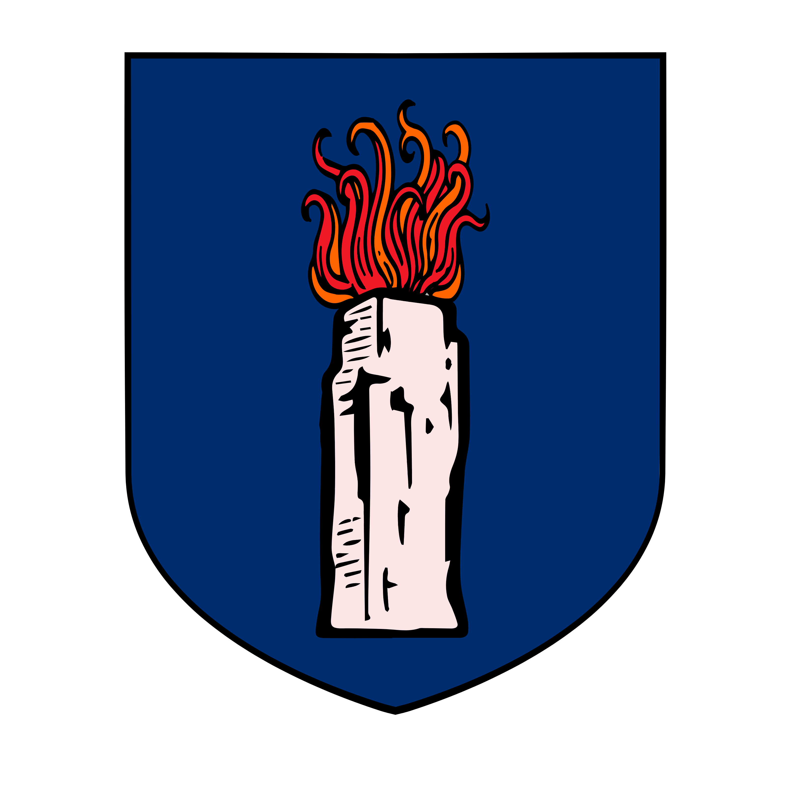

%%
[[Iztaw]]
[[Gethricism]]
[[Vihr]]
[[Candleguard]]
[[Deacon]]
[[Trinicism]]
[[Kethricism]]
%%

 <h4 class="wiki-header">Church of Iztaw</h4>
 

 <strong>Denomination</strong>
 <a href="Gethricism" class="internal-link">High Gethricism</a>
 

 

 <strong>Head</strong>
 High-Bisop Orthel II
 

 

 <strong>Seat</strong>
 The Voldom, <a href="Iztaw" class="internal-link">Iztaw</a>
 

 

 <strong>Founder</strong>
 <a href="Volboris" class="internal-link">Volboris the Healer</a>
 

 

 <strong>Founded</strong>
 241PA
 

 

 

 <strong>Militia</strong>
 <a href="Candleguard" class="internal-link">Candleguard</a>
 

 

 <strong>Heraldic Symbol</strong>
 Gethric Candleflame
 

 

The Church of Iztaw is the clergy of the <a href="Gethricism" class="internal-link">Gethric</a> faith and the institution of its oldest denomination, High Gethricism. It has canonised almost every Saint in the history of the faith. Its head is the High-Bisop of Iztaw, "Bisop" being the Vihri form of the title, and the present High-Bisop is the blessed Orthel II. For the political entity, see <a href="Iztaw" class="internal-link">Iztaw</a>.

The clerics and priests of Iztaw keep chapels and churches across the known world. What sets them apart from the clergy of <a href="Trinicism" class="internal-link">Trinicism</a>, beyond their teachings, is their organisation: the clergy of Iztaw follows a strict hierarchy of priests, clerics and bishops, all of whom answer to the office of the High-Bisop.

The wealth of the Church and its hold on the faithful have often led observers to treat it as little less than a nation of its own, and for many decades of history the High-Bisop was a more powerful man in <a href="Vihr" class="internal-link">Vihr</a> than the King in Zavlech. Agents of the Church are said to take on every shape and guise, working from the light of the altar as much as from the shadows of an alleyway. Above all else the clergy values discretion, so its methods and its part in events are usually left to speculation.

<h2>Ranks of the Clergy</h2>
<h3>High-Bisop of Iztaw</h3>

The High-Bisop of Iztaw is the head of the Gethric Church and the foremost authority on all matters of canonical law and theological judgement. He is elected for life by the Bishops upon the death of his predecessor, although not every Bishop's vote counts the same. The High-Bisop is usually also the ruler of the realm of <a href="Iztaw" class="internal-link">Iztaw</a>, and so formally a subject of the Ras of <a href="Vihr" class="internal-link">Vihr</a>.

<h3>Archbishop, Primat and Patriarch</h3>

Certain Bishops are ordained as Archbishops and made responsible for an entire region. They are usually more important and influential than the Bishops beneath them, although exceptions have been made for especially important municipalities. Archbishops vote in the election of the High-Bisop, and their votes weigh significantly more than those of other Bishops.

A Primat is a device by which the Church still formally considers itself the head of the territories it lost in the <a href="The Great Schism" class="internal-link">Great Schism</a> of 764PA, when the western churches broke away to form <a href="Trinicism" class="internal-link">Trinicism</a>. In the eyes of Iztaw a Primat is an Archbishop who has no vote in the election of the High-Bisop but is still acknowledged as a high-ranking servant of the Prophet. The Primati do not match the Archbishops of the Trinicist clergy one for one: there are Trinicist Archbishops of Ur and of Trykkerog, for example, who go unacknowledged because a Gethric Archbishop of the same see already exists. The Patriarchs of <a href="Kethricism" class="internal-link">Kherova and Azuvke</a> are given a similar honorific standing.

The main Archbishoprics are those of Grachy, Ur, Trykkerog, Vihr, Pilvia and Rean. The Church further recognises the Primati of Weadland, Meadland, Cevolia and Othirdon, and the Patriarchs of Kherova and Azuvke.

<h3>Bishop</h3>

A Gethric Bishop is the overseer of an ecclesiastical province. He holds oversight of his diocese and effective authority over the suffragans of his province, ensuring that the faith and ecclesiastical discipline are properly observed, that the authority of the Church is maintained and expanded, and that the education of the lesser ranks of the clergy prospers. Bishops are appointed to their provinces by the High-Bisop, almost always on the recommendation of the Archbishop concerned, and they hold a vote in the election of the High-Bisop.

<h3>Deacon</h3>

A Deacon is an ordained Minister or Father of the faith who acts as co-worker and right hand to the Bishop, usually focused on direct service, public outreach and the more immediate protection of the faith within the province. A Bishop tends to have only a single Deacon, although this tradition has been broken in the past, and the Deacon is chosen at the personal request of his Bishop. In some cases the role is forgone entirely, particularly in smaller Bishoprics or those that work closely with a Gethric order of knights or a similar body, and the Vicar then assumes its remaining duties. Among the Meadi and Weadi the title is also given to a minister of the law called upon by a noble lord, a lord castellan or a city council; see <a href="Deacon" class="internal-link">Deacon</a>.

<h3>Vicar</h3>

A Vicar is an ordained Minister or Father of the faith who assists the Bishop in the material governance of the province. Usually only one Vicar is appointed, but particularly large provinces may have more than one. The Vicar is almost always a local man, deeply engrained in regional politics. Vicars are chosen by the Archbishop of the region and, unlike Deacons, may keep their office when the Bishop changes.

<h3>Father and Minister</h3>

A Father of the Church is a Priest who has completed his clerical education in the Minor Cudra and the Maior Cudra, has made his pilgrimage, the Uwazna, to Iztaw, and has been ordained there by the High-Bisop. A Minister is a Priest who has also completed the Tregesia and is granted the right to practise clerical law. Every major parish is typically headed by a Father or a Minister. No woman is granted either role, even upon completing the same requirements as a Priest.

<h3>Priest</h3>

A Priest is a member of the clergy who has completed the Minor Cudra but not yet the Maior Cudra. The great majority of clerical officials hold this rank and take on most administrative and spiritual tasks, and many are mentored by a Father or a Minister.

<h3>Disciple</h3>

A Disciple is a person who has given themselves to the Church but has not yet passed the first clerical examination, the Minor Cudra. Disciples may not sit the Minor Cudra before the age of 15, and most do not complete it before the age of 22.

