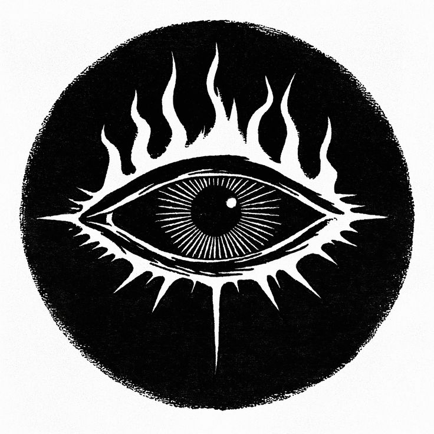

%%
[[Kherova]]
[[Kethricism]]
[[Wermian Accords]]
[[Treaty of Kulum]]
[[Bihra Shamanism]]
[[Vazena]]
%%

 <h4 class="wiki-header">Kherovan Inquisition</h4>
 

 <strong>Denomination</strong>
 <a href="Kethricism" class="internal-link">Kethricism</a>
 

 

 <strong>Head</strong>
 The Patriarch of Kherova, High Inquisitorial Council
 

 

 <strong>Seat</strong>
 The Silent Monastery, Kher
 

 

 <strong>Founded</strong>
 585PA
 

 

 <strong>Members</strong>
 ca. 300 Inquisitors, over 1000 personnel
 

 

 

 <strong>Emblem</strong>
 The All-Seeing Eye of Truth
 

 

The Kherovan Inquisition is the enforcement arm of <a href="Kethricism" class="internal-link">Kethricism</a>, founded in 585PA in response to the findings of the Great Expedition in Rakh. It stands under the direct control of the Patriarch of Kherova as head of the Kethric denomination, and is officially tasked with enforcing magical law within <a href="Kherova" class="internal-link">Kherova</a>. Its symbol is the All-Seeing Eye of Truth engulfed in the flames of Kethric. Outside Kherova its agents are commonly known as Witchfinders.

<h2>Doctrine and Mandate</h2>

The Inquisition is the institutional expression of the Doctrine of Dualism, which holds that arcane power corrupts the soul of its user. It regards the <a href="Wermian Accords" class="internal-link">Wermian Accords</a>, the principal agreement regulating magic, as inadequate, describing them in its own words as "a near 400 year old document that could not fathom the cruel ingenuity to come".

<h2>Operations Abroad</h2>

Owing to the good relations Kherova keeps with <a href="Vihr" class="internal-link">Vihr</a> and <a href="Grevenna" class="internal-link">Grevenna</a>, and to its economic weight as the main trade route to Nirydia, Kherovan Inquisitors often operate beyond their own country. Some hold royal mandates that allow them to pursue and deal with any fugitive, criminal or threat to Kherova and her people.

The <a href="Treaty of Kulum" class="internal-link">Treaty of Kulum</a>, signed by most nations of the continent after the rise and fall of Ahrmiz Saceren, commonly known as Ahrmiz the Conjurer, gave Kherovan Inquisitors international legal authority to apprehend the remnants of his cult. Local lords and authorities often criticise the practice, and individual agents are accused of abusing it to carry out secret missions and witch-hunts across the continent. Since the Niedrest Incident of 923PA, in which the entire Inquisition delegation to southern Urland was assassinated, western nations have begun to withdraw the authority one by one.

Most stories about the Witchfinders are less dark than their reputation suggests. Tales of children torn from their parents and citizens burned on the pyre exist, but they are usually matched by reports of Inquisitors genuinely helping common folk, hunting down aberrations and pacifying rogue and criminal casters.

<h2>Organisation</h2>

The seat of the Inquisition is the Silent Monastery in Kher, the capital of Kherova. It is organised in nine Tribunals, each with its own hierarchy, tasks and history. Each Tribunal serves under a High Inquisitor, and the High Inquisitors together form the High Inquisitorial Council, which heads the organisation and is subject only to the will of the Patriarch of Kherova.

Within the Tribunals the hierarchy runs from the High Inquisitor to the Inquisitors, of whom there are about 300 across all Tribunals, and to the Acolytes who seek to rise to the rank of Inquisitor themselves, numbering from a mere dozen to over a hundred depending on the Tribunal. Below them stands the inquisitorial personnel, easily over a thousand soldiers, clerks, scribes, envoys and other aides.

<h2>Tribunals</h2>

The Tribunal of the Marble Script is concerned with religious peace and the persecution of heretics and heathens within Kherova. It was founded in 585PA.

The Tribunal of the Final Peace protects burial rites and hunts necromancers. It was founded in 585PA.

The Tribunal of the Open Face is the diplomatic arm of the Inquisition, formed of the delegations to Trinicist and Gethric institutions and courts in foreign countries. It was founded in 585PA.

The Tribunal of Nirydia holds the experts in <a href="Bihra Shamanism" class="internal-link">Bihra Shamanism</a> and <a href="Bihra" class="internal-link">Bihra</a> magic, the Guardians of the East, who work closely with the Eastern Fortresses. It was founded in 585PA.

The Tribunal of the Clear Soul hunts wizards and arcanists within Kherova who do not fall under the jurisdiction of the Tribunal of the Final Peace, although the two often collaborate. It was founded in 585PA.

The Order of the White Hall gathers the dwarven sages and scholars of the Inquisition and deals with heresy in the dwarven communities of Kherova. It also seeks, contains and destroys powerful magical relics. It was founded in 599PA.

The Spellbreaker Guard is the military arm of the Inquisition within the Kherovan army, an anti-magic force in battle that carries the mirror shields first devised by Saint <a href="Vazena" class="internal-link">Vazena</a>. It was founded in 710PA.

The Keepers of the Pale Truth are an internal police corps within the Inquisition and the clergy. They were founded in 710PA.

The Hunters of the Onyx Cult are dedicated to the destruction of the Cult of Ahrmiz and its relics, and to the safeguarding and cleansing of Kulum. They were founded in 908PA.

