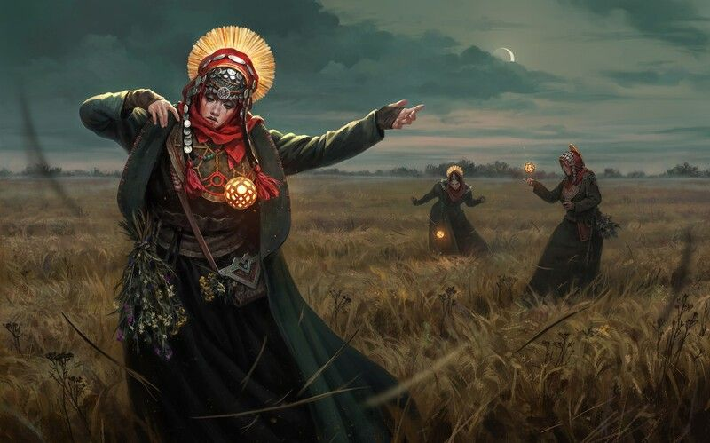

%%
[[Gethricism]]
[[Volboris]]
[[Church of Iztaw]]
[[Trinicism]]
[[Urbridge]]
[[Fellows of the Dancing Flame]]
[[The Great Schism]]
%%

 <h4 class="wiki-header">Sisterhood of the Morning</h4>
 

 <strong>Type</strong>
 Religious sisterhood
 

 

 <strong>Leader</strong>
 The Maguma
 

 

 <strong>Largest Chapter</strong>
 <a href="Urbridge" class="internal-link">Urbridge</a>
 

 

 <strong>Founded</strong>
 Early days of the faith, first recorded 259PA
 

 

 

 <strong>Faith</strong>
 <a href="Gethricism" class="internal-link">Gethricism</a>
 

 

 <strong>Patron Saint</strong>
 <a href="Volboris" class="internal-link">Volboris</a>
 

 

 <strong>Allegiance</strong>
 Independent
 

The Sisterhood of the Morning is an order of "wise women", most commonly associated with spiritual guides, healers and blessed women of grace, that seeks to embody the virtues of its patron, the Church father Saint <a href="Volboris" class="internal-link">Volboris</a>. It is decidedly independent in its political associations and is one of the few elder Gethric institutions that largely avoided taking sides in the <a href="The Great Schism" class="internal-link">Great Schism</a> between High Gethricism and <a href="Trinicism" class="internal-link">Trinicism</a>.

<h2>History</h2>

The members of the Sisterhood date the origins of the group back to the early days of the faith. It first appears in church records in 259PA, as a group independent of the clergy of the <a href="Church of Iztaw" class="internal-link">Church of Iztaw</a>, and when the western churches broke with Iztaw in 764PA, the Sisterhood was among the few old institutions of the faith that stayed largely apart from the split.

<h2>Organisation</h2>

The Sisterhood is an entirely female organisation with a well-defined hierarchy. It operates in a similar fashion to the knightly orders and is organised in regional chapters, the largest of which is the <a href="Urbridge" class="internal-link">Urbridge</a> Chapter in central Urland. Its head is the Maguma, the oldest of the Magu, but in practice the Sisterhood is led by the Magu of its individual regional chapters. The sisters often cooperate with nunneries and abbeys around the world, and some act entirely within them.

The Sisterhood is present in the regions of Trykkerog, Vihr, Meadrath, Urland, Garmeley and Nostroya, and it is almost entirely absent from Cevolis, largely due to longstanding conflicts with the <a href="Fellows of the Dancing Flame" class="internal-link">Fellows of the Dancing Flame</a>.

<h2>Reputation</h2>

Sisters are often consulted by communities, authorities and even great leaders, owing to their sworn political independence, their good reputation and their known expertise in matters of magic. The Sisterhood has also come under criticism for its reluctance to share information, and rumours of occult practices that are less than "by the book" have long surrounded it.

  

<small><i>Painting of the Sisters of Morning during a cleansing in southern Grachy</i></small>