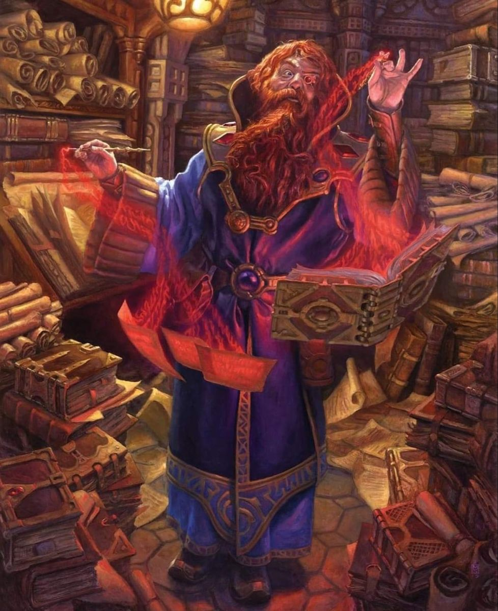
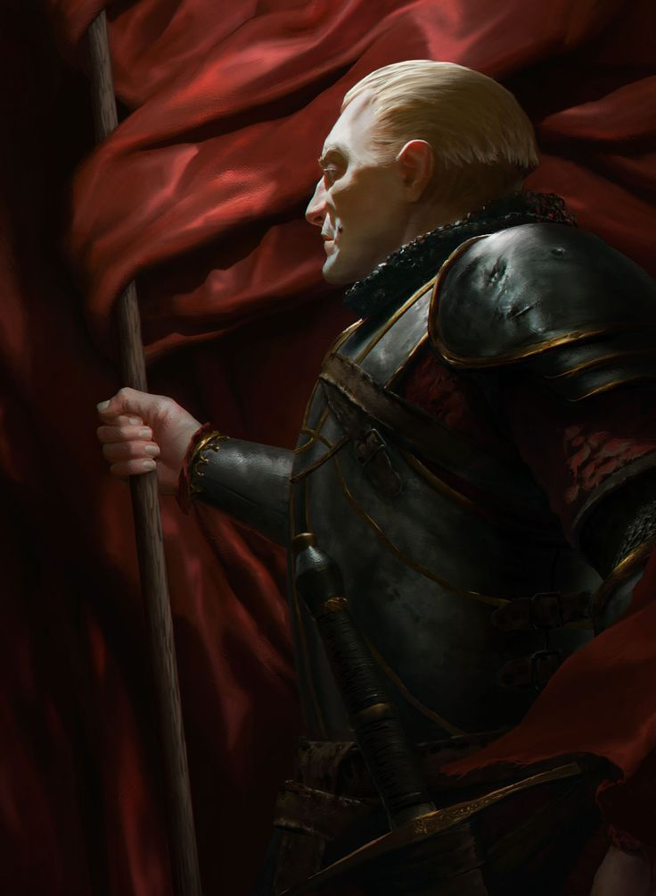
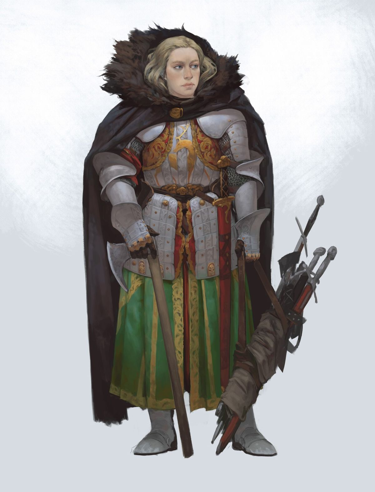

%%  
[[Vihr]]  
[[Halgrach]]  
[[Grachy]]  
[[Vormil II]]  
[[Oleksandr IV]]  
[[Vaergriff]]  
[[Trazlov Consortium]]  
[[Selbia]]  
[[Levazci]]   
[[Idrov zi Sribo]]   
[[Karelya Modriv]]   

%%  

  
<h4 class="wiki-header">Brothers War</h4>  

  
<strong>Also known as</strong>  
The Great Southern War (in Grachy)  

  

  
<strong>Date</strong>  
828PA to 835PA  

  

  
<strong>Location</strong>  
The Iron Claw, the Grachhyll, the Hyllpass, the Torn Sea  

  

  
<strong>Result</strong>  
White peace, end of the Kingdom of Halgrach, Republic of Grachy formed  

  

  
<strong>Territorial changes</strong>  
Tuskwatch passes to Grachy  

  

  

  
<strong>Belligerents</strong>  
<a href="Vihr" class="internal-link">Rascy zi Vihr</a>, <a href="Halgrach" class="internal-link">Rascy zi Halgrach</a>  

  

  
<strong>Commanders</strong>  
<a href="Vormil II" class="internal-link">Vormil II "Axebreaker"</a>, <a href="Idrov zi Sribo" class="internal-link">Idrov zi Sribo</a>, Mezekil zi Brov, <a href="Oleksandr IV" class="internal-link">Oleksandr IV</a> †, Volodmir zi Bryansk †, <a href="Karelya Modriv" class="internal-link">Karelya Modriv</a>

  

  

The Brothers War was fought from 828PA to 835PA between the Kingdom of <a href="Vihr" class="internal-link">Vihr</a> and the Kingdom of <a href="Halgrach" class="internal-link">Halgrach</a>, on the Iron Claw, in the valleys of the Grachhyll, around the Hyllpass and on the Torn Sea. In <a href="Grachy" class="internal-link">Grachy</a> it is called the Great Southern War. Ras <a href="Vormil II" class="internal-link">Vormil II</a> began it in the hope of a quick victory over a smaller neighbour, and for its first two years it went his way. Then Ras <a href="Oleksandr IV" class="internal-link">Oleksandr IV</a> of Halgrach turned it, and over its second half the Vihri were pushed back across the whole of the Iron Claw. The war ended only because Halgrach collapsed from within. Oleksandr died in 834PA, almost certainly at the hands of the <a href="Vaergriff" class="internal-link">Vaergriff</a>, the Grachi made themselves a republic, and in 835PA their generals agreed to a white peace. Halgrach did not survive the war, but Vihr has never counted it a victory.
  
<h2>Name</h2>  

The Grachi are the descendants of the Vihri settlers who followed Fidor of Trazlov around the Iron Claw in 124PA, and their kingdom grew out of the eastern colonies of Vihr. The Vihri have always thought of Halgrach as their long lost little brother, and the war took its name in Vihr from that old feeling. The Grachi have never cared for the name, and they call it the Great Southern War.
  
<h2>Background</h2>  

The causes of the war were largely economic. Under the later kings of the House of Stir, Halgrach pressed ever harder on the merchants of the <a href="Trazlov Consortium" class="internal-link">Trazlov Consortium</a> and on the other traders of Vihr, whose cogs carried most of the trade of the eastern Torn Sea, with tolls, seizures and favours for its own merchants. At the same time a great supply of Graccum, a precious substance then newly known, was found in the Grachhyll, the mountains that divide the two realms, and both crowns wanted the valleys where it lay.
  

   
<small><i>Lorenov Gasinik, Mage of Halgrach and Chief-Diviner</i></small>  

Vormil II had governed Vihr for his brother Viago VII for most of the 810s, and he came to the throne in 822PA with nine years of a peace he had not chosen behind him and no victory of his own. Halgrach was much the smaller kingdom, and the Ras and his council expected a short war. The arms of Halgrach showed a great axe aflame, and at the outset Vormil swore to break it and took the name Axebreaker. He rode into the war in golden armour made by the dwarven smiths of Xer-Kol, under his own green version of the royal arms, and many said that he looked like a saint marching to slay the demons of the Incursions. He limped back cursed and mocked.
  
<h2>Course of the War</h2>  
<h3>Fidograd and Istrov</h3>  

The war opened in 828PA with a blow from the sea. Gri Mezekil zi Brov, the king's brother-in-law, led the royal fleet around the Iron Claw, with the ships of the Consortium in support, and fell on Fidograd, the oldest town of the Grachi, before its defenders were ready. He destroyed its garrison and burned much of the Grachi fleet in the harbour, and for the rest of the war Vihr held the advantage at sea. The Vihri armies crossed onto the Iron Claw behind him and laid siege to Istrov itself, while other contingents pushed up into the valleys of the Grachhyll.
  

Only at the Hyllpass did the war go wrong from the start. Tuskwatch, the watch-town at the eastern end of the pass, fell to the Grachi almost at once. It was held by the Boyar <a href="Karelya Modriv" class="internal-link">Karelya Modriv</a> of Izhevk, who kept it through harsh winters on scant supply against every attempt to retake it.
  
<h3>The Red Cloud and Kanyak Keep</h3>  

In 830PA Oleksandr IV turned the war. While the Vihri were committed on the Iron Claw and in the mountains, he struck at the Hyllpass, and Vormil II met him in the lands near the pass at the Battle under the Red Cloud. The Vihri were badly beaten, and the Ras, who commanded in person, was struck down by a magical warhammer. He lost an eye, and the wound carried a curse that had to be held in check for the rest of his life by a priest who never left his side.
 

   
<small><i>Idrov "Quick Idrov" zi Sribo, Var of Selbia, Commander of the Vihri Armies and Hetman of the Selbia Brigade</i></small>  

 

Command of the Vihri armies passed to <a href="Idrov zi Sribo" class="internal-link">Idrov zi Sribo</a>, the Var of <a href="Selbia" class="internal-link">Selbia</a> and the younger son of Rezvyr zi Sribo, who had led the coalition in the <a href="Third War of Elbae Aggression" class="internal-link">Third War of Elbae Aggression</a>. Idrov was the Hetman of the Selbia Brigade and was known as Quick Idrov. In 831PA he met the Grachi at Kanyak Keep on the Iron Claw and killed Gri Volodmir zi Bryansk, one of the greatest warriors of Halgrach and one of its foremost nobles, with his own hand. It was the last great Vihri victory of the war.
  
<h3>Gasinik and the Grachhyll</h3>  

The Vihri contingents in the valleys of the Grachhyll depended on supply caravans that came up through the mountains, and from 831PA onward the caravans were ambushed again and again. The Grachi knew their routes and their days because of Gasinik, a mage of Halgrach whose powers of divination let him see where the Vihri would be. Starved of supply, the Vihri armies in the mountains became disorganised and fell back, and Oleksandr pressed them across the whole of the peninsula. The siege of Istrov was given up, Fidograd was lost again, and by 833PA the war was being fought on the Vihri side of the mountains.
  
<h3>White Bear Crag and Gorling Vale</h3>  

In the summer of 834PA Oleksandr won his last victory at the Battle of White Bear Crag, near the Hyllpass, one of the bloodiest battles of the war. It left the road into <a href="Levazci" class="internal-link">Levazci</a> open, but his army was too spent to take it, and in Halgrach the mood had already turned against him. His people had borne six years of war against a much larger enemy, and he was seen as having squandered an unlikely victory by fighting on. In the fall of 834PA he took up a weak position at Gorling Vale against the advice of his general staff and of the Grachi nobility, and he died there following a minor engagement. It is all but confirmed that the Vaergriff was behind his death, and behind the muddy inheritance he left, the rumours of illegitimate children and the uncertain fate of his daughter Olena of Stir. Vihr has never admitted it.
  
<h2>Peace</h2>  

With Oleksandr dead and no clear heir, the magnates, nobles and burghers of the Ushkyn assembled in the Blue Palace in Halgrach and declared the Republic of Grachy. The new republic needed peace as quickly as it could get it, and its generals sued for one. Vihr, which had been on the back foot for most of the war, accepted. The peace of 835PA was a white one. Neither side paid anything or gave anything up, except that Tuskwatch, which the Grachi still held, stayed with Grachy. It was the only ground that changed hands in the whole war, and the Hyllpass has been the border ever since.
  
<h2>Aftermath</h2>  

   
<small><i>Boyar Karelya Modriv, later Gram of the Hyllpass</i></small>  

 

Vihr never forgot the shameful result of the war, and even among the more content and otherwise inclined voices Vormil II is remembered negatively, while <a href="Idrov zi Sribo" class="internal-link">Idrov zi Sribo</a> came out of the war as its hero. Halgrach had been dissolved, and in a sense its axe had been broken, but no one believed that Vormil had broken it, and his epithet took on an almost mocking aspect immediately after the peace. He reigned for fourteen more years and died in 849PA of an attempt to burn the curse out of his wound with holy fire.
  

Gasinik was questioned after the war, on the demand of Vihr, and found not guilty of breaking the <a href="Orenburg Pact" class="internal-link">Orenburg Pact</a>, which forbids the mages of its institutions to use destructive magic on the field of battle but not to read the future for a general. The verdict was bitterly resented in Vihr and is still cited whenever the Pact's limits are argued over.
  

For Grachy the war was the end of its monarchy and the beginning of the republic. Karelya Modriv's family rose to become the Grams of the Hyllpass Region, a title the Modriv line still holds. The fall of the kings of Halgrach and the rise of the burghers opened the Grachi ports to the Consortium more widely than ever before, and in the end the merchants of Trazlov gained more from the peace than the crown of Vihr had hoped to win in the war. Oleksandr IV is remembered in Grachy as the warrior king who beat a far larger enemy, and the traditionalists of the Grand Ushkyn still speak of a return to the monarchy.
  
