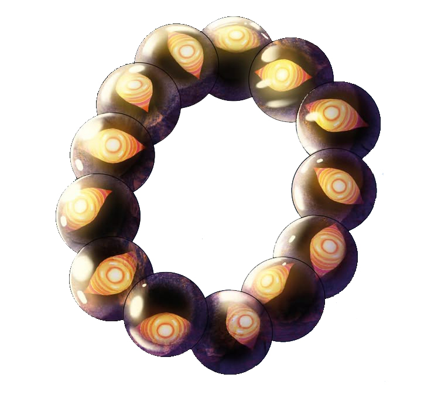

%%
[[Hilcarax]]
%%

    <h4 class="wiki-header">The Eyes of Koshtir</h4>
    

        <strong>Date of Creation</strong>
        early 8th century PA
    

    

        <strong>Grade</strong>
        Banr
    

    

        <strong>Creator</strong>
        <a href="Hilcarax" class="internal-link">Hilcarax</a>
    

    

        <strong>Current Owner  or Location</strong>
        Tercero Vicario
    

    

        <strong>Past Owners</strong>
        Temple of Ibin-Gyu
    

    

	 

This Bracelet was crafted by <a href="Hilcarax" class="internal-link">Hilcarax the Misteater</a> himself, imbued with the power of the Mists, its eyes open when it senses magical dangers around and it serves as a warning to its wearer. Initially granted as a protective ward to his most trusted acolytes, it later on became the treasure of the lost ruin of Ibin-Gyu, a small island in the Purple Seas. In the early 10th century a hobgoblin of <a href="Guadaxerra" class="internal-link">Guadaxerra</a>, light on his feet, ventured into the lost ruins and managed to retrieve the treasure.
