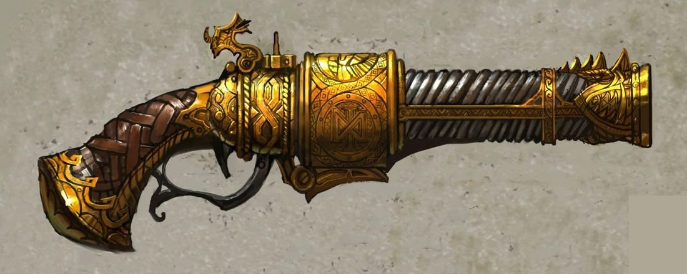

%%  
[[Keyzal Workshop]]  
[[Ormir Pizak]]  
[[Currentbending]]  
[[Tizin-Kol]]  
%%

 <h4 class="wiki-header">Keyzal 21</h4> 
 <strong>Date of Creation</strong> 920s. 
 
 <strong>Type</strong> Osmium Firearm 
 
 <strong>Creator</strong> <a href="Keyzal Workshop" class="internal-link">Keyzal Workshop</a> 
 
 <strong>Current Owner  or Location</strong> Grachy 
 
 <strong>Past Owners</strong> <a href="Ormir Pizak" class="internal-link">Ormir Pizak</a> 
 
  
 
A Mk. 21 Osmiumthrower of the <a href="Keyzal Workshop" class="internal-link">Keyzal Workshop</a> from the dwarven realm of <a href="Tizin-Kol" class="internal-link">Tizin-Kol</a>, highly delicate and one of only a handful of advanced current bending weapons that have reached the surface. The Keyzal 21 is capable, if wielded by an experienced user, of launching multiple projectiles at the same target within a single current-ignition, allowing for expert assurance of devastation. As all models of the Keyzal Thrower line, the Keyzal 21 requires fused Osmium cartridges, colloquially referred to as "Bonebreakers" due to their destructive power, as ammunition.
 <h2>Function</h2> 
Like all Osmiumthrowers, the Mk. 21 works by <a href="Currentbending" class="internal-link">currentbending</a>. Its barrel is a pair of rails of deepforged silver, and its heart a stack of strikestone held under strain in an iron frame. Pulling the trigger drops a hammer on the stack, loosing its stored current into the rails in a single ignition, and the current, running through the cartridge's deepforged jacket from one rail to the other, hurls the osmium slug from the barrel with a crack and a flash of lightning at the muzzle. What sets the Mk. 21 apart is that its rails hold the current of an ignition rather than spending it at once: a practised gunner can let it out shot by shot, sending several Bonebreakers after the same target before the stack must be wound again.
 
The weapon is as demanding as it is deadly. It kicks hard enough to throw an unbraced shooter, its rails go grey and useless if run too hot, and a cracked strikestone can loose its whole charge at once. The fused osmium of its cartridges gives off a poisonous fume when heated in the throw, and Keyzal gunners fire in masks and goggles; clouded eyes mark the veterans of the trade.
 
A pair of Keyzal 21s was found in the hands of the grachy kennel master <a href="Ormir Pizak" class="internal-link">Ormir Pizak</a> who led a group of hunters and mercenaries on the orders of <a href="Rodomyr" class="internal-link">Grigory Rodomyr</a>, he was slain by a party of adventurers in the small village of Sargov in the last days of summer of the year 927PA.
