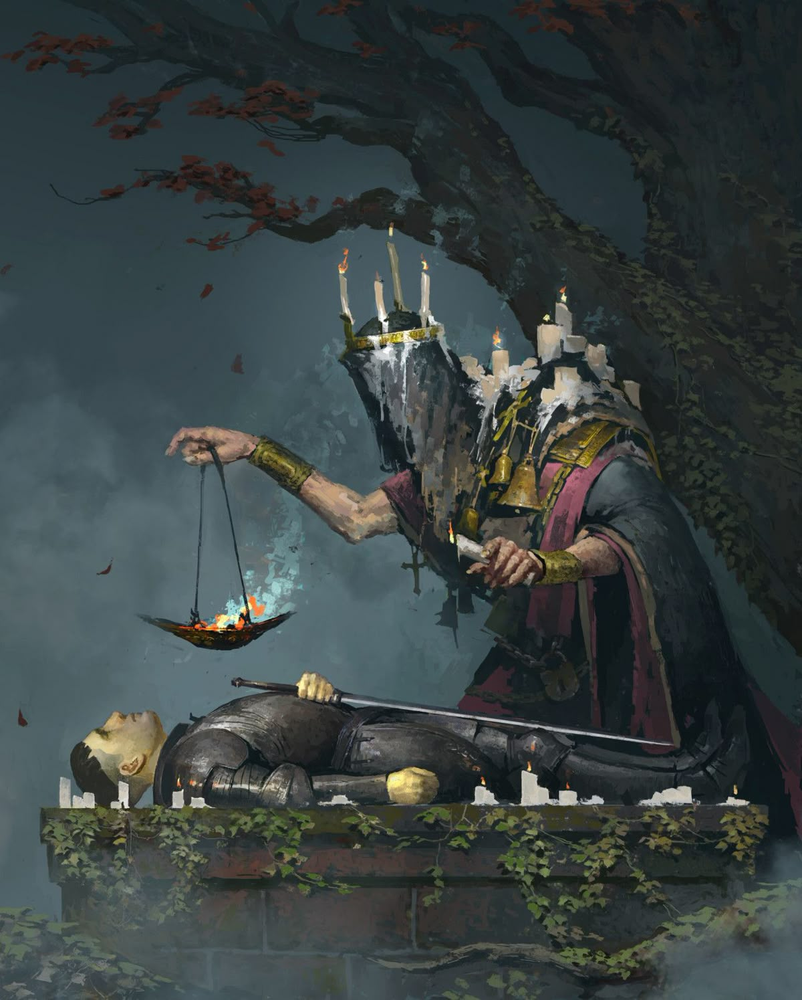

%%
[[Gethric]]
[[Volboris]]
[[Razmyr]]
[[The Incursion]]
[[Church of Iztaw]]
[[Iztaw]]
[[Kethricism]]
[[Trinicism]]
[[Diarism]]
[[Razmyrism]]
[[Remembrance]]
[[Candleguard]]
[[Kherovan Inquisition]]
[[Order of the Silver Wheel]]
[[Sisterhood of the Morning]]
[[Wermian Accords]]
[[Gethric Pogroms]]
[[Gethricism in the New World]]
[[The Great Schism]]
%%

  
<small><i>A traditional Gethric Wake, performed by a Father of the Church</i></small>

For the Church, its hierarchy and organisation, see the <a href="Church of Iztaw" class="internal-link">Church of Iztaw</a>. For the worldly realm of Iztaw, governed by the Church under the Ras of Vihr, see <a href="Iztaw" class="internal-link">Iztaw</a>. For the events that led to the founding of the faith, see <a href="The Incursion" class="internal-link">The Incursion</a>.

Gethricism, also called the Gethric Faith, is the dominant faith of Ilrakhan. It is founded on the life of the Prophet <a href="Gethric" class="internal-link">Gethric</a>, who ended the Wermian Incursion in 240PA, and on the writings of his companions, the Church fathers, of whom some are revered as Saints. The faith rejects the worship of creator deities and all-powerful gods. Its believers instead venerate the Prophet and the Saints, figures of history believed to have led truly holy and principled lives, and hold that oaths sworn and kept with conviction allow the soul to endure death and join the Prophet in the Homestead Beyond.

Gethricism is split into three major denominations. High Gethricism, the oldest and most widespread, is led by the <a href="Church of Iztaw" class="internal-link">Church of Iztaw</a> and its High-Bisop. <a href="Kethricism" class="internal-link">Kethricism</a> has been led by the Patriarch of Kherova since the Kethric Schism of 471PA, and <a href="Trinicism" class="internal-link">Trinicism</a> is the decentralised faith of the western churches that broke with Iztaw in the <a href="The Great Schism" class="internal-link">Great Schism</a> of 764PA. Smaller movements such as <a href="Diarism" class="internal-link">Diarism</a> and <a href="Razmyrism" class="internal-link">Razmyrism</a> stand at the edges of the faith and are regarded as heretical by many. The most important holidays are the Silver Procession, a week of celebrations held in the first month of the year, and the Day of the Prophet, which is celebrated at the end of summer.

<iframe src="https://editor.garmeley.com/v/inara/?region=gethricism&amp;view=flat"
        width="100%" height="480" style="border:0;border-radius:8px;background:transparent"
        loading="lazy" allow="fullscreen" title="gethricism (Inara)"></iframe>
 <small><i> The Spread of the Gethric Faith by 927PA</i></small>
<h2>Origins</h2>

Gethric was born Gezric, a farmer from the disputed Wermian territories, in 199PA. When the Host of Daemons of the Second Incursion reached the walls of Tawring in 227PA, he defeated a Daemon of the Abyss with a miracle of white flames, a deed remembered as the first miracle of the Prophet. He led as many survivors as he could out of Tawring before the city fell, and he became the leader of the Vihri Union of Vanquishers, as the assembled warriors of the Vihrmen Federation called themselves.

Around Gethric gathered a circle of righteous companions remembered as his Brotherhood, among them <a href="Volboris" class="internal-link">Volboris</a>, who could heal the most terrible wounds with a glance, and <a href="Razmyr" class="internal-link">Razmyr</a>, who could see the events of past and future. Together the three are known as the Iztaw Three. Steel tempered in the powers of Gethric and his companions proved able to wound the invaders, and as the war went on, many devout warriors found themselves granted powerful abilities of their own. Their deeds, among them the duel at Garzo Hill with the Lidless Fiend and Gethric's speech at the Lehva Bank, were retold first as inspiration and soon as divine belief.

The war against the Daemonic Host lasted fourteen years. When the forces of the living reclaimed Tawring, Gethric slew there the Great Daemon he had cursed Vazmoris, Well of Despair, and the city was renamed Iztaw. In the autumn of 240PA Gethric ended the Rubric and abjured the Daemons of the Abyss. As eyewitnesses and later the fathers of the Church tell it, he burned in a white light, and every creature summoned by the Wermian magi burned with him, so that no trace was left of the man.

Those of Gethric's companions who remained spread word of his deed, healed the lands as best they could, and taught nobles and commoners alike the mantras and oaths of the Brotherhood so that they too might work miracles thought impossible. His words and lessons were recorded by Razmyr, and his followers united under Volboris. One year after Gethric's passing, Volboris the Healer proclaimed the Church in Iztaw, the city the Prophet had won back from the Daemons, and became its first High-Bisop. As Razmyr turned more and more to theology and to the matter of the soul, the organisation of the faithful fell to Volboris, who laid the foundations of the clergy.

<h2>Beliefs</h2>
<h3>Conviction and the Oath</h3>

Gethricism promises self-fulfilment and realisation in power and wisdom through hard work and through honesty with oneself and one's surroundings. It is taught that with true and righteous convictions, said without deceit or lie, a mouse could move a mountain and change the very fabric of the world itself. Such a conviction may weave a thread so strong in the world that it endures death itself, so that the believer retains ego and memory in the afterlife and joins Gethric and the faithful in the Homestead Beyond, a paradise without suffering or trial.

To a devout believer the oaths and tenets of the faith are almost always more important than their content. As long as they are said and upheld with conviction before oneself, they act as a guiding path and a warding light on the road to the afterlife. The central themes of the faith, among them self-realisation, the oaths and the nature of the soul in this world and the next, are traced back to the teachings of Razmyr, who is said to have received visions of Gethric after the Prophet's ascension.

<h3>Death and the Homestead Beyond</h3>

Core to the Gethric worldview is the belief that while the physical remains of a corpse wither away, or may even be reanimated or defiled by foul necromancy, the spirit separates from the body upon true death and usually loses itself and all individuality in the process. Only a soul held together by true conviction is believed to keep to the road to the Homestead Beyond. The concept of the Homestead was adopted largely through the teachings of Razmyr, the Soul Shepherd, who was an avid student of the soul.

<h3>The Prophet and the Saints</h3>

A central theme of Gethricism is the rejection of creator deities and all-powerful gods. The faithful instead rejoice in the veneration of the Prophets, figures of history believed to have led truly holy and principled lives, who are held to reside as immortal sages in the Homestead Beyond. Gethric stands above all others as the True Prophet. He and his companions Volboris and Razmyr were never formally canonised. In the first century of the faith the Iztaw Three were understood as the only true Saints, their sainthood assumed rather than declared.

The later Saints were canonised by the Conclaves of the Church of Iztaw, the first being <a href="Melmer" class="internal-link">Melmer of Uhl</a> and <a href="Tronos" class="internal-link">Tronos of the Veil</a> at the Conclave of 410PA, and the most recent <a href="Andre" class="internal-link">Andre of Trydlew</a> at the Conclave of 876PA. Each Saint represents one or more domains within the Gethric Canon and has a favoured weapon. Gethric himself represents Fire and Good and favours the mace, Volboris represents Law and Healing and favours the morningstar, and Razmyr represents Death and Knowledge and favours the scythe. The denominations do not venerate all Saints alike. Kethricists reject Tronos and <a href="Markur" class="internal-link">Markur</a>, and Trinicists reject Andre. Several Saints are the patrons of whole nations, such as <a href="Vazena" class="internal-link">Vazena</a> of Kherova, <a href="Igor" class="internal-link">Igor</a> of Grachy, Markur of Meadrath and <a href="Luca" class="internal-link">Luca</a> of Cevolia. Statues of the Saints are widespread among all denominations, although they are most prominently venerated in Kherova.

<h3>Divine and Arcane Power</h3>

In Gethric teaching, divine power is a believer's will and conviction exerted outward upon the world, and its source is the strength of the person's own faith. The faith has regarded arcane power with suspicion from its beginning, since the Incursion that stands at its foundation is the gravest example of what unchecked magic can wreak upon the world. The denominations differ in how far this suspicion goes. High Gethricism has canonised arcanists such as Tronos and Markur of the Many Eyes, who is often held up as the ideal Gethric wizard, while Kethricism holds to the Doctrine of Dualism, which declares arcane power categorically different from the divine and a corruption of the soul of its user.

<h3>Order and Hierarchy</h3>

The faith encourages its believers to uphold natural order and hierarchy. As the king rules the peasant, so does the father rule the son and the fox the hare, and progressive and revolutionary ideas are often rejected or looked upon warily by traditional Gethrists. A strong sense of order and lawful custom, and a deep respect for family, ancestors and the dead, are taught in the abbeys and chapels of the Church, which canonises Saints and blessed people with the utmost care. The Doctrine of Human Exceptionalism, first set down in 254PA, gave humankind a special place in this order. In the theology of Vihr it later hardened into a hostility towards elvenkind that culminated in the <a href="Gethric Pogroms" class="internal-link">Gethric Pogroms</a> of 763PA.

<h2>Scripture</h2>

The White Book, a collection of quotes, sayings, prayers and oaths of the earliest Church fathers compiled by Saint Razmyr, is the foundational text of the faith and a symbol of its academic side. Many hermits, priests, clerics and bishops have devoted themselves solely to its study and to self-enlightenment through Gethricism. Trinicists hold the White Book to be the only divinely inspired text and the only infallible source of Gethric doctrine.

Volboris the Healer is held to be responsible for the majority of the Divine Liturgy. Tronos of the Veil built on the writings of Razmyr and the Church fathers, but many of his contributions to the liturgy and to the White Book were rescinded after the Wermian Accords were written. They are known today as the Apocryphae and are rarely found outside secure Gethric libraries. The old Rite of Remembrance dates back to some of the earliest records of the White Book and to musings attributed to Razmyr that are not part of the greater Gethric Canon. In Kherova, the Codex Vazenis of Saint Vazena of Kairos unites natural, spiritual and dwarven philosophy and provides the doctrinal basis of Kethric runebinding.

<h2>Practice</h2>
<h3>The Candle and the Vow</h3>

The commonest act of Gethric devotion is the lighting of a candle for the Prophet. In the first years of the faith it was said that the flame of Gethric would find a candle in every family, in every home and castle, and the Gethric Candleflame has since become the symbol of the faith and stands on the banner of Iztaw.

Oaths and vows lie at the heart of Gethric life, though the denominations swear them differently. High Gethric vows are usually public and celebrated as lifelong commitments, and they are sometimes written down and worn as signs of fervour and belief. Kethric oaths are private, specific and goal oriented, kept within the self and rarely shared, while Trinicist vows often express an attempt to change or reflect on oneself or one's surroundings, ambitions and dreams. Knightly vows came to be sworn as Gethric oaths through the influence of Saint <a href="Dorian" class="internal-link">Dorian the Kind</a>, and the Hedgeknights swear oaths to defend those in need and vanquish those who would prey upon them, then travel the roads and towns of counties and kingdoms in the hope of earning their place in the Homestead Beyond.

<h3>Liturgy</h3>

Numerous liturgical rites exist among the many churches of the faith, reflecting its regional and historical variety. The Gethric Mass, also known as the Divine Mass, is the principal liturgy of the Church of Iztaw. The Kethric Patriarchate keeps its own rites, while the liturgy of the western Trinicist churches varies greatly.

<h3>Holidays and Pilgrimage</h3>

The most important holidays of the faith are the Silver Procession, a week of celebrations held in the first month of the year, and the Day of the Prophet, celebrated at the end of summer. The lay faithful come to Iztaw in great numbers for both, and the <a href="Candleguard" class="internal-link">Candleguard</a> walks with the Silver Procession. Each Saint also has a feast day, although some, such as that of Tronos, pass largely unobserved.

The Uwazna is the pilgrimage to Iztaw. Every Father of the Church must complete it and be ordained in the holy city by the High-Bisop. Pilgrims from the west follow the Pilgrims Path, which leads from Urland through the desolation of <a href="Wermia" class="internal-link">Wermia</a> to the Pilgrims' Gate of Iztaw and has been guarded by the <a href="Order of the Silver Wheel" class="internal-link">Order of the Silver Wheel</a> since 398PA.

<h3>Reaffirmation</h3>

Reaffirmation is an older practice of the faith, common to all denominations, that was once widely undertaken and has faded somewhat into obscurity in contemporary liturgy. It is almost entirely lost to the Trinicist communities of today, while Kethricists, especially those of lower standing, still practise it somewhat frequently. In Reaffirmation a believer confides their doubts, hopes and fears to a figure of the faith, often one of authority, and describes their figurative or often literal oath and their feelings towards it, whether in a specific situation or as a more general worry. These conversations are seen as spiritually healing and are held in confidence between sheep and shepherd.

The tradition is arguably a relic of an older time, but it remains protected as an institution by both the Patriarch of Kherova and the High-Bisop of Iztaw. In especially devout communities, convicted criminals are sometimes granted a moment of solace before their execution to confer with a father or priest in this manner. Owing to the international nature of the faith, the traditional Old Vihri phrase "Shepherd, I fear I have lost the path, can you help me find it again?", or one of its various translations, is used to begin Reaffirmation, at least by traditional practice.

<h3>Death and Remembrance</h3>

Burial rites and the protection of the dead hold a place of great importance in Gethric life. In Kherova the Tribunal of the Final Peace of the <a href="Kherovan Inquisition" class="internal-link">Kherovan Inquisition</a> is charged with protecting burial rites and hunting necromancers. The religious concept of <a href="Remembrance" class="internal-link">Remembrance</a>, derived from the old Rite of Remembrance, is kept by the Remembrancers, who keep the names of the dead and read them aloud without end in the belief that this shelters souls. It is widely accepted within Razmyrism but less popular in other clerical and academic communities.

<h2>Organisation</h2>

High Gethricism is organised in the <a href="Church of Iztaw" class="internal-link">Church of Iztaw</a>, a strict hierarchy of Archbishops, Bishops, Deacons, Vicars, Fathers, Ministers, Priests and Disciples that answers to the High-Bisop of Iztaw, currently Orthel II, who was elected in 915PA. The High-Bisop is elected for life by the Bishops of the Church, rules the holy realm of <a href="Iztaw" class="internal-link">Iztaw</a> and holds his seat at the Voldom, the cathedral named for Volboris. Kethricism is led by the Patriarch of Kherova, currently Viktrik I, and by the Patriarch of Azuvke, who heads a separate but closely aligned see. Trinicism has no central authority, and its Bishops recognise no hierarchy among themselves.

Clerical education in the Church of Iztaw follows a series of examinations. A Disciple may not take the first of them, the Minor Cudra, before the age of fifteen, and most complete it only by the age of twenty-two and become Priests. A Father of the Church must also complete the Maior Cudra and the Uwazna and be ordained by the High-Bisop, and a Minister must in addition complete the Tregesia, which grants the right to practise clerical law. Women may not hold the rank of Father or Minister, even upon completing these requirements.

The Church keeps its own militia, the <a href="Candleguard" class="internal-link">Candleguard</a>, a body of armed clergy that has been confined to church grounds since the settlement of 377PA. For work beyond them, the Church has long turned to hired adventurers of pure spirit. The knightly and monastic traditions of the faith have also given rise to many orders. The <a href="Order of the Silver Wheel" class="internal-link">Order of the Silver Wheel</a>, founded in 398PA, guards the Pilgrims Path through Wermia. The <a href="Knights of the Gryphon" class="internal-link">Knights of the Gryphon</a> rose to prominence under Saint Dorian, and the <a href="Knights of the Unicorn" class="internal-link">Knights of the Unicorn</a> were founded by Saint Andre. The <a href="Fellows of the Dancing Flame" class="internal-link">Fellows of the Dancing Flame</a> spread the faith by force in Cevolis from 383PA and have since moved their allegiance to Trinicism.

The <a href="Sisterhood of the Morning" class="internal-link">Sisterhood of the Morning</a>, an order of wise women who seek to embody the virtues of Volboris, first appears in church records in 259PA as a group independent of the clergy, and it has largely avoided taking sides in the Great Schism. The Scions of Markur, founded by Saint Markur, are said to permeate academia, nobility and the Church in secret. In Kherova, the Kherovan Inquisition, founded in 585PA, is the enforcement arm of Kethricism and of the Doctrine of Dualism.

<h2>History</h2>
<h3>Spread of the Faith</h3>

Over the following decades and centuries Gethricism spread like wildfire through the lands of modern day <a href="Vihr" class="internal-link">Vihr</a>, <a href="Grachy" class="internal-link">Grachy</a>, <a href="Kherova" class="internal-link">Kherova</a>, <a href="Grevenna" class="internal-link">Grevenna</a>, <a href="Urland" class="internal-link">Urland</a>, <a href="Meadrath" class="internal-link">Meadrath</a>, <a href="Battvia" class="internal-link">Battvia</a> and beyond. By 263PA its teachings had spread beyond Vihr into Meadland, Urland and Grachy. The Kheri peoples converted in 284PA under Khat Tiblin II, and in 306PA Gethricism became the state religion of Urland, while the old Turvik practice faded across Ilrakhan. The Fellows of the Dancing Flame carried the faith into Cevolis by force from 383PA, and by 390PA most of Korsfall and Gisvale had turned to the Prophet. In 400PA religious laws in Vihr and Urland banned the worship of so-called pagan gods, and Gethricism had become the most popular religion on the continent. In 429PA Ardol V of Gisvale became its first Gethric-born king, and Gethricism had become the predominant religion in Meadland as Augurism and Turvik paganism dwindled. The conversions of Saint Melmer of Uhl brought most of the Bykmål people of Trykkerog to the faith.

<h3>The Conclaves and the Kethric Schism</h3>

For its first century the faith knew only the Iztaw Three as Saints. The Conclave system emerged as the Church came to need a formal and bounded process for acknowledging holiness, and the Conclave of 410PA canonised its first Saints, Melmer of Uhl and Tronos of the Veil. Tronos, an Urien arcanist whose research touched on conjuration and necromancy, was canonised over the explicit objections of the Kherovan clergy. Under Archbishop <a href="Adzul I" class="internal-link">Adzul</a> of Kherova, the First Council of Opuzna codified the Doctrine of Dualism in 458PA. When High-Bisop Taromir I rejected it, the Second Council of Volazc issued the Kethric Declaration in 471PA and elevated Adzul I as the first Patriarch of Kherova.

The Kethric Schism was far less violent than the later split in the west. Kheri practices and customs had long been different from, and foreign to, the Vihri Gethric tradition, and the Church of Iztaw, which had neither the reach nor the arms to reverse the decision, accepted the split with relative peace. Taromir I never withdrew his theological objection, and the Patriarchate holds a standing similar in honour to an Archbishopric, acknowledged by Iztaw but not recognised.

<h3>The Wermian Accords</h3>

The <a href="Wermian Accords" class="internal-link">Wermian Accords</a> of 536PA were agreed by an international congregation led by the Bishop and later Saint <a href="Palus" class="internal-link">Palus Aergestes</a> at Stagbone Hall in Morael, near the remnants of Old Wermia. The paramilitary orders of the Church of Iztaw enjoyed political power never seen before or since at the time, and the Accords, which ban necromancy, the summoning of intelligent beings, the naming of Daemons and other magical practices, were in large part dictated by them. They were enforced at first only by followers of Gethricism but have since been adopted by virtually all nations of Ilrakhan.

<h3>The Pogroms and the Great Schism</h3>

In 763PA the Conclave under High-Bisop Manral I canonised <a href="Fredric" class="internal-link">Fredric Foehammer</a> and ratified the <a href="Gethric Pogroms" class="internal-link">Gethric Pogroms</a>, the persecution of elves and those of elven blood in the lands of the Church. The following year a Conclave met at Trinfurt to consider the matter. The Order of the Silver Wheel marched to dissolve it by force but was met by local heroes and by the armed forces of Meadrath and failed. The Conclave at Trinfurt brought about the Great Schism of 764PA, in which many of the western churches less dependent on Iztaw reorganised in a decentralised denomination, known as <a href="Trinicism" class="internal-link">Trinicism</a> after Trinfurt itself. Ras Orian I of Vihr ended the Pogroms in 778PA, though the Church never repealed its ratification.

<h3>The Modern Age</h3>

After the War of Horn and Fang between Vihr and Meadrath, feeling in Vihr turned against a clergy accused of having betrayed and sabotaged the country, and the Council of 870 carved the Vadcy of Torry out of the lands of Iztaw. Andre of Trydlew, who had led the armies of Vihr in that war, was canonised at the Conclave of 876PA over the protests of Trinicist bishops and remains the last Saint of the Gethric Canon to date.

The ninth century also brought new challenges to the faith. The half-elven archmage Viccolo di Pora renounced Gethricism in 856PA and has written widely against the Gethric clergy, and in 894PA the philosopher Perrin Diar founded Diarism with his address at the University of Jera. In 915PA Orthel II was elected High-Bisop of Iztaw, and in 925PA the Church of Iztaw proclaimed the use of firearms in the cause of the Candleflame just and right.

<h2>Denominations and Movements</h2>
<h3>High Gethricism</h3>

High Gethricism is the oldest and still most widespread form of the faith. It places particular value on the literal transcriptions of the words of the Prophet and his Brotherhood, often taking literal and perhaps somewhat outdated meanings from them. At its head stands the clergy of Iztaw, whose clerics and priests are present in chapels and churches around the modern world. The vast funds of the Church and its great influence over its worshippers have often led this institution to be seen as barely less than a nation of its own, and for many decades of history the High-Bisop, not the king in Zavlech, was the most powerful man in Vihr. Knightly and monastic traditions are deeply ingrained within the Church, as its many orders and the Hedgeknights show.

<h3>Kethricism</h3>

<a href="Kethricism" class="internal-link">Kethricism</a> is the faith of Kherova and <a href="Azuvke" class="internal-link">Azuvke</a>, where the Prophet is known as Kethric. It separated from the Church of Iztaw with the Kethric Declaration of 471PA and is defined by the Doctrine of Dualism, by the dwarven tradition of runebinding, which it holds to be wholly divine, and by private, goal oriented oaths. Its question "what do you leave behind as testament to your life?" shapes Kethric devotion as deeply as any formal doctrine.

<h3>Trinicism</h3>

<a href="Trinicism" class="internal-link">Trinicism</a> is the newest and least centralised of the three denominations, born of the Great Schism of 764PA. Its Bishops recognise no higher authority among themselves, raise no religious tithe and may not keep a militia of their own. Trinicists hold the White Book to be the only infallible source of doctrine and see Gethric as a man enlightened through circumstance and character rather than a hero ordained at birth.

<h3>Diarism and Razmyrism</h3>

<a href="Diarism" class="internal-link">Diarism</a>, founded by <a href="Perrin Diar" class="internal-link">Perrin Diar</a> in 894PA, seeks to unite Kalbinist and Gethric belief. It holds Gethric to have been the only true incarnation of the Creator and rejects all other Saints, and it is heresy to some and the true faith to others. <a href="Razmyrism" class="internal-link">Razmyrism</a> reveres Razmyr as the one true Prophet and questions Gethric's role in the Incursion. Its small and isolated communities in Grevenna, Dalniz, Il-Haena, Hainach and southern Ur have been repeatedly persecuted.

<h2>Gethricism Today</h2>

In 927PA Gethricism remains the dominant faith of Ilrakhan. High Gethricism is the faith of Vihr, Grachy and most of Urland, Kethricism that of Kherova and Azuvke, and Trinicism dominates Cevolia, Meadland and Weadland and holds disputed communities in Uhl, Trinvale and Gelmsburg. Gethric and Trinic missionaries followed the first explorers to <a href="Gethricism in the New World" class="internal-link">Aisligos</a>, where Trinicism has become the strongest faith of the young colonies and Diarism is growing in popularity. Trinicist missions are spreading in <a href="Othirdon" class="internal-link">Othirdon</a>, and in southern Nirydia the small Kethric Church of Ganoa looks to the Patriarch of Kherova from the <a href="Ganoa Valley" class="internal-link">Ganoa Valley</a>.

The faith faces strains on several sides. Since the Niedrest Incident of 923PA, in which the entire delegation of the Kherovan Inquisition to southern Urland was assassinated, western nations have withdrawn the international authority of the Inquisition one by one. The Di Pora Revolution, which began in academic circles in 926PA, has seen the Wermian Accords widely questioned by the Trinicist establishment.

<h2>People of Interest</h2>

Orthel II, High-Bisop of Iztaw Viktrik I, Patriarch of Kherova Fyor Ziminastrus, Grand Master of the Order of the Silver Wheel <a href="Perrin Diar" class="internal-link">Perrin Diar</a>, founder of Diarism

