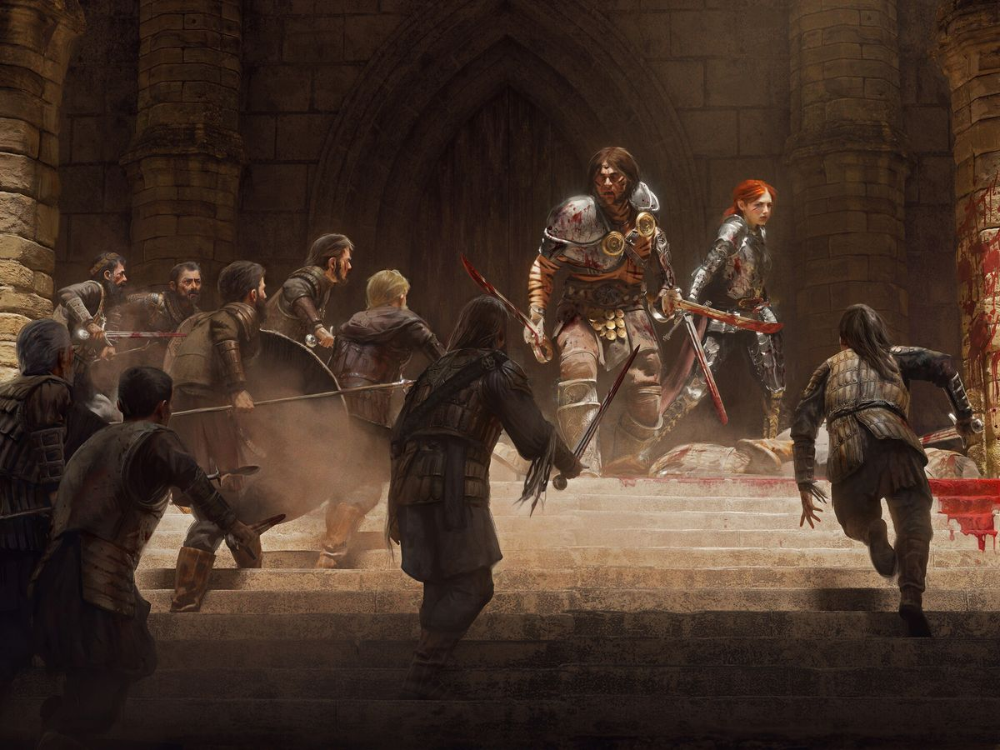

%%
[[Gethricism]]
[[Trinicism]]
[[Church of Iztaw]]
[[Gethric Pogroms]]
[[Order of the Silver Wheel]]
[[Meadrath]]
[[Gisvale]]
[[Gisela II]]
[[Order of the Iron Tower]]
[[Andre]]
%%

 <h4 class="wiki-header">Great Schism</h4>
 

 <strong>Date</strong>
 764PA
 

 

 <strong>Location</strong>
 Trinfurt, eastern Crownlands of <a href="Meadrath" class="internal-link">Meadrath</a>
 

 

 <strong>Cause</strong>
 Ratification of the <a href="Gethric Pogroms" class="internal-link">Gethric Pogroms</a>, authority of the <a href="Church of Iztaw" class="internal-link">Church of Iztaw</a>
 

 

 <strong>Result</strong>
 Western churches break with Iztaw, founding of <a href="Trinicism" class="internal-link">Trinicism</a>, Defence of Trinfurt
 

 

 

 <strong>Parties</strong>
 Church of Iztaw, <a href="Order of the Silver Wheel" class="internal-link">Order of the Silver Wheel</a>, the western bishops, Kingdom of Meadrath
 

 

 <strong>Leading Figures</strong>
 High-Bisop Manral I, Grand Master Vaskor zi Myrg, Queen <a href="Gisela II" class="internal-link">Gisela II</a>, Bishop Adelbert von Beuer
 

 

 
 <small><i>The Conclave at Trinfurt</i></small>

The Great Schism was the division of the <a href="Gethricism" class="internal-link">Gethric faith</a> in 764PA, in which the Conclave at Trinfurt broke the western churches away from the <a href="Church of Iztaw" class="internal-link">Church of Iztaw</a> and founded the denomination of <a href="Trinicism" class="internal-link">Trinicism</a>, named after Trinfurt itself. It followed within a year of the ratification of the <a href="Gethric Pogroms" class="internal-link">Gethric Pogroms</a> by the Conclave of 763, and it cost the Church of Iztaw its western half. Far more bitter than the Kethric Schism of 471PA, it remains the deepest division within the faith.

<h2>Background</h2>

By the middle of the 8th century the western churches had long chafed under the authority of Iztaw. The Church of Iztaw raised its tithe across the faithful lands, kept its own militia in the <a href="Candleguard" class="internal-link">Candleguard</a>, held wide rights of clerical law and answered to a High-Bisop who was at once the spiritual leader and the subject of the Ras of Vihr. In the emerging western realms it was increasingly seen as a Vihri state church, and many worldly rulers saw in the clergy a threat to their own hegemony. The drift showed itself as early as 737PA, when the Bishop of Korsfall canonised the pirate <a href="Yahrwick" class="internal-link">Yahrwick of Zeeport</a> without the sanction of a Conclave, a canonisation Iztaw never recognised.

<h2>The Conclave of 763</h2>

The First War of Elbae Aggression, fought from 750PA to 762PA, hardened the old Doctrine of Human Exceptionalism in Vihr into open hatred of elvenkind. When the war ended with the death of Saint <a href="Fredric" class="internal-link">Fredric</a> at Danipol in 762PA, the Conclave of 763 under High-Bisop Manral I canonised the Hero of Danipol and, in the same session, ratified the Gethric Pogroms. Manral I issued the Bull that declared elves ontologically evil and opposed to the divine truth of the Prophet, and Ras Miskomir III outlawed elvenkind in Vihr and in all the countries of the true faith.

The decision was not accepted everywhere. Zovac Harlini, the Kar-Zavr of Vihr, condemned the killings and resigned his post, and Queen <a href="Gisela II" class="internal-link">Gisela II</a> of Meadrath called the Pogroms politically motivated barbarianism, ordered by a puppet Bisop under the control of the Vihri crown.

<h2>The Conclave at Trinfurt</h2>

Trinfurt is a Gismer town in the Trinbend of northern Ilrakhan, where the river Trinmo flows south into Urland, and the river is traditionally considered the border between Meadland on its west and Ur on its east and south. Together with Barbridge and Turv, which lie further south along the river, it is one of the three Bendburgs, and in 764PA it was the only one of them under Meadi rule. The town belonged to the eastern Crownlands of Meadrath, and it was, as it remains, the main gate through which the goods of central Ur entered <a href="Gisvale" class="internal-link">Gisvale</a> and through it all of Meadrath. Its Count was a weak figure, and the most important man of the city was its Bishop, Adelbert von Beuer, a stern ally of the Archbishop of Bellhome. Trinfurt was a bishopric of central importance on a continental scale, and it became the meeting point of the western bishops.

In 764PA the Conclave met at Trinfurt to consider the ratification of 763. It rejected the Pogroms and went further than its critics in Iztaw had feared. In what came to be known as the Trinfurt Articles, it declared the White Book the only divinely inspired text and the only infallible source of Gethric doctrine, denied that the High-Bisop represented the Prophet on this plane, and held every Bishop to be answerable to the faith rather than to Iztaw. The Conclave also decided that no Bishop should hold the right to name or confirm worldly lords, a point of particular importance to Gisela II, and it restricted clerical law. Before Trinfurt, and in High Gethric lands to this day, every crime committed on church land, as well as every crime committed by or against a member of the clergy, falls under clerical law. In the lands that followed Trinfurt only crimes committed on church grounds do.

<h2>The Defence of Trinfurt</h2>

The <a href="Order of the Silver Wheel" class="internal-link">Order of the Silver Wheel</a>, sponsored by and closely tied to the High-Bisop, marched on Trinfurt to dissolve the Conclave by force, led by its Grand Master Vaskor zi Myrg, a Paladin of the order. The town held against a short siege. A famous group of bards, later known as the Loyal Three, sang magical hymns that held off the Paladins in support of the local defenders. On the steps of Trinfurt Cathedral the two heroes Merten and Fianna fought off dozens of footmen of the Silver Wheel and died there, buying time for the defenders to organise in the town. The militia and heroes of the city then held the Iron Tower, a castle in the centre of Trinfurt, against the knights. The <a href="Order of the Iron Tower" class="internal-link">Order of the Iron Tower</a>, founded in the aftermath of the Conclave and named after the castle, later honoured Merten and Fianna as its first members.

 
<small><i>Merten and Fianna on the steps of Trinfurt Cathedral</i></small>

When the armed forces of the Meadi queen arrived, the knights were driven off. The Conclave was not dissolved, and the western churches broke with Iztaw. The failure at Trinfurt marked the beginning of the decline of the Silver Wheel, which has never regained the influence it held before the Schism.

<h2>Aftermath</h2>

Gisela II joined the Trinic cause, supported local militias against Gethric violence and purged the Meadi clergy of those who stood with Iztaw. The worldly rulers who had backed Trinfurt set further limits on the new church in the years that followed. Trinicist Bishops raise no religious tithe and finance themselves through donations and worldly business, and no Bishop may raise a clerical militia of his own as the Candleguard of the old Church does.

The lords and ladies of Cevolia, Meadland and Weadland followed their bishops out of the Church of Iztaw. In Ur the split was far more divisive and regional. The region remains divided on the question to this day, with Trinicist communities in Uhl and Gelmsburg, but Trinicism is truly powerful only in the Trinvale. A few of the old institutions of the faith, among them the <a href="Sisterhood of the Morning" class="internal-link">Sisterhood of the Morning</a>, largely avoided taking sides.

Iztaw never accepted the loss. No attempt was made to win the west back by force after Trinfurt, for Vihr was occupied with the Pogroms and, from 772PA, with the Treeplague that ravaged its south. Ras Orian I ended the Pogroms in 778PA, but the Church never repealed the ratification of 763, and the Schism was never healed. On paper the Church of Iztaw still claims every church and bishopric of the faith, and in later centuries it came to style the archbishops of the lands it had lost as Primati, a theological and legal wording that allows the Church to maintain face.

<h2>Views of the Schism</h2>

The two traditions remember the Schism differently. In Vihri tradition the Pogroms followed a war in which the Elbae Sultanate had been the aggressor and a great Saint had died in battle against the elves, the edict was an act of defence, and the Schism was the work of western bishops who wished to escape the authority of Iztaw. The Trinic view holds that the Pogroms were persecution under the cover of faith, and that the Schism was the lesser evil.

<h2>Legacy</h2>

The wound of the Schism stayed open for the following century. Saint <a href="Andre" class="internal-link">Andre of Trydlew</a>, a staunch traditionalist and royalist, pushed against the disassociation of the western countries from Iztaw, and his canonisation at the Conclave of 876 was widely protested by Trinicist bishops, who reject him to this day. The <a href="Fellows of the Dancing Flame" class="internal-link">Fellows of the Dancing Flame</a> moved their allegiance from High Gethricism to Trinicism over the centuries, and the half-elven archmage <a href="Viccolo di Pora" class="internal-link">Viccolo di Pora</a>, whose writings against the Gethric clergy are widely read, makes his case in the shadow of the Pogroms that began it. Trinfurt itself passed with the rest of the county into the Archduchy of Gisvale in 786PA, after the Twins War.

<h2>People of Interest</h2>

Manral I, High-Bisop of Iztaw Miskomir III, Ras of Vihr, called the Black <a href="Gisela II" class="internal-link">Gisela II</a>, Queen of Meadrath Adelbert von Beuer, Bishop of Trinfurt Vaskor zi Myrg, Grand Master of the Silver Wheel Merten and Fianna, defenders of Trinfurt Zovac Harlini, Kar-Zavr of Vihr

