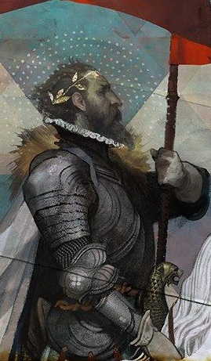

%%
[[Vihr]]
[[Breza]]
[[Knights of the Unicorn]]
[[Muriel von Gloss]]
[[Gelmsburg]]
[[Gethricism]]
%%

 <h4 class="wiki-header">Andre</h4>
 

 <strong>Title</strong>
 of Trydlew, the Unicorn Knight
 

 

 <strong>Represents</strong>
 Nobility and Animals
 

 

 <strong>Favoured Weapon</strong>
 Lance
 

 

 <strong>Culture</strong>
 <a href="Vihr" class="internal-link">Vihri</a> <a href="Human" class="internal-link">Human</a>
 

 

 <strong>Born</strong>
 820PA
 

 

 <strong>Died</strong>
 874PA, 54 years of age
 

 

 

 <strong>Canonised</strong>
 Conclave of 876PA
 

 

 <strong>Allegiance</strong>
 <a href="Knights of the Unicorn" class="internal-link">Knights of the Unicorn</a>, <a href="Vihr" class="internal-link">Rascy zi Vihr</a>
 

 

 <strong>Venerated in</strong>
 <a href="Gethricism" class="internal-link">Gethricism</a>, <a href="Kethricism" class="internal-link">Kethricism</a>
 

 

 
 <small><i>Saint Andre</i></small>

Saint Andre of Trydlew represents Nobility and Animals within the Gethric Canon, his favoured weapon is the Lance. Andre was born a Vihri nobleman in 820PA and died at the age of 54 in 874PA, he was canonised at the Conclave of 876 that was widely protested by trinic Bishops, as of the current day he is the last Saint of the Gethric Canon to be canonised.

The Gri of Trydlew, known as the “Unicorn Knight”, is perhaps the only canonized saint more controversial than Tronos of the Veil. A devout Gethrian, he was also a stern loyalist of the Vihri Throne and General during the War with Meadrath that is now known as the War of Horn and Fang. He is well liked by autocrats and lords, but rejected for various reasons by the Trinicists.

Andre founded the Order of the Knights of the Unicorn and was a staunch traditionalist and royalist, pushing against the disassociation from the Clergy at Iztaw of various foreign countries in regions like Cevolia and Meadland following the Conclave at Trinfurt. During the great Northern War between Meadrath and Vihr concerning the Bay and City of Uhl, better known as the War of Horn and Fang, he led the forces of Vihr in battle as the General of the armies, personally fighting in many major engagements during the war. Towards the end of the war he killed the meadi Sorceress <a href="Muriel von Gloss" class="internal-link">Muriel von Gloss</a> by impaling her on his lance at the Battle of Gadly Bridge, avenging <a href="Viagoris" class="internal-link">Viagoris</a> and removing one of Meadraths greatest assets from the table. He deemed her a sinner and demon worshipper and was lauded for his deed in many lands, with even various academics and members of the magical establishment in Meadrath speaking out in favour of her death at his hands.

Saint Andre is the only Saint whose lineage is confirmed and alive today, as the current Gri of Atej, Gri Robar of Atej, is a direct descendant of the Unicorn Knight. Andre is very popular within Vihr itself but also enjoys great fame in Gelmsburg and Eldmar, where the great Cathedral of Saints Triumph, raised in his honour in the city of Gelmsburg itself, is nearing the final stages of its construction.
