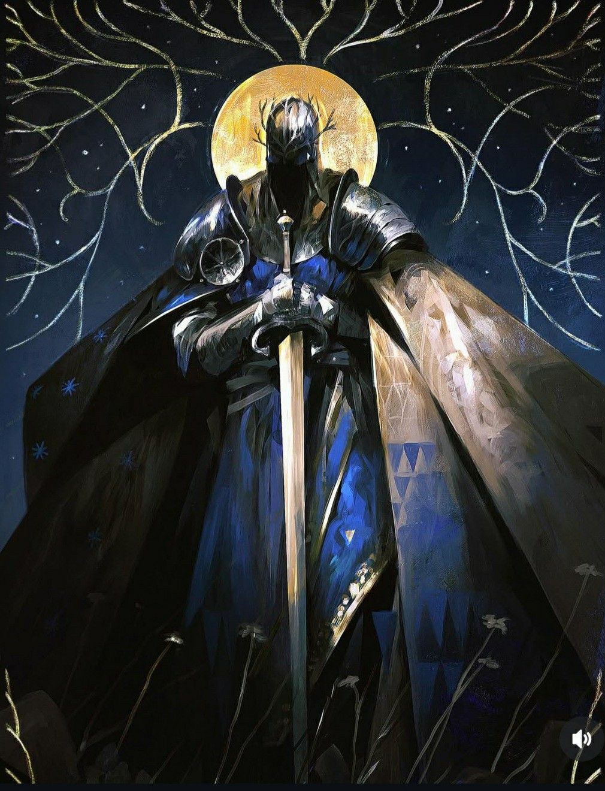

%%
[[Gethricism]]
[[Fellows of the Dancing Flame]]
[[Cevolia]]
[[Meadrath]]
[[Urland]]
[[Ralond]]
%%

 <h4 class="wiki-header">Berengar</h4>
 

 <strong>Title</strong>
 Starknife, Leader of the Silverhearts, Patron of the Dancing Flame
 

 

 <strong>Represents</strong>
 the Stars and Ruins
 

 

 <strong>Favoured Weapon</strong>
 Falchion
 

 

 <strong>Culture</strong>
 disputed, most often <a href="Cevolia" class="internal-link">Cevoli</a> <a href="Human" class="internal-link">Human</a>
 

 

 <strong>Died</strong>
 before 400PA
 

 

 

 <strong>Canonised</strong>
 Conclave of 446PA
 

 

 <strong>Allegiance</strong>
 the Silverhearts, <a href="Fellows of the Dancing Flame" class="internal-link">Fellows of the Dancing Flame</a>
 

 

 <strong>Venerated in</strong>
 <a href="Gethricism" class="internal-link">Gethricism</a>, <a href="Kethricism" class="internal-link">Kethricism</a>, <a href="Trinicism" class="internal-link">Trinicism</a>
 

 

 
 <small><i>Saint Berengar</i></small>

Saint Berengar Starknife represents the Stars and Ruins within the Gethric Canon, his favoured weapon is the Falchion. A largely legendary knight of the 4th century PA, he is said to have slain the Djinn of Redoubt and the heathen warrior Akaros of Trevi, and he is counted among the founding members of the <a href="Fellows of the Dancing Flame" class="internal-link">Fellows of the Dancing Flame</a>. It is not clear how and when he died as a physical man, but he is generally accepted to have died before 400PA. He was canonised at the Conclave of 446PA alongside <a href="Ralond" class="internal-link">Saint Ralond</a>, the second Conclave to elevate new Saints after the Conclave of 410PA had canonised <a href="Melmer" class="internal-link">Melmer</a> and <a href="Tronos" class="internal-link">Tronos</a>.

<h2>Life and Legend</h2>

Berengar is a rather mythological figure, and little of his life can be separated from the legends told of him. Even his heritage is disputed. He is most often claimed to have been Cevoli, but Reani, Meadi and Urien traditions each claim him as one of their own. With a band of heroes who followed his ideals, known as the Silverhearts, he roamed Ur, Rean and <a href="Cevolia" class="internal-link">Cevolia</a>.

Two deeds stand above the rest of his legend. The first is the slaying of the Djinn of Redoubt. The second is his victory over Akaros of Trevi, a heathen warrior with supernatural powers. During their battle Berengar is said to have called down a great rain of fire and rocks from the stars upon the army of Akaros. He was said to be able to read the will and righteousness of a person with a single glance, and his eyes are said to have shone with the light of a hundred stars.

Berengar is remembered as one of the founding members of the Fellows of the Dancing Flame, the order of Gethric knights that carried the faith into Cevolis by force from 383PA.

<h2>The Silverhearts</h2>

The story of Berengar and his companions has become popular folklore, and the members of his party take on different characters depending on the region where it is told. Ulmo is usually a human with a knack for magic. In some tellings he is a wise old man and a father figure to the Saint, while in others he is a drunken ruffian in a more comedic role. Thiar is in some stories a converted elf and Berengar's best friend, the only one in the party able to equal him with a blade, while in others, among them the Vihri and Grachi folk tales, he is not an elf at all but a roguish human who changes faces to solve problems.

Masova is the most controversial figure of the party. In some stories she is clearly a love interest of both Berengar and Thiar. In others she is a devout and motherly figure who exemplifies the holy virtues, and in others still she is a sinful woman who at first tried to bring ruin to the party and to seduce its members, until she was converted by Berengar's true heart.

<h2>Relics and Depiction</h2>

Berengar's own falchion is known as the Starknife, and the name has become his epithet. Among his other relics is the Helm of Ruin, a helmet that is said to have given him great powers while drawing on his own life energy. He wore a famous blue robe, which one of the stories says was given to him by the witch of Nailtrees. In art he is often depicted with the firmament of stars lit up behind him upon the night sky.

<h2>Veneration</h2>

Berengar is a universally beloved figure and is venerated in all three major denominations. He is revered above all in eastern Cevolia and western Meadland, while in Ur, Trykkerog and Vihr he is favoured as a hero of children and celebrated more as a famous hero than as a figure of devotion. He is the patron Saint of the Fellows of the Dancing Flame, and the image of a knight riding a comet, or falling star, that the Fellows use is said to resemble him.

