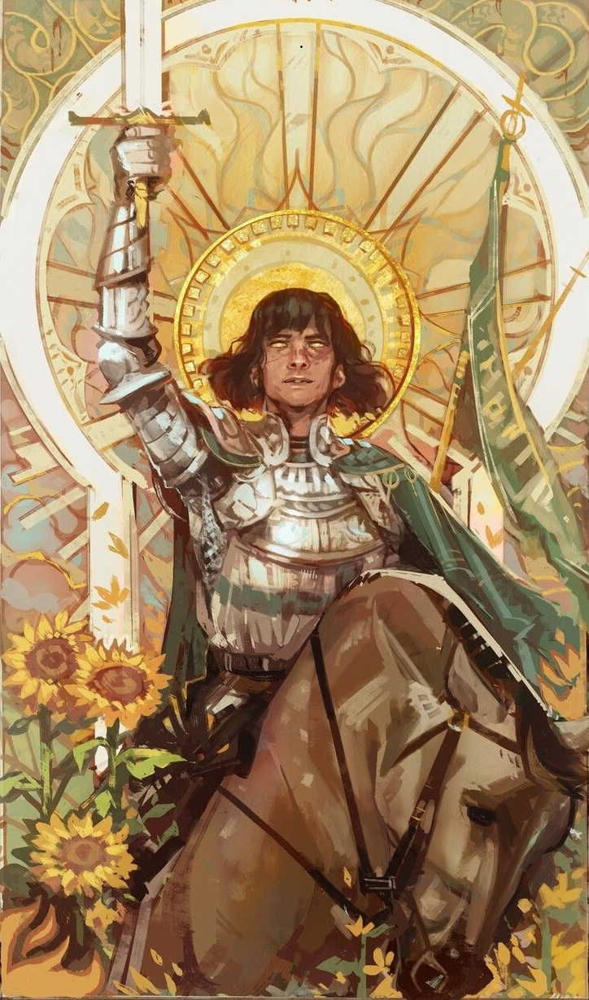

%%
[[Knights of the Gryphon]]
[[Urbridge]]
[[Gethricism]]
[[Kifrir]]
%%

 <h4 class="wiki-header">Dorian</h4>
 

 <strong>Title</strong>
 the Kind, Prince of Summer
 

 

 <strong>Represents</strong>
 Charm and Plants
 

 

 <strong>Favoured Weapon</strong>
 Longsword
 

 

 <strong>Culture</strong>
 <a href="Garmeley" class="internal-link">Garmish</a> <a href="Human" class="internal-link">Human</a>
 

 

 <strong>Born</strong>
 641PA
 

 

 <strong>Died</strong>
 681PA, 40 years of age
 

 

 

 <strong>Canonised</strong>
 Conclave of 681PA
 

 

 <strong>Allegiance</strong>
 <a href="Knights of the Gryphon" class="internal-link">Knights of the Gryphon</a>
 

 

 <strong>Venerated in</strong>
 <a href="Gethricism" class="internal-link">Gethricism</a>, <a href="Kethricism" class="internal-link">Kethricism</a>, <a href="Trinicism" class="internal-link">Trinicism</a>
 

 

 
 <small><i>Saint Dorian</i></small>

Saint Dorian the Kind represents Charm and Plants within the Gethric Canon, his favoured weapon is the Longsword. Dorian was born a Garmish commoner in 641PA and died at the age of 40 in 681PA, he was canonised at the Conclave of 681PA in the same year.

A famous human Knight of the <a href="Knights of the Gryphon" class="internal-link">Knights of the Gryphon</a>, Dorian popularised knightly vows as gethric Oaths and was responsible for the later dominance and rise of the Order, as well as being credited for influencing many of the knightly traditions in Urland specifically to adopt a more clerical culture, such as his strong influence on the Knights of the Gryphon as an overall institution beyond his own Chapter, which he dubbed the "Shields of Summer". Dorian is associated with the Sunflower and sometimes called the "Prince of Summer" although he had no notable noble blood flowing through his veins. Dorian was a notable companion of <a href="Kifrir" class="internal-link">Saint Kifrir the Mirror-Dwarf</a>.

Although usually portrayed in armour and with a weapon, commonly the sword, Dorian represents the virtue of Pacifism, Peace and Patience as well as harmony with nature. The Saint's constant companion was his horse Beleva, who is said to have lived an unnaturally long life and be capable of speech and responsible for many heroic deeds in the exploits of Dorian.
