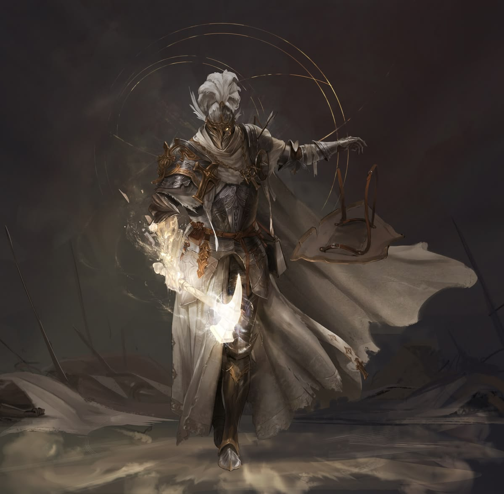

%%
[[Wars of Elbae Aggression]]
[[Niedrest]]
[[Gethricism]]
[[First War of Elbae Aggression]]
[[Ravenleaf Forest]]
[[Gethric Pogroms]]
[[The Great Schism]]
%%

 <h4 class="wiki-header">Fredric</h4>
 

 <strong>Title</strong>
 Foehammer, Hero of Danipol
 

 

 <strong>Represents</strong>
 Glory and War
 

 

 <strong>Favoured Weapon</strong>
 Warhammer
 

 

 <strong>Culture</strong>
 <a href="Urland" class="internal-link">Urien</a> <a href="Human" class="internal-link">Human</a>
 

 

 <strong>Born</strong>
 720PA
 

 

 <strong>Died</strong>
 762PA, Danipol
 

 

 <strong>Cause of Death</strong>
 fell in battle 42 years of age
 

 

 

 <strong>Canonised</strong>
 Conclave of 763PA, High-Bisop Manral I
 

 

 <strong>Venerated in</strong>
 <a href="Gethricism" class="internal-link">Gethricism</a>, <a href="Kethricism" class="internal-link">Kethricism</a>, <a href="Trinicism" class="internal-link">Trinicism</a>
 

 

 
 <small><i>Saint Fredric</i></small>

Saint Fredric Foehammer, the Hero of Danipol, represents Glory and War within the Gethric Canon, his favoured weapon is the Warhammer. Fredric was born an Urien human in 720PA and fell in battle at the age of 42 at the Second Battle of Danipol in 762PA. He was canonised at the Conclave of 763PA under High-Bisop Manral I, the same Conclave that ratified the controversial <a href="Gethric Pogroms" class="internal-link">Gethric Pogroms</a>, which ultimately led to the <a href="The Great Schism" class="internal-link">Great Schism</a>.

<h2>Life</h2>

Fredric first made his name in the 740s as the slayer of the Hydra of Ravenleaf, one of the many monsters of the <a href="Ravenleaf Forest" class="internal-link">Ravenleaf Forest</a>. Later on he bested Readric the Violet in personal combat and brought the Necromantic Cult of Zutur to an end. During the <a href="First War of Elbae Aggression" class="internal-link">First War of Elbae Aggression</a> he described himself as called by the Prophet to defend the Gethric faith against the elven advance. He first appeared at the Battle of Orom with fewer than two hundred companions and fought with a ferocity that the size of his band did not suggest was possible, although he could not turn the battle and the coalition retreated.

What he did next turned the war. The advance of the Sultanate on Dimelski required the Tower of Seriak, which controlled the chokepoint between Orom and the city. Fredric took Seriak with his two hundred men and held it for seven days against nearly five thousand Sultanate soldiers. The delay allowed Lord Zirvid of Mirzan to arrive with a Kheri army and his Spellbreaker regiments and break the Siege of Dimelski before the reinforcements of the Sultanate could reach it.

At the Second Battle of Danipol in 762PA Fredric drove directly into the command of the Sultanate. He killed Hazir ab-Keyel, the Masir who had planned and led the entire campaign, in personal combat, then turned and duelled Inrafir Elbae, the son of the Sultan and commander of the Falcon Brigade, and slew him as well. Having lost his helmet in the fight with Inrafir, he was struck in the throat by an arrow and died before the battle ended. The Sultanate sounded the retreat and withdrew behind the Horad, and the First War of Elbae Aggression was over.

<h2>Canonisation</h2>

The Conclave of 763PA canonised Fredric within a year of his death and sanctified him as the Hero of Danipol. In the same session it ratified the Gethric Pogroms, the persecution of elves and those of elven blood in the lands of the Church, and the Great Schism of 764PA followed within the year. Today Fredric is no longer much associated with the Pogroms.

<h2>Relics</h2>

Fredric's pure white warhammer, the Foehammer, was declared a holy relic of the Church at his canonisation and was stolen in the 9th century. The theft is often credited to Kippin the Dove, the most legendary thief of the 9th century. His skull has been hardened in gold and is preserved in Saint Fredric's Church in the Urien city of <a href="Niedrest" class="internal-link">Niedrest</a>, whose twin gothic spires dominate the skyline of the western bank. The skull is said to grant courage, and the pilgrims who flock to it every year buy blessed pewter badges from the Church, while its stained glass depicts the martial victories of the Saint. His gauntlets, the Truefingers, are equally revered and have been worn in the martial tradition by various heroes since his passing.

<h2>Veneration</h2>

Fredric is seen as the ultimate symbol of the warrior, an ideal to aspire to for every man and woman marching into battle for a cause they believe in. Those who wish to be remembered for mighty deeds and legendary battles more than to live a long life and be forgotten pray to Fredric, and he is said to grant them the strength of his hammer and the power of his conviction. His heroics and his symbolism as a warrior hero have made him enormously popular in both High Gethricism and Trinicism. He is without doubt the most favoured Saint of soldiers, warriors and mercenaries and is beloved by knights as well, and he has become the subject of great poems and theatrical plays such as "Light in the Ravenleaf" and "The Hammer of Danipol". In Grevenna the First War of Elbae Aggression is remembered as a victory defined by sacrifice, and the canonisation of the Hero of Danipol is a part of that memory.
