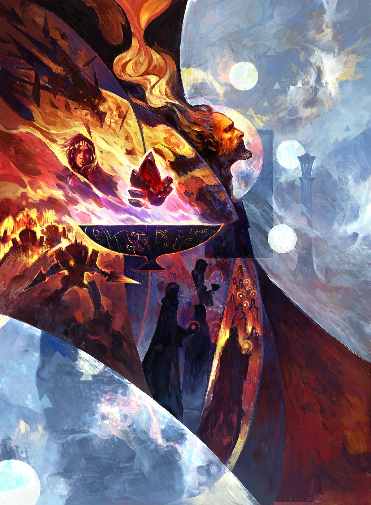
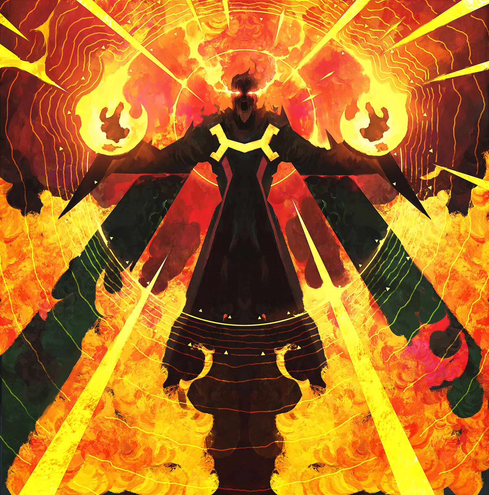

%%
[[Iztaw]]
[[Wermia]]
[[The Positive Plane]]
[[Gethricism]]
[[Kethricism]]
[[Trinicism]]
[[The Incursion]]
[[Volboris]]
[[Razmyr]]
%%

 <h4 class="wiki-header">Gethric</h4>
 

 <strong>Title</strong>
 The Prophet, Hero of Iztaw
 

 

 <strong>Represents</strong>
 Fire and Good
 

 

 <strong>Favoured Weapon</strong>
 Mace
 

 

 <strong>Culture</strong>
 <a href="Wermia" class="internal-link">Wermian</a> <a href="Human" class="internal-link">Human</a>
 

 

 <strong>Born</strong>
 Gezric, 199PA, Wermia
 

 

 <strong>Died</strong>
 240PA
 

 

 <strong>Cause of Death</strong>
 the ending of the Rubric 41 years of age
 

 

 

 <strong>Allegiance</strong>
 Vihri Union of Vanquishers
 

 

 <strong>Venerated in</strong>
 <a href="Gethricism" class="internal-link">Gethricism</a>, <a href="Kethricism" class="internal-link">Kethricism</a> (as Kethric), <a href="Trinicism" class="internal-link">Trinicism</a>
 

 

 
 <small><i>The Prophet ends the Incursion</i></small>

Gethric the Prophet, born Gezric, was a Wermian farmer who ended the <a href="The Incursion" class="internal-link">Wermian Incursion</a> in 240PA and became the founder of the <a href="Gethricism" class="internal-link">Gethric faith</a>. He represents Fire and Good within the Gethric Canon, and his favoured weapon is the mace. The Founder of the Faith and Hero of <a href="Iztaw" class="internal-link">Iztaw</a>, he is worshipped as the True Prophet and given a higher reverence than even the other Saints of the Church. He is one of the Iztaw Three who fought during the Incursions, alongside <a href="Razmyr" class="internal-link">Razmyr</a> and <a href="Volboris" class="internal-link">Volboris</a>.

<h2>Early Life</h2>

Gezric was born in 199PA, a farmer from the disputed Wermian territories on the frontier between the Kingdom of <a href="Wermia" class="internal-link">Wermia</a> and the Vihrmen Federation. Many details of his early life are disputed. He is said to have been born in Wermia, but clerical art often portrays him as a Vihri farmer.

<h2>The Incursion</h2>

When the Second Incursion broke out at Holweid in 226PA, the Host of Daemons marched east and north and met its first real resistance at the walls of Tawring in 227PA. During the siege the young farmer defeated a Daemon of the Abyss with a miracle of white flames and terrible power, abjuring the creature from beyond. This deed is remembered as the first miracle of the Prophet. Gethric surrounded himself with a group of righteous heroes and led as many survivors as possible out of Tawring before the city fell, among them men and women of all walks of life, farmers, lords and sages alike. He became the leader of the Vihri Union of Vanquishers, as the assembled warriors of the Federation called themselves.

The roots of the faith lie in the years that followed. Gethric's legendary meeting with Volboris, who could eradicate disease and heal the most terrible wounds with a glance, his fateful encounter with Razmyr, who could see the events of past and future, the duel at Garzo Hill with the Lidless Fiend, the arrival of the Urien Fleet at Trazlov and his speech at the Lehva Bank were all recorded and retold, first as mere inspiration and soon as divine belief. Steel tempered in the powers of Gethric and his companions and worked by old Wermian blacksmiths proved able to wound the invaders, who were otherwise invincible to iron and bronze.

 
<small><i>Gethric's Wrath</i></small>

The war against the Daemonic Host lasted fourteen years. When the forces of the living reclaimed Tawring, Gethric slew the Great Daemon he had cursed Vazmoris, Well of Despair, within the city, which was renamed Iztaw and its walls rebuilt. In the autumn of 240PA Gethric ended the Rubric and abjured the Daemons of the Abyss. It is said that as the man who was a farmer and became a Prophet burned in a white light, every vile creature summoned by the Wermian magi burned with him. No trace was left of him, but his words and lessons were recorded by Razmyr, and his followers united under Volboris, who proclaimed the Church at Iztaw one year after his passing.

<h2>Sainthood and Veneration</h2>

Gethric, Volboris and Razmyr occupy a unique position within the Gethric Canon, in that none of them were ever formally canonised through the Conclave process that would later govern the elevation of all subsequent Saints. Their sainthood was not declared but assumed, recognised by the first Vihri communities of the faith as a truth that transcended any institutional mechanism for conferring it. The Conclave system for canonising new Saints, which produced its first formal elevation with Melmer and Tronos in 410PA, developed in part as a response to this, a recognition that the Church required a formal and bounded process for extending sainthood beyond the founding generation without suggesting that new Saints occupied the same foundational standing as the Prophet and his companions.

The faithful believe that Gethric resides in the Homestead Beyond, where those who keep their oaths with true conviction may one day join him. Razmyr is said to have received visions of Gethric after the Prophet's ascension, and much of Gethric teaching on the oaths and the nature of the soul is traced back to them. The lighting of a candle for the Prophet is the commonest act of Gethric devotion, and the Day of the Prophet is celebrated at the end of summer.

The denominations of the faith view the Prophet differently. In <a href="Kherova" class="internal-link">Kherova</a> he has always been called Kethric, and the Kethric denomination takes its name from him. Trinicists see him as a man enlightened through circumstance and character rather than a divine hero ordained at birth, and emphasise his humanity as the source of his strength and conviction. <a href="Diarism" class="internal-link">Diarism</a> holds him to have been the only true incarnation of the Creator, while the Razmyrists question his role in the Incursion and revere Razmyr as the one true Prophet.

<h2>Depiction</h2>

Although he died at the age of 41, Gethric is classically depicted as an older man, and clerical art often portrays him as a Vihri farmer rather than a Wermian one.

