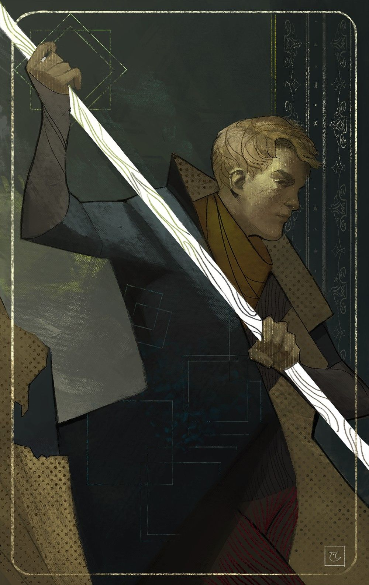

%%
[[Grachy]]
[[Roygviil]]
[[Nation Entries/Historical Realms/Ilrakhan/Halgrach]]
[[Izhevk]]
[[Gethricism]]
%%

 <h4 class="wiki-header">Igor</h4>
 

 <strong>Title</strong>
 the Humble, Patron Saint of Grachy
 

 

 <strong>Represents</strong>
 Luck
 

 

 <strong>Favoured Weapon</strong>
 Longspear
 

 

 <strong>Culture</strong>
 <a href="Grachy" class="internal-link">Grachi</a> <a href="Human" class="internal-link">Human</a>
 

 

 <strong>Born</strong>
 488PA
 

 

 <strong>Died</strong>
 524PA, 36 years of age
 

 

 

 <strong>Canonised</strong>
 Conclave of 529PA
 

 

 <strong>Venerated in</strong>
 <a href="Gethricism" class="internal-link">Gethricism</a>, <a href="Kethricism" class="internal-link">Kethricism</a>, <a href="Trinicism" class="internal-link">Trinicism</a>
 

 

 
 <small><i>Saint Igor</i></small>

Saint Igor the Humble represents Luck within the Gethric Canon, his favoured weapon is the Longspear. Igor was born a Grachi farmer in 488PA and died at the age of 36 in 524PA, he was canonised at the Conclave of 529PA.

Born the son of a Grachi farmer, Igor rose to prominence due to his exploits fighting against the fae and druids of <a href="Roygviil" class="internal-link">Roygviil</a>, and vanquishing the Black Kraken. Igor is the Patron Saint of modern day <a href="Grachy" class="internal-link">Grachy</a> and its predecessor, the Kingdom of <a href="Halgrach" class="internal-link">Halgrach</a>. There exist two Cathedrals exclusively devoted to Igor within Grachy, St Igor's Cathedral in <a href="Izhevk" class="internal-link">Izhevk</a>, also known as the Cathedral of Remembrance, and St Igor's Cathedral in Modva, the seat of the Archbishop of Grachy, Yury Goruky.

Igor is the patron of all gamblers, merchants & peasants, his followers see him as a symbol for hope in the darkest night, the slim horizon in the distance and the glimmer of possibility. His legendary Spear Wyrker is said to have never missed its target and been able to grow many metres long or as short as a finger if Igor wished it so. His hopeful and bright approach to foes and friends and youthful spirit in life and death are core aspects of the Saint's worship.
