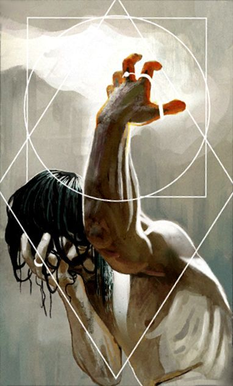

%%
[[Itharia]]
[[Sons of Kasimir]]
[[Porto Casimiro]]
[[Gethricism]]
[[Vihr]]
[[Eye of Kasimir]]
[[Szievek]]
[[Battvia]]
[[Cyraclion]]
[[Rogyn]]
[[Vorellan War]]
%%

 <h4 class="wiki-header">Kasimir</h4>
 

 <strong>Title</strong>
 the Martyr
 

 

 <strong>Represents</strong>
 Weather and Community
 

 

 <strong>Favoured Weapon</strong>
 Flail
 

 

 <strong>Culture</strong>
 <a href="Vihr" class="internal-link">Vihri</a> <a href="Human" class="internal-link">Human</a>
 

 

 <strong>Born</strong>
 553PA
 

 

 <strong>Died</strong>
 602PA, <a href="Itharia" class="internal-link">Itharia</a>
 

 

 <strong>Cause of Death</strong>
 ritual sacrifice 49 years of age
 

 

 

 <strong>Canonised</strong>
 Conclave of 606PA
 

 

 <strong>Venerated in</strong>
 <a href="Gethricism" class="internal-link">Gethricism</a>, <a href="Kethricism" class="internal-link">Kethricism</a>, <a href="Trinicism" class="internal-link">Trinicism</a>
 

 

 
 <small><i>Saint Kasimir</i></small>

Saint Kasimir the Martyr represents Weather and Community within the Gethric Canon, his favoured weapon is the Flail. Kasimir was born a <a href="Vihr" class="internal-link">Vihri</a> human in 553PA and died at the age of 49 in 602PA on the infamous Itharian Expedition. He was canonised at the Conclave of 606PA.

<h2>Life</h2>

Kasimir undertook many pilgrimages to bring the faith to new shores, such as travels to various dwarven holds and even the depths of <a href="Rogyn" class="internal-link">Rogyn</a>. His last venture was the Itharian Expedition to <a href="Itharia" class="internal-link">Itharia</a>, the large island off the north-western coast of Behera that many consider cursed for its fearsome inhabitants, its mysterious ruins and the crimson cliffs of the Strait of Ithar. The expedition sought to recover the lost knowledge of <a href="Cyraclion" class="internal-link">Cyraclion</a>, the ancient civilisation of the island, from the time before Itharia broke apart more than a millennium earlier, and to convert the peoples of the island, whom the Church regarded as heathens and barbarians, to the faith of the Candleflame.

On the red shores of the island Kasimir was killed in ritual sacrifice by the cannibals and satyrs of the Lands of Dance and Fire. The expedition returned without him in 602PA.

<h2>Legacy</h2>

A cult of reverence for Kasimir began to form in the decades after his death. Around thirty years after the expedition the entrepreneur Esnasz of House Haywdicz raised the <a href="Sons of Kasimir" class="internal-link">Sons of Kasimir</a> under the Banner of Kasimir, a pristine flail held by a hand covered in blood. House Haywdicz claimed to be distantly related to the Saint, although the claim has never been entirely verifiable. The company began as little more than a rabble of opportunists, but over time it grew into a hardened company of warriors more akin to a military order, and a sizeable part of its members always believed in the martyrdom of Kasimir and wished for an equally impactful death. The last scions of House Haywdicz have since passed away, as have most if not all of the Sons of Kasimir after their final stand at Vorella in the <a href="Vorellan War" class="internal-link">Vorellan Wars</a>.

More than two centuries after his death, in 839PA, cevoli settlers sent out by the Crown of <a href="Battvia" class="internal-link">Battvia</a> built a fortified port on the western coast of Itharia and named it <a href="Porto Casimiro" class="internal-link">Porto Casimiro</a> in his honour. It remains the first and so far only human settlement on the island. In <a href="Szievek" class="internal-link">Szievek</a> the great astrolabe of the city, finished in 899PA, is named the <a href="Eye of Kasimir" class="internal-link">Eye of Kasimir</a> after him. The University of Szievek chose his name with both of his domains in mind, as the Eye reads the sky for the farmers of the Lehva and its small dial keeps the hours of the city.

<h2>Veneration</h2>

Kasimir is venerated in all three major denominations of the faith. His title of the Martyr reflects the manner of his death, and to the Sons of Kasimir he remained the model of the martyr until their end.
