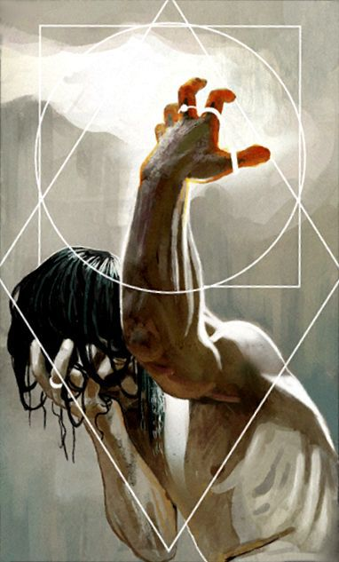

%%
[[Itharia]]
[[Sons of Kasimir]]
[[Porto Casimiro]]
[[Gethricism]]
%%

 <h4 class="wiki-header">Kasimir</h4>
 

 <strong>Title</strong>
 the Martyr
 

 

 <strong>Represents</strong>
 Weather and Community
 

 

 <strong>Favoured Weapon</strong>
 Flail
 

 

 <strong>Culture</strong>
 <a href="Vihr" class="internal-link">Vihri</a> <a href="Human" class="internal-link">Human</a>
 

 

 <strong>Born</strong>
 553PA
 

 

 <strong>Died</strong>
 602PA, <a href="Itharia" class="internal-link">Itharia</a>
 

 

 <strong>Cause of Death</strong>
 ritual sacrifice 49 years of age
 

 

 

 <strong>Canonised</strong>
 Conclave of 606PA
 

 

 <strong>Venerated in</strong>
 <a href="Gethricism" class="internal-link">Gethricism</a>, <a href="Kethricism" class="internal-link">Kethricism</a>, <a href="Trinicism" class="internal-link">Trinicism</a>
 

 

 
 <small><i>Saint Kasimir</i></small>

Saint Kasimir the Martyr represents Weather and Community within the Gethric Canon, his favoured Weapon is the Flail. Kasimir was born a vihri human in 553PA and died at the age of 49 in 602PA following the infamous Itharan Expedition, he was canonised at the Conclave of 606.

Kasimir undertook many pilgrimages to bring the Faith to new shores, during his last venture to the red shores of <a href="Itharia" class="internal-link">Itharia</a> he was killed in ritual sacrifice by the natives. Over 250 years after his dreadful expedition the battvian mission to establish a fortified port on the western coast of Itharia would name the first and so far only human settlement on the Island <a href="Porto Casimiro" class="internal-link">Porto Casimiro</a> in his honour. In Szievek the great astrolabe of the city, the <a href="Eye of Kasimir" class="internal-link">Eye of Kasimir</a>, was named for him as well.
