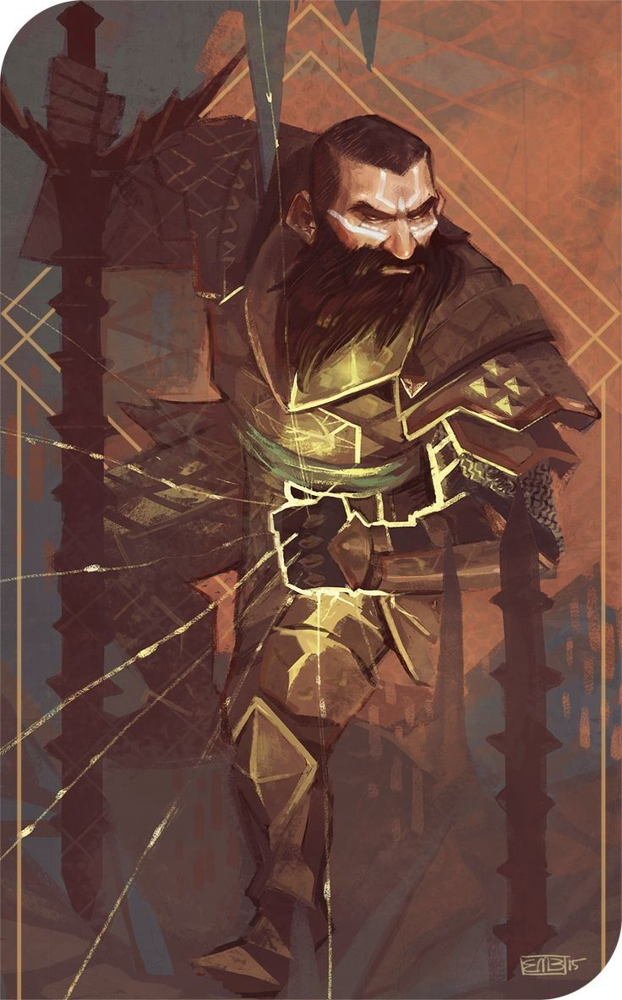

%%
[[Tizin-Kol]]
[[Gethricism]]
[[Dwarf]]
[[Dorian]]
[[Tirbo]]
[[Hobgoblin Invasion]]
%%

 <h4 class="wiki-header">Kifrir</h4>
 

 <strong>Title</strong>
 the Mirror-Dwarf
 

 

 <strong>Represents</strong>
 Trickery and Evil
 

 

 <strong>Favoured Weapon</strong>
 Ram-Hammer
 

 

 <strong>Culture</strong>
 <a href="Mistspires" class="internal-link">Mistspire</a> <a href="Dwarf" class="internal-link">Dwarf</a>
 

 

 <strong>Born</strong>
 620PA
 

 

 <strong>Died</strong>
 719PA, 99 years of age
 

 

 

 <strong>Canonised</strong>
 Conclave of 720PA
 

 

 <strong>Allegiance</strong>
 <a href="Tizin-Kol" class="internal-link">Tizin-Kol</a>
 

 

 <strong>Venerated in</strong>
 <a href="Gethricism" class="internal-link">Gethricism</a>, <a href="Kethricism" class="internal-link">Kethricism</a>, <a href="Trinicism" class="internal-link">Trinicism</a>
 

 

 
 <small><i>Saint Kifrir</i></small>

Saint Kifrir the Mirror-Dwarf represents Trickery and Evil within the Gethric Canon, his favoured Weapon is the Ram-Hammer. Kifrir was born a Mistspire Dwarf in 620PA and died at the age of 99 in 719PA, he was canonised at the Conclave of 720PA.

A Dwarf of Tizin-Kol, who earned infamy in the <a href="Hobgoblin Invasion" class="internal-link">Hobgoblin Wars of the 7th Century</a>, slaying <a href="Tirbo" class="internal-link">Tirbo the Warlord of the Clans</a> and saving thousands of commoners, defying the wishes of the noble houses. His application of divine spells in combat has led to some concerns among the more pacifist branches of the Clergy; he is however still worshipped in all three major denominations. He is popular for playing a pivotal role during the subversion of Ricter of Gelm's plot who, following the Fall of the Capital and the apocalyptic dissolution of Urland, sought to invoke necromantic powers to bring down the Hobgoblin menace and potentially most of Ur as well. Kifrir was a notable companion of <a href="Dorian" class="internal-link">Saint Dorian the Kind</a>.
