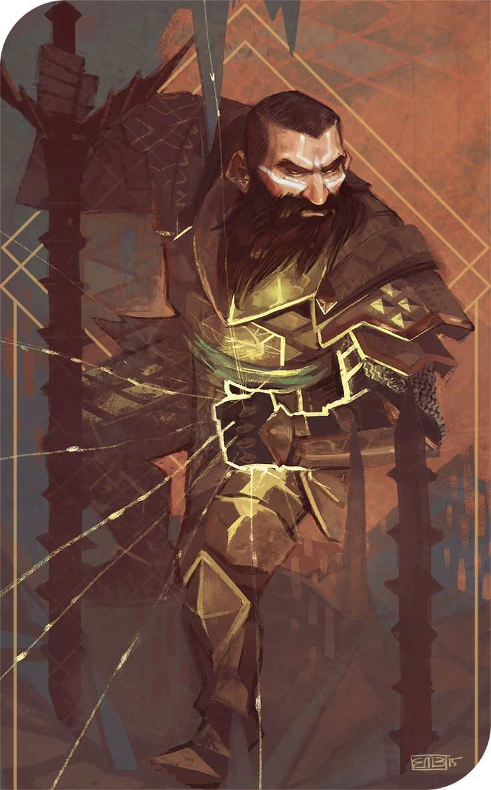

%%
[[Xer-Kol]]
[[Gethricism]]
[[Dwarf]]
[[Dorian]]
[[Tirbo]]
[[Hobgoblin Invasion]]
[[Urbridge]]
[[Gelmsburg]]
[[Vazena]]
%%

 <h4 class="wiki-header">Kifrir</h4>
 

 <strong>Title</strong>
 the Mirror-Dwarf
 

 

 <strong>Represents</strong>
 Trickery and Evil
 

 

 <strong>Favoured Weapon</strong>
 Ram-Hammer
 

 

 <strong>Culture</strong>
 <a href="Trollbacks" class="internal-link">Trollback</a> <a href="Dwarf" class="internal-link">Dwarf</a>
 

 

 <strong>Born</strong>
 620PA
 

 

 <strong>Died</strong>
 719PA, 99 years of age
 

 

 

 <strong>Canonised</strong>
 Conclave of 720PA
 

 

 <strong>Allegiance</strong>
 <a href="Xer-Kol" class="internal-link">Xer-Kol</a>
 

 

 <strong>Venerated in</strong>
 <a href="Gethricism" class="internal-link">Gethricism</a>, <a href="Kethricism" class="internal-link">Kethricism</a>, <a href="Trinicism" class="internal-link">Trinicism</a>
 

 

 
 <small><i>Saint Kifrir</i></small>

Saint Kifrir the Mirror-Dwarf represents Trickery and Evil within the Gethric Canon, his favoured weapon is the Ram-Hammer. Kifrir was born a <a href="Trollbacks" class="internal-link">Trollback</a> <a href="Dwarf" class="internal-link">Dwarf</a> of <a href="Xer-Kol" class="internal-link">Xer-Kol</a> in 620PA and died at the age of 99 in 719PA, he was canonised at the Conclave of 720PA. He is best known for slaying <a href="Tirbo" class="internal-link">Tirbo the Warlord of the Clans</a> at the Battle of Gobsfall Keep in 696PA.

<h2>Life</h2>

Kifrir left Xer-Kol as a young dwarf together with his parents and never returned, and his association with the hold is largely tangential. He became a notable companion of <a href="Dorian" class="internal-link">Saint Dorian the Kind</a>, who founded the Shields of Summer chapter within the Knights of the Gryphon in 670PA. By the time of the <a href="Hobgoblin Invasion" class="internal-link">Hobgoblin Invasion</a> of Urland, nine years after Dorian's death and canonisation, Kifrir had become the de facto leader of the Shields of Summer.

Kifrir was an avid musician and singer, a detail that is often forgone in his more classical veneration. While some described him as hedonistic and too jovial, many considered that in life the warmth of the candle flame shone through him and his good nature onto his friends and allies.

<h2>The Mirror-Dwarf</h2>

Kifrir owes his epithet to his habit of appearing as if there were many of him. In the blink of an eye four or six copies of the Mirror-Dwarf could stand before the same enemy.

<h2>The Hobgoblin Invasion</h2>

When the hobgoblin horde under Tirbo came out of the Kortopi Mountains in the winter of 690PA and defeated the Urien forces at Elpfield, Kifrir faced a choice that historians have argued about ever since. As the main Urien forces assembled for what would become the Battle of Foarley, he could join the army or lead the many defenceless civilians, whose defenders had died at Elpfield, east across the Trinmo to safety. Defying the wishes of the noble houses, he chose the farmers, commonfolk and village communities who had no one else, and so he was not present at Foarley, at Hadley or at the siege of Dursan. While kings and dukes died, he moved thousands of innocents across the river.

With the rescue complete, Kifrir joined the surviving lords of Urland at Gobsfall Keep, the fortification at the Trinmo crossing held by Arsin of Gilkeep, Grand Master of the Knights of the Gryphon. In 696PA Tirbo personally led the hobgoblin push across the river, as he had led every major engagement of the invasion, and Kifrir slew him there, weaving his divine magic into the fight. The Thirsting Guard, the enchanted plate of the warlord, was lost to the Dirgae when he fell. Without Tirbo the unified horde fragmented and the Trinmo held.

<h2>Later Life</h2>

In the years after the fall of the capital and the apocalyptic dissolution of Urland, Ricter of Gelm sought to use the necromantic artifact known as Morfeld's Key to destroy the hobgoblin menace and crown himself King of all Urland. The invocation required the sacrifice of the entire city of Lindmol and threatened to bring down much of Ur as well. Kifrir was among the group of adventurers who foiled the plot and killed Ricter in 702PA, before the invocation could be completed. He died in 719PA at the age of 99.

<h2>Veneration</h2>

Kifrir is worshipped in all three major denominations of the faith, although his use of divine spells in combat has led to some concern among the more pacifist branches of the clergy. To many Gethric dwarves he and <a href="Vazena" class="internal-link">Saint Vazena</a> are especially beloved, although the two exemplify entirely different qualities of the faith. The Shields of Summer, whom he led in the field during the Hobgoblin Invasion, remain a chapter of the <a href="Urbridge" class="internal-link">Order of Urbridge</a> to this day.
