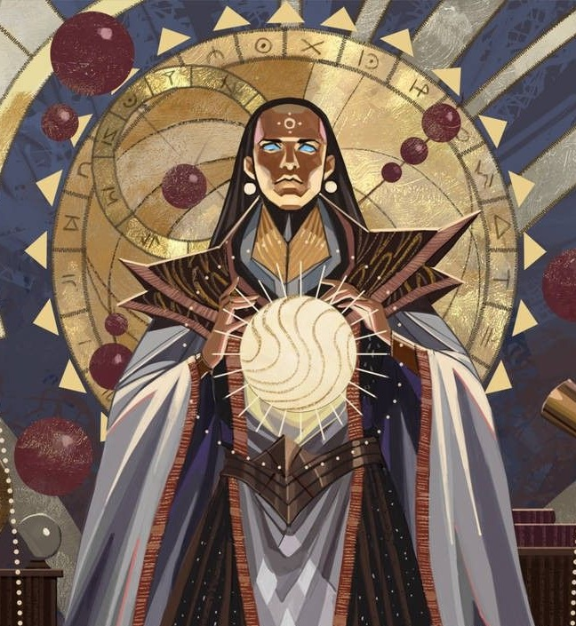

%%
[[Korsfall College]]
[[War of Trout and Drake]]
[[Avero]]
[[Gethricism]]
[[Scions of Markur]]
[[Meadrath]]
[[Lyandra]]
[[Weadland]]
[[Jera]]
[[Augurism]]
[[Diarism]]
[[Perrin Diar]]
[[Kalbinism]]
%%

 <h4 class="wiki-header">Markur</h4>
 

 <strong>Title</strong>
 of the Many Eyes, Patron Saint of Meadrath
 

 

 <strong>Represents</strong>
 Magic and the Sun
 

 

 <strong>Favoured Weapon</strong>
 Rapier
 

 

 <strong>Culture</strong>
 <a href="Meadrath" class="internal-link">Meadi</a> <a href="Human" class="internal-link">Human</a>
 

 

 <strong>Born</strong>
 610PA
 

 

 <strong>Died</strong>
 690PA, 80 years of age
 

 

 

 <strong>Canonised</strong>
 Conclave of 691PA, High-Bisop Taromir III
 

 

 <strong>Allegiance</strong>
 <a href="Scions of Markur" class="internal-link">Scions of Markur</a>
 

 

 <strong>Venerated in</strong>
 <a href="Gethricism" class="internal-link">Gethricism</a>, <a href="Trinicism" class="internal-link">Trinicism</a>
 

 

 
 <small><i>Saint Markur</i></small>

Saint Markur of the Many Eyes represents Magic and the Sun within the Gethric Canon, his favoured weapon is the Rapier. Markur was born a Meadi nobleman in 610PA and died at the age of 80 in 690PA, he was canonised at the Conclave of 691PA alongside <a href="Lyandra" class="internal-link">Saint Lyandra</a> by High-Bisop Taromir III. He is the patron Saint of <a href="Meadrath" class="internal-link">Meadrath</a> and the founder of the <a href="Scions of Markur" class="internal-link">Scions of Markur</a>.

<h2>Life</h2>

A scion of <a href="Korsfall College" class="internal-link">Korsfall College</a>, Markur was a powerful wizard and is held to have been one of the most gifted oracles of all time. In the aftermath of the <a href="War of Trout and Drake" class="internal-link">War of Trout and Drake</a>, which ended in 664PA after thirty-three years of fighting had devastated the farmlands of the Gisvale, he travelled Meadrath and Ur, founding many abbeys and schools, helping the commoners and rebuilding the land with arcane and divine magic. Among his foundations is Reymar College in the small town of Reymar, which has since become a boarding school for the noble elites.

Most of his life is documented in the "Ocula Benevola", the biography written by his student and later friend, the scholar <a href="Avero" class="internal-link">Avero of the Eightfolds</a>, who as a young man spent many years studying under Markur and following him across the lands, witnessing his miracles. Markur is sometimes said to have possessed many eyes upon his body, although this may be a figment of storytelling and imagination that merely refers to his gift of divination.

His divinations and cryptic readings of the <a href="White Book" class="internal-link">White Book</a>, of reality and of the future, are gathered in the Lex Novelis, the nearest thing the White Book has to an addendum. Markur wrote it in Meadi and High Vihri, often changing between the two in the middle of a sentence, and his hand was hard for anyone but his closest followers to decipher. It has never been admitted to the book and remains extremely hard to read.

Markur died in his sleep in 690PA after seventeen days of meditation. Avero notes that shortly before, Markur told him: "For me, I can see no further than this point, but we shall meet again, old friend." He is buried in the Sunhill Mausoleum near Drakesfall.

<h2>The Scions</h2>

Based on the divinations and prophecies of his later years, which remain the most closely guarded secrets of the order, Markur founded the Scions of Markur, a secretive organisation that permeates academia, nobility and the Church. Avero is usually credited as its first member. The Scions see themselves as the guardians of the world as it is known and the wardens of the fundamental balance of magic, and they remain active throughout Ilrakhan to this day.

<h2>Veneration</h2>

Markur is largely seen as the ideal Gethrian wizard, and his canonisation stands as an example of the willingness of <a href="Gethricism" class="internal-link">High Gethricism</a> to honour arcanists. <a href="Kethricism" class="internal-link">Kethricism</a> rejects him for his free use of arcane magic in accordance with the Doctrine of Dualism, so that he is venerated only in High Gethricism and <a href="Trinicism" class="internal-link">Trinicism</a>. Among Trinicists he is, together with Saint Yahrwick, likely the most popular of all Saints.

Markur is extremely important in the regions of Meadland and <a href="Weadland" class="internal-link">Weadland</a>. His most important churches, such as those of Bellhome and <a href="Jera" class="internal-link">Jera</a>, are among the most important churches of the kingdom.

<h2>Interpretations</h2>

To some Markur represents a deeper truth within the Gethric Canon, and he has often been brought into the context of the <a href="Kalbinism" class="internal-link">Kalbinist</a> figure of the Creator, of <a href="Gethric" class="internal-link">Gethric</a> himself, of the modern theology of <a href="Diarism" class="internal-link">Diarism</a> and of older religious traditions, such as the image of <a href="Augurism" class="internal-link">Augur Ralfantis</a>. Like the teachings of the Augur, which centre on the marriage of the arcane and the divine, Markur's life joined both, and Augurism still survives in parts of Meadrath, the kingdom of which he is the patron. Some have read his last words to Avero in the light of the Gin-Augur, the awaited rebirth of Ralfantis from the midst of his worshippers, as the promise of a return.

Rumours regarding the membership of <a href="Perrin Diar" class="internal-link">Perrin Diar</a> in the Scions are very much alive. Diarism was born with Diar's address at the University of Jera in 894PA, in a city whose church of Markur is among the most important in Meadrath, and many connect much of the imagery of Gethric as the monotheistic god of Diarism to classical depictions of Markur rather than to the Prophet.

