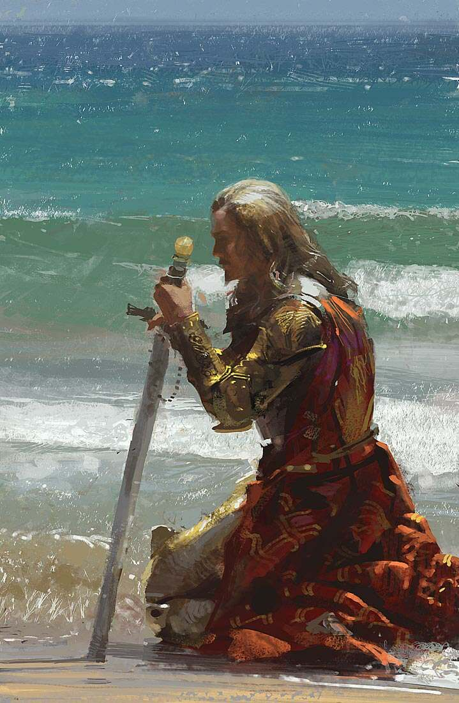

%%
[[Baeling]]
[[Juelfluk]]
[[Gethricism]]
%%

 <h4 class="wiki-header">Melmer</h4>
 

 <strong>Title</strong>
 Wave-Kissed
 

 

 <strong>Represents</strong>
 Water and Travel
 

 

 <strong>Favoured Weapon</strong>
 Trident
 

 

 <strong>Culture</strong>
 <a href="Urland" class="internal-link">Urien</a> <a href="Human" class="internal-link">Human</a>
 

 

 <strong>Born</strong>
 345PA, Uhl
 

 

 <strong>Died</strong>
 386PA
 

 

 <strong>Cause of Death</strong>
 slain on his last voyage 41 years of age
 

 

 

 <strong>Canonised</strong>
 Conclave of 410PA
 

 

 <strong>Allegiance</strong>
 <a href="Church of Iztaw" class="internal-link">Church of Iztaw</a>
 

 

 <strong>Venerated in</strong>
 <a href="Gethricism" class="internal-link">Gethricism</a>, <a href="Kethricism" class="internal-link">Kethricism</a>, <a href="Trinicism" class="internal-link">Trinicism</a>
 

 

 
 <small><i>Saint Melmer</i></small>

Saint Melmer Wave-Kissed represents Water and Travel within the Gethric Canon, his favoured Weapon is the Trident. Melmer was born an Urien nobleman in 345PA and died at the age of 41 in 386PA following his final voyage, he was canonised at the Conclave of 410 alongside <a href="Tronos" class="internal-link">Saint Tronos</a>.

Melmer of Uhl set out on the six voyages to Trykkerog during the later 4th century, converting a large part of the population to the Gethric Faith and founding the city of Tversby. Melmer was slain on his last voyage and the circumstances surrounding his demise remain a mystery, his Trident is displayed within Wavewrought Cathedral, in Tversby. The largest Bay of Trykkerog, opposite the Hagshorn on the Torn Sea, is named the Melmers Bay after him and he is seen as the most important Saint to the Bykmål peoples.
