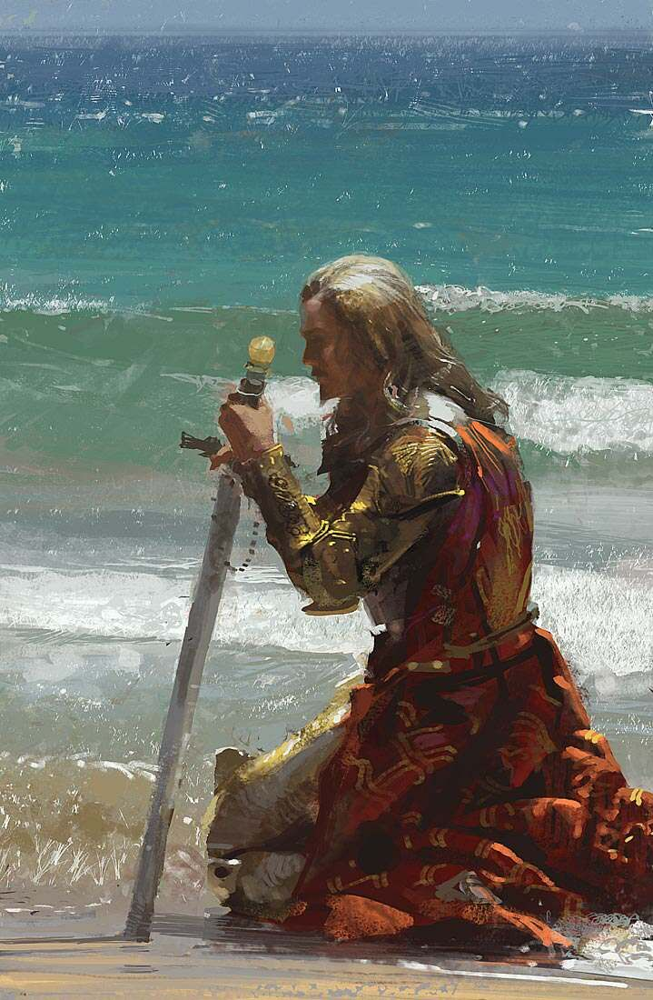

%%
[[Baeling]]
[[Juelfluk]]
[[Gethricism]]
[[Trykkerog]]
[[Bykmåli]]
[[Vignasoya]]
[[Tronos]]
[[Uhl]]
%%

 <h4 class="wiki-header">Melmer</h4>
 

 <strong>Title</strong>
 Wave-Kissed
 

 

 <strong>Represents</strong>
 Water and Travel
 

 

 <strong>Favoured Weapon</strong>
 Trident
 

 

 <strong>Culture</strong>
 <a href="Urland" class="internal-link">Urien</a> <a href="Human" class="internal-link">Human</a>
 

 

 <strong>Born</strong>
 345PA, Uhl
 

 

 <strong>Died</strong>
 386PA
 

 

 <strong>Cause of Death</strong>
 slain on his last voyage 41 years of age
 

 

 

 <strong>Canonised</strong>
 Conclave of 410PA
 

 

 <strong>Allegiance</strong>
 <a href="Church of Iztaw" class="internal-link">Church of Iztaw</a>
 

 

 <strong>Venerated in</strong>
 <a href="Gethricism" class="internal-link">Gethricism</a>, <a href="Kethricism" class="internal-link">Kethricism</a>, <a href="Trinicism" class="internal-link">Trinicism</a>
 

 

 
 <small><i>Saint Melmer</i></small>

Saint Melmer Wave-Kissed, also known as Melmer of Uhl, represents Water and Travel within the Gethric Canon, his favoured weapon is the Trident. Melmer was born an Urien nobleman in <a href="Uhl" class="internal-link">Uhl</a> in 345PA and died at the age of 41 in 386PA during his final voyage. He was canonised at the Conclave of 410PA alongside <a href="Tronos" class="internal-link">Saint Tronos</a>, the first Saints to be elevated by a Conclave.

<h2>The Voyages to Trykkerog</h2>

Melmer set out on six voyages to <a href="Trykkerog" class="internal-link">Trykkerog</a> during the later 4th century, the first of them in 372PA. At the time the <a href="Bykmåli" class="internal-link">Bykmål</a> peoples of the island were known on the southern coasts of the Torn Sea above all for their raids. Melmer first sailed on his own initiative, and on each of his later voyages he came with more support, drawn from every source available to him. He converted a large part of the population to the Gethric faith and founded the city of Tversby.

His last voyage took him to the shores of the Wolfsbay near the town of Levangr and into the Swamps of Arel, deep in skori territory in the west of Trykkerog. He was slain there in 386PA, and the circumstances surrounding his death remain a mystery.

The raiding that had defined the reputation of the island was phased out in the wake of his conversions and was largely replaced by the empire building of the Baeling Dynasty. The conversion he began took more than a century, spreading from the courts of the jarls and kings to the countryside, and it was completed under the Baeling Empire, which was declared in 517PA. Not all of the island followed him. The skori of <a href="Vignasoya" class="internal-link">Vignasoya</a> in the western fjords, in whose lands he died, resisted the conversion and have remained firm in their old traditions, and much of their cultural tradition and recent history is still defined by that resistance.

<h2>Wave-Kissed</h2>

Melmer's epithet reflects his love of sailing and seafaring. He was said to always sail on gentle waves, and storms were said to clear at his arrival. In many tellings the waters loved him and gladly obeyed him.

<h2>Canonisation</h2>

Until the Conclave of 410PA only the Iztaw Three had been held as Saints, and the Conclave system was developed as a formal and bounded process for extending sainthood beyond the founding generation. Melmer and Tronos were the first Saints it produced. Melmer's canonisation was uncontroversial, even in Kherova, where the elevation of Tronos at the same Conclave set in motion the process that led to the <a href="Kethricism" class="internal-link">Kethric Declaration</a> of 471PA.

<h2>Relics and Veneration</h2>

Melmer's trident is displayed within Wavewrought Cathedral in Tversby. The largest bay of Trykkerog, opposite the Hagshorn on the Torn Sea, is named Melmers Bay after him, and the Kingdom of <a href="Baeling" class="internal-link">Baeling</a> is centred on its shores. He is venerated in all three major denominations and is seen as the most important Saint to the Bykmål peoples.
