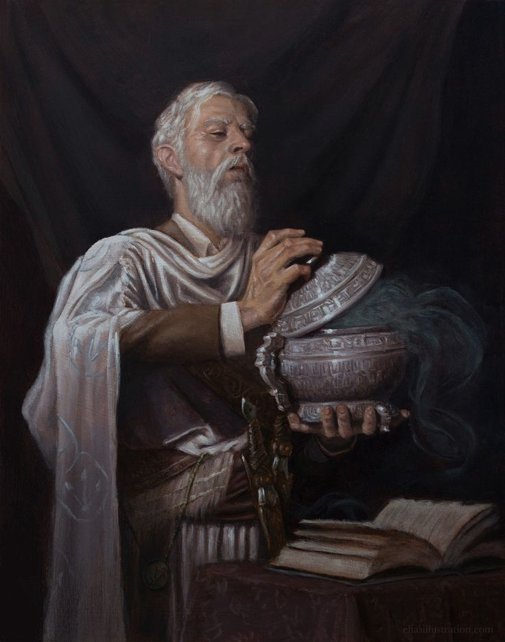

%%
[[Ott]]
[[Gnome]]
[[Wermian Accords]]
[[Gethricism]]
[[Tytus]]
[[Artificery]]
%%

 <h4 class="wiki-header">Palus Aergestes</h4>
 

 <strong>Title</strong>
 Gnome Friend, Father of the Accords
 

 

 <strong>Represents</strong>
 Runes and Erosion
 

 

 <strong>Favoured Weapon</strong>
 Shortsword
 

 

 <strong>Culture</strong>
 <a href="Urland" class="internal-link">Urien</a> <a href="Human" class="internal-link">Human</a>
 

 

 <strong>Born</strong>
 481PA
 

 

 <strong>Died</strong>
 563PA, 82 years of age
 

 

 

 <strong>Canonised</strong>
 Conclave of 577PA
 

 

 <strong>Allegiance</strong>
 <a href="Church of Iztaw" class="internal-link">Church of Iztaw</a>
 

 

 <strong>Venerated in</strong>
 <a href="Gethricism" class="internal-link">Gethricism</a>, <a href="Kethricism" class="internal-link">Kethricism</a>, <a href="Trinicism" class="internal-link">Trinicism</a>
 

 

 
 <small><i>Saint Palus</i></small>

Saint Palus Aergestes, often titled "Gnome Friend" represents Runes and Erosion within the Gethric Canon, his favoured Weapon is the Shortsword. Palus was born an Urien nobleman in 481PA and died at the age of 82 in 563PA, he was canonised at the Conclave of 577PA.

An Urien Scholar and Bishop that studied with Gnomish communities, while primarily a theologian interested in the exchange of spiritualism between human and gnomish culture, he opened a wider door for arcanists and academics within their society, especially favoured in the Trinicist Regions. His time among the Gnomes of Ott produced in him a deep and genuine appreciation for the art of <a href="Artificery" class="internal-link">Prosum</a>, which he studied extensively and advocated for as a legitimate expression of disciplined craft and conviction. Palus never practiced the Prosum himself, holding that his calling lay in theology and diplomacy rather than in the workshop, but his written defences of the art are cited to this day by gnomish artificers seeking ecclesiastical recognition of their craft as compatible with Gethric values. Palus is widely considered the Father of the <a href="Wermian Accords" class="internal-link">Accords</a> and was instrumental in their creation, an act that cemented him as a predominant Father of modern Gethricism.

Aergestes is widely credited as the creator of the so called <a href="Waxborn" class="internal-link">Waxborn</a>, the perfect marriage between the scholarly lore of Artificery and magic and the divinity of the faith.

Palus lived well into the latter half of the 6th century, and although his work in the sciences is often side-lined for his diplomatic achievements he has left behind numerous treatises on the physical make up of the world, specifically considerations on disease in animals and differing sentient species. In his final years he became a vocal advocate for the canonisation of <a href="Tytus" class="internal-link">Tytus the Unbound</a>, whose defeat of the Lich Mendizaba he had followed closely and whose martyrdom he publicly argued the Church had a theological obligation to formally recognize. He lived to see the canonisation he had championed completed at the Conclave of 555PA, six years after the death of Tytus and eight years before his own.
