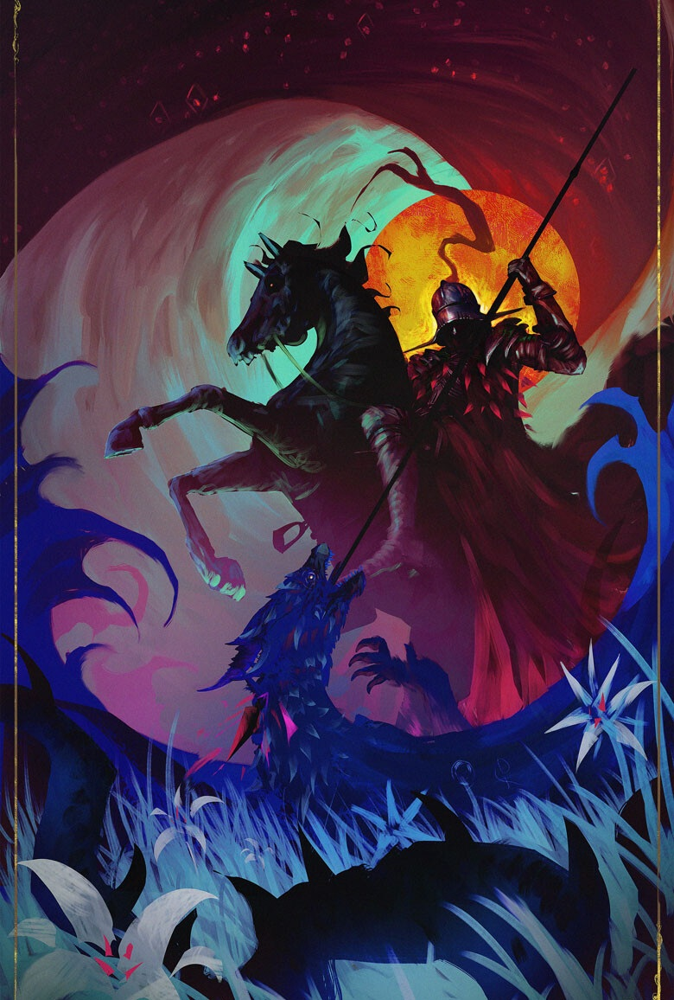

%%
[[Kethricism]]
[[Kherova]]
[[Bihra]]
[[Gethricism]]
%%

 <h4 class="wiki-header">Ralond</h4>
 

 <strong>Title</strong>
 Scaleslayer
 

 

 <strong>Represents</strong>
 Madness and Truth
 

 

 <strong>Favoured Weapon</strong>
 Rhoka
 

 

 <strong>Culture</strong>
 <a href="Kheri" class="internal-link">Kheri</a> <a href="Human" class="internal-link">Human</a>
 

 

 <strong>Born</strong>
 391PA
 

 

 <strong>Died</strong>
 436PA, 45 years of age
 

 

 

 <strong>Canonised</strong>
 Conclave of 446PA
 

 

 <strong>Venerated in</strong>
 <a href="Gethricism" class="internal-link">Gethricism</a>, <a href="Kethricism" class="internal-link">Kethricism</a>, <a href="Trinicism" class="internal-link">Trinicism</a>
 

 

 
 <small><i>Saint Ralond</i></small>

Saint Ralond Scaleslayer represents Madness and Truth within the Gethric Canon, his favoured Weapon is the Rhoka. Ralond was born a Kheri nobleman in 391PA and died at the age of 45 in 436PA,he was canonised at the Conclave of 446PA alongside <a href="Berengar" class="internal-link">Saint Berengar</a>.

A Kherovan wandering Knight of the mid 5th century, he is the main character in the infamous Kherovan poem “Ralond and Reana”. His pilgrimage and adventure deep into the Kobold (Bihra) ridden lands of Nirydia and the desolation of Thamiras Rest are historical and accounted for in the poem. He despises lies and his silver Rhoka Vulgslasher was said to burn bright when malicious deceit was told around him.
