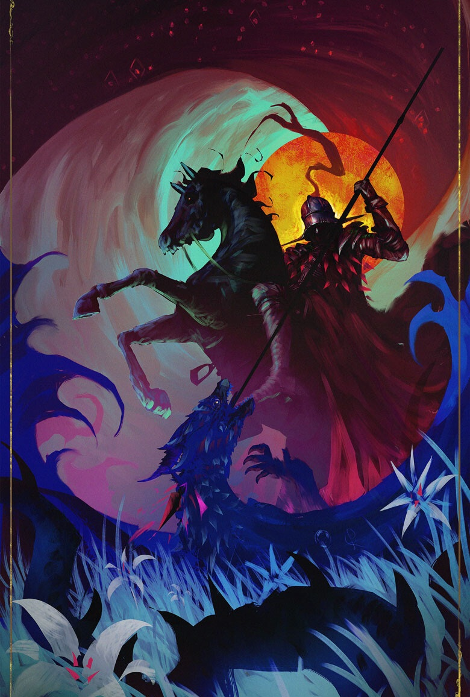

%%
[[Kethricism]]
[[Kherova]]
[[Bihra]]
[[Gethricism]]
[[Berengar]]
[[Bihra Shamanism]]
[[Dragon]]
%%

 <h4 class="wiki-header">Ralond</h4>
 

 <strong>Title</strong>
 Scaleslayer
 

 

 <strong>Represents</strong>
 Madness and Truth
 

 

 <strong>Favoured Weapon</strong>
 Rhoka
 

 

 <strong>Culture</strong>
 <a href="Kheri" class="internal-link">Kheri</a> <a href="Human" class="internal-link">Human</a>
 

 

 <strong>Born</strong>
 391PA
 

 

 <strong>Died</strong>
 436PA, 45 years of age
 

 

 

 <strong>Canonised</strong>
 Conclave of 446PA
 

 

 <strong>Venerated in</strong>
 <a href="Gethricism" class="internal-link">Gethricism</a>, <a href="Kethricism" class="internal-link">Kethricism</a>, <a href="Trinicism" class="internal-link">Trinicism</a>
 

 

 
 <small><i>Saint Ralond</i></small>

Saint Ralond Scaleslayer, also known as Ralond of Erbil, represents Madness and Truth within the Gethric Canon, his favoured weapon is the Rhoka. Ralond was born a <a href="Kheri" class="internal-link">Kheri</a> nobleman in 391PA and died at the age of 45 in 436PA. He was canonised at the Conclave of 446PA alongside <a href="Berengar" class="internal-link">Saint Berengar</a>, and he is among the most beloved Saints of <a href="Kherova" class="internal-link">Kherova</a>.

<h2>Life and Legend</h2>

Ralond was a Kherovan wandering knight of the mid 5th century and is the main character of the infamous Kherovan poem "Ralond and Reana", a tale of love and loss in which Reana, the lost love of Ralond, is stolen from him by Vulg. The poem recounts his pilgrimage deep into the Kobold, or <a href="Bihra" class="internal-link">Bihra</a>, ridden lands of Nirydia and into the desolation of Thamiras Rest, the wastes named after the Wyrm <a href="Dragon" class="internal-link">Thamira</a> of the Fated Journey of Khariel. Although the poem is a work of legend, the pilgrimage and the adventures it describes are held to be historical.

Vulg was a Steppe Bihra of the pre-Luchun era, a massive warrior more beast than Bihra, beside whom even the greatest warriors and Khans of the Odovo and Genbela Khaganates of his time were said to pale. He is said to have possessed three heads, a detail that is likely not an exaggeration given the physical anomalies common among the shamans of <a href="Bihra Shamanism" class="internal-link">Bihra culture</a>. Ralond defeated him in 428PA.

Ralond is said to have despised lies above all else. His silver Rhoka, Vulgslasher, was said to burn bright whenever malicious deceit was spoken around him.

<h2>Madness and Truth</h2>

Two legends explain how Ralond came to represent madness. According to the first, Ralond saw too much. He came to see everything and everyone for what they truly were and lost himself, as the value of the gentle lie drifted from his reality. The second and more hopeful legend associates madness with self-doubt and reflection, which it considers a vital part of the journey to self-realisation, since to be self-assured can only be valued by one who was once in doubt. In this telling Ralond cuts through his madness in prayer.

<h2>Death and Relics</h2>

The exact circumstances of Ralond's death in 436PA are unknown. His lance, Tonguetaker, and his sword were recovered and are venerated as relics.

<h2>Veneration</h2>

Ralond is venerated in all three major denominations of the faith. In Kherova he is arguably more beloved in popular practice than <a href="Vazena" class="internal-link">Vazena of Kairos</a>, the patron Saint of the Khatrym. In <a href="Kethricism" class="internal-link">Kethricism</a> the burning blade of Vulgslasher is understood as an image of hidden truth, the conviction that what is real is what endures, regardless of what is declared.
