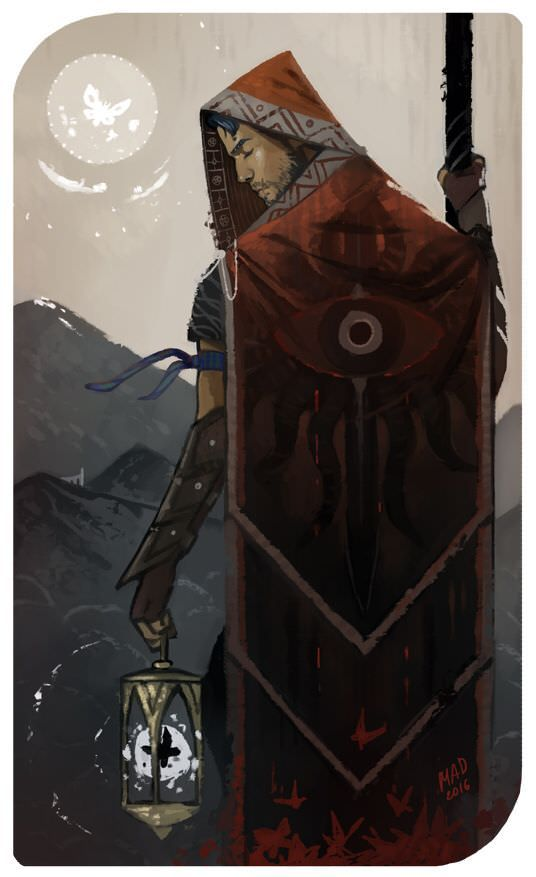

%%
[[The Negative Plane]]
[[The Positive Plane]]
[[Church of Iztaw]]
[[Gethricism]]
[[Gethric]]
[[Razmyrism]]
[[The Incursion]]
[[Volboris]]
[[White Book]]
[[Tronos]]
%%

 <h4 class="wiki-header">Razmyr</h4>
 

 <strong>Title</strong>
 the Soul Shepherd
 

 

 <strong>Represents</strong>
 Death and Knowledge
 

 

  <strong>Favoured Weapon</strong>
 Scythe
 

 

 <strong>Died</strong>
 about 273PA
 

 

 

 <strong>Allegiance</strong>
 Vihri Union of Vanquishers
 

 

 <strong>Venerated in</strong>
 <a href="Gethricism" class="internal-link">Gethricism</a>, <a href="Kethricism" class="internal-link">Kethricism</a>, <a href="Trinicism" class="internal-link">Trinicism</a>, <a href="Razmyrism" class="internal-link">Razmyrism</a>
 

 

 
 <small><i>Saint Razmyr</i></small>

Saint Razmyr the Soul Shepherd represents Death and Knowledge within the Gethric Canon, his favoured weapon is the Scythe. Razmyr is the sole prophet and "true saviour" of the often viewed as heretical <a href="Razmyrism" class="internal-link">Razmyrists</a>.

A Scholar and companion of Gethric, he wrote the <a href="White Book" class="internal-link">White Book</a>, the foundational scripture of the faith, whose core is the words and prophecies of the Prophet. Largely responsible for the Adoption of the Concept of the Homestead Beyond and an avid student of the soul. He is part of the Iztaw Three that fought during the <a href="The Incursion" class="internal-link">Incursions</a>, alongside <a href="Volboris" class="internal-link">Volboris</a> and <a href="Gethric" class="internal-link">Gethric</a>.

While Volboris may have laid the foundations for the clergy itself and the structure and worldly impact of the church on the world, it was Razmyr who can be seen as largely responsible for the scripture of the faith, its mythology of the Homestead Beyond and the most important pieces of its liturgy, the Divine Mass among them.. Said to have received visions of Gethric himself following his ascension and earthly death following the end of the Incursions, central themes such as self-realization, the Oaths and the nature of the Soul within our world and the next can all be traced back to Razmyr.

Razmyr finished the Vita flammae, his chronicle of the life of Gethric and the Incursions, and the Sedesarium, the speech of twelve hours in which he told of his visions, in the late 260s. Around 271PA his student Radomir the Scribe joined them with the Institutiones of Volboris into one book. His great debates with Volboris began at the Council of 254, the second-last meeting of the two before their final encounter in 270PA. The date and manner of Razmyr's death are unknown. The Church says only that he was called to the Prophet's side, presumably around 273PA, and his original manuscript of the White Book is kept in the deepest chamber of the Voldom at Iztaw.

The occult writings of Razmyr were never received into the White Book. They are compiled for the most part in the Codex Razmyra of the Razmyrists, written in his own tongue, the script of the Shepherd, which most scholars cannot decipher. Kethricism holds that his sight of past and future tempted him towards the arcane, and that he overcame the temptation by giving up its use for himself and turning it wholly to the service of the Prophet, a true sacrifice.

Razmyr, like his companions Gethric and Volboris, was never formally canonised through the Conclave process as his sainthood was understood rather than declared. His divinity was recognized by the first generations of the Church as a self evident truth requiring no institutional confirmation. For the faith's first century the Iztaw Three occupied a singular position within Gethric theology, revered as the only figures of divine standing. The Conclave system for canonising new Saints emerged partly as an acknowledgment that the Church needed a formal and bounded process for extending that recognition.
