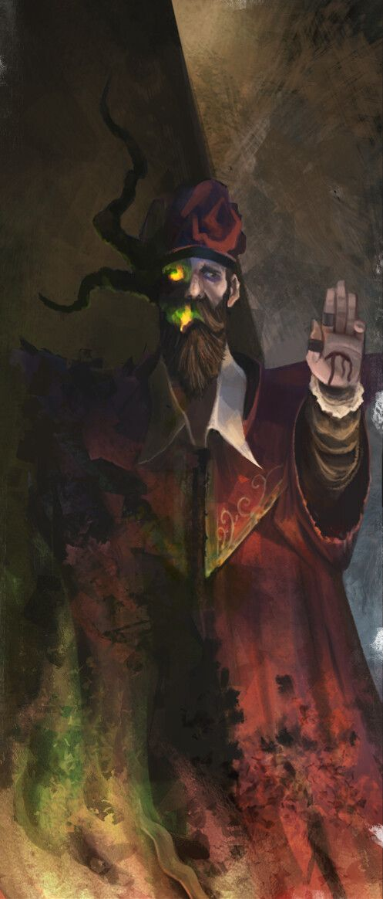

%%
[[Auguric Rite & Autonomous Spells]]
[[Unliving]]
[[Wermian Accords]]
[[Gethricism]]
[[Razmyr]]
%%

 <h4 class="wiki-header">Tronos</h4>
 

 <strong>Title</strong>
 of the Veil
 

 

 <strong>Represents</strong>
 Darkness and Chaos
 

 

 <strong>Favoured Weapon</strong>
 Staff
 

 

 <strong>Culture</strong>
 <a href="Urland" class="internal-link">Urien</a> <a href="Human" class="internal-link">Human</a>
 

 

 <strong>Born</strong>
 309PA
 

 

 <strong>Died</strong>
 392PA, 83 years of age
 

 

 

 <strong>Canonised</strong>
 Conclave of 410PA
 

 

 <strong>Venerated in</strong>
 <a href="Gethricism" class="internal-link">Gethricism</a>, <a href="Trinicism" class="internal-link">Trinicism</a>
 

 

 
 <small><i>Saint Tronos</i></small>

Saint Tronos of the Veil represents Darkness and Chaos within the Gethric Canon, his favoured Weapon is the Staff. Tronos was born an Urien human in 309PA and died at the age of 83 in 392PA, he was canonised at the Conclave of 410 alongside <a href="Melmer" class="internal-link">Saint Melmer</a>.

A now controversial Saint, this Urien arcanist sought to commune with Spirits, engaging in questionable methods of Conjuration and Necromancy, his research led to many discoveries in the Arcane and Divine but was also a major reason for the Wermian Accords and their restriction of certain magical practices. His worship is rejected by the Kherovan Patriarchate.

Tronos writing and theories about the nature of the soul built upon those of Razmyr, and he built upon much of the Church fathers writing and liturgy, but was not afforded the respect by posterity that Razmyr was, simply due to the latter's elevated status as a companion of the Prophet in life and one of the Iztaw Three, that fought the Daemons of the Incursions. Many parts of his contributions to liturgy and the White Book have been rescinded since his times and following the writing of the Accords, they are now known as the Apocryphae and are rare to find outside of secure Gethric libraries.

The canonisation of Tronos at the Conclave of 410PA had consequences that extended far beyond his own contested legacy. In Kherova, where the clergy had explicitly objected to his elevation and where the theological implications of canonising an arcanist whose research mapped directly onto the kind of soul corruption the Kheri understood the Incursion to have demonstrated, the decision was the decisive provocation that began the formal process leading to the <a href="Kethricism" class="internal-link">Kethric Declaration of 471PA</a>. The First Council of Opuzna, which produced the Doctrine of Dualism and set the two traditions on their irreconcilable paths, was convened directly in response to Iztaw's decision to proceed with the canonisation of Tronos over Kherovan objection. His name is thus inseparable from the history of the most significant denominational schism in the Gethric faith before the Great Schism of 764PA.

In the modern era Tronos is by a considerable margin the least venerated Saint in the Gethric canon, his canonical status has never been formally revoked by the Church of Iztaw, but locations solely dedicated to his worship are vanishingly rare, his feast day passes largely unobserved, and his name appears in contemporary Gethric discourse almost exclusively in the context of theological controversy. Trinicist communities, who are less bound to canonical tradition than the Iztaw establishment, are occasionally willing to acknowledge the scholarly significance of his contributions while still distancing themselves from the man. The Kherovan Patriarchate does not acknowledge him at all.
