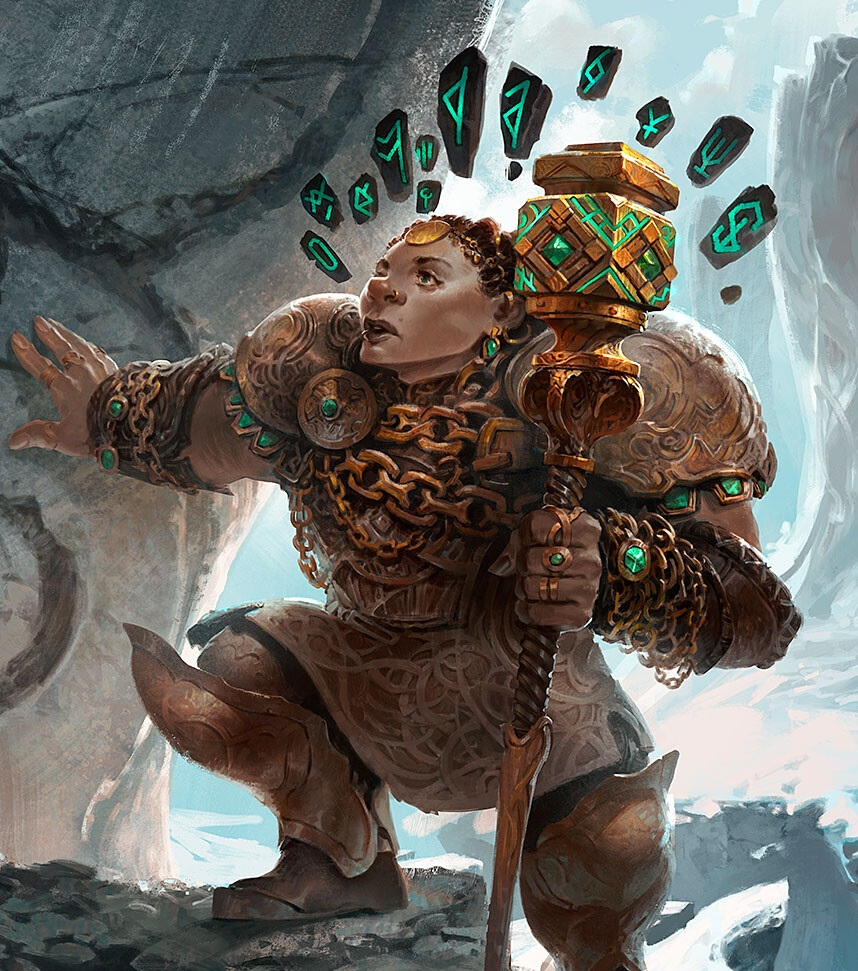

%%
[[Artificery]]
[[Kherova]]
[[Gethricism]]
[[Kethricism]]
[[Kherovan Inquisition]]
[[Kheri]]
[[Dwarf]]
[[Tizin-Kol]]
[[Daban-Kol]]
[[Roxerian Glass]]
[[Kifrir]]
%%

 <h4 class="wiki-header">Vazena</h4>
 

 <strong>Title</strong>
 of Kairos, Patron Saint of Kherova
 

 

 <strong>Represents</strong>
 Earth and Artificery
 

 

 <strong>Favoured Weapon</strong>
 Greataxe
 

 

 <strong>Culture</strong>
 <a href="Mistspires" class="internal-link">Mistspire</a> <a href="Dwarf" class="internal-link">Dwarf</a>
 

 

 <strong>Born</strong>
 421PA, Kairos
 

 

 <strong>Died</strong>
 489PA, 68 years of age
 

 

 

 <strong>Canonised</strong>
 Conclave of 495PA
 

 

 <strong>Venerated in</strong>
 <a href="Gethricism" class="internal-link">Gethricism</a>, <a href="Kethricism" class="internal-link">Kethricism</a>, <a href="Trinicism" class="internal-link">Trinicism</a>
 

 

 
 <small><i>Saint Vazena</i></small>

Saint Vazena of Kairos represents Earth and Artificery within the <a href="Gethricism" class="internal-link">Gethric Canon</a>, her favoured weapon is the Greataxe. Vazena was born a Mistspire dwarf in Kairos in 421PA and died at the age of 68 in 489PA. She was canonised at the Conclave of 495PA amid great controversy among the <a href="Church of Iztaw" class="internal-link">Iztaw clergy</a> as the first non-human Saint of the faith, and she is the patron Saint of <a href="Kherova" class="internal-link">Kherova</a>.

Vazena was a <a href="Kheri" class="internal-link">Kheri</a> dwarf of Kairos, the oldest city of Kherova, whose founding traditions reach back to the 13th century BA and whose Ankheri people have long kept close craft and trade relationships with the dwarven holds of the north. She is credited with the conversion of the dwarves of <a href="Tizin-Kol" class="internal-link">Tizin-Kol</a> and of the southern <a href="Mistspires" class="internal-link">Mistspires</a>, and with popularising craftsmanship as a way to achieve Gethrian ideals.

She was responsible for a large wave of conversions within the splintered dwarven communities around <a href="Daban-Kol" class="internal-link">Daban-Kol</a> and is often viewed as the greatest and first example of the love of Gethric touching all, not just humans. To many Gethric dwarves she and <a href="Kifrir" class="internal-link">Kifrir</a> are especially beloved, although the two exemplify entirely different qualities of the faith.

<h2>The Codex Vazenis</h2>

Vazena wrote the Codex Vazenis, which unified many of the natural and spiritual beliefs of pre-Gethrian societies and of dwarven and gnomish kind with the Gethric faith. Among its many contributions is the art of Runebinding, which the Codex formally describes as a practice distinct from simple and dangerous <a href="Artificery" class="internal-link">Artificery</a>, one that marries ancient dwarven rites with Gethric principles of divine worship.

The Codex provides the doctrinal basis on which <a href="Kethricism" class="internal-link">Kethricism</a> holds Runebinding to be wholly divine rather than arcane, the will and faith of the craftsman inscribed into the work itself. Her standing as patron Saint of Kherova gives the tradition an institutional protection that no Inquisitor has ever seriously challenged. Runebinding is practised above all by the dwarven craftspeople of Daban-Kol and the High Kheri communities. The Codex itself is protected by the Order of the White Hall in Kairos.

Among Vazena's many inventions are the mirror shields carried by the Spellbreaker Guard of the <a href="Kherovan Inquisition" class="internal-link">Kherovan Inquisition</a>, which disrupt magical workings and are said to turn aside spells cast against their bearers. In later generations the shields came to be faced with polished <a href="Roxerian Glass" class="internal-link">Roxerian mirror</a>. They proved decisive against the Grevenni magi at the Slaughter of Yazbridge in the Yellow War and against the magi of the Sultanate in the First War of Elbae Aggression.

<h2>Canonisation and Veneration</h2>

Vazena's canonisation at the Conclave of 495PA, more than two decades after the Kethric Declaration of 471PA, was resisted by the Iztaw clergy, both because she was a dwarf and because she was a Kherovan. It was however also meant as an olive branch to the Kethric Patriarchate, which gladly embraced her separately as well and made her the patron Saint of Kherova, and her theological legacy is most fully realised within the Kethric tradition. She is venerated in all three major denominations and is well loved by smiths, artists and craftsmen. Although she is the patron Saint of Kherova, <a href="Ralond" class="internal-link">Ralond the Scaleslayer</a> is arguably the more beloved figure there in popular practice.

Many of her relics are kept in Daban-Kol. Among the most well known of them are the Stones of Vazena, a group of divine rocks infused with her masterful runes, the Scepter of Kairos and the armour of Ad-Thul.
