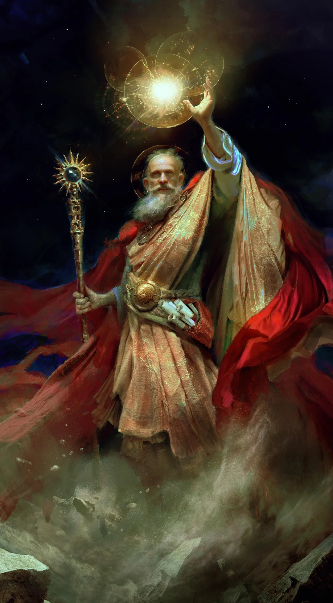

%%
[[Church of Iztaw]]
[[Sisterhood of the Morning]]
[[Gethricism]]
[[The Incursion]]
[[Gethric]]
[[Razmyr]]
%%

 <h4 class="wiki-header">Volboris</h4>
 

 <strong>Title</strong>
 the Healer, First High-Bisop of Iztaw
 

 

 <strong>Represents</strong>
 Law and Healing
 

 

 <strong>Favoured Weapon</strong>
 Morningstar
 

 

 

 <strong>Allegiance</strong>
 Vihri Union of Vanquishers, <a href="Church of Iztaw" class="internal-link">Church of Iztaw</a>
 

 

 <strong>Venerated in</strong>
 <a href="Gethricism" class="internal-link">Gethricism</a>, <a href="Kethricism" class="internal-link">Kethricism</a>, <a href="Trinicism" class="internal-link">Trinicism</a>
 

 

 
 <small><i>Saint Volboris</i></small>

Saint Volboris the Healer represents Law and Healing within the Gethric Canon, his favoured Weapon is the Morningstar.

A friend and companion of Gethric in life, Volboris founded the Iztaw Clergy and the Church as an Institution. He was the first High-Bisop of the Church and is responsible for the majority of the Divine Liturgy. He is part of the Iztaw Three that fought during the <a href="The Incursion" class="internal-link">Incursions</a>, alongside <a href="Razmyr" class="internal-link">Razmyr</a> and <a href="Gethric" class="internal-link">Gethric</a>.

Unlike the Saints canonised by later Conclaves, Volboris was never formally elevated through any institutional process and no vote was taken, no deliberation held. In the generation following his death, the communities of the nascent Church simply began treating him as what the faithful had always understood him to be. The first High-Bisop was a figure of divine standing whose presence with Gethric during the Incursion and whose foundational role in building the Church placed him beyond the need for human ratification. For the first century of the faith's existence, Gethric, Volboris and Razmyr were understood as the only true Saints and the later Conclave system for canonising new figures developed precisely because the Church needed a formal mechanism for acknowledging holiness that did not claim the same direct, unmediated authority as the founding generation.
