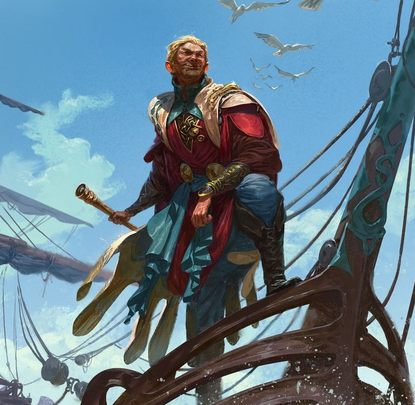

%%
[[Trinicism]]
[[Blijgrat]]
[[Zeeport]]
[[Meadrath]]
%%

 <h4 class="wiki-header">Yahrwick</h4>
 

 <strong>Title</strong>
 of Zeeport
 

 

 <strong>Represents</strong>
 Liberation and Air
 

 

 <strong>Favoured Weapon</strong>
 Cutlass
 

 

 <strong>Culture</strong>
 Weadi <a href="Human" class="internal-link">Human</a>
 

 

 <strong>Died</strong>
 737PA, <a href="Zeeport" class="internal-link">Zeeport</a>
 

 

 <strong>Cause of Death</strong>
 martyred in the rebellion of Zeeport
 

 

 

 <strong>Canonised</strong>
 737PA, by the Bishop of <a href="Korsfall" class="internal-link">Korsfall</a>, not recognised by Iztaw
 

 

 <strong>Venerated in</strong>
 <a href="Trinicism" class="internal-link">Trinicism</a>
 

 

 
 <small><i>Saint Yahrwick</i></small>

Saint Yahrwick of <a href="Zeeport" class="internal-link">Zeeport</a> represents Liberation and Air within the Gethric Canon, his favoured Weapon is the Cutlass.

The so far only Saint canonized by the Bishop of <a href="Korsfall" class="internal-link">Korsfall</a>, the bishop of the royal court, Yahrwick was a vigilante and "holy" pirate, who began as a pirate who preyed on every ship, but fought more and more for the independence of the Weadi and against the heathen Skori of Vignasoya, who ruled Zeeport and outlawed the worship of the candlegods. He slipped through the blockade of the city to bring the rebels food, then organised the resistance against the Skori in their castle, the Brod, and died a martyr in the nights of the rebellion that freed the city in 737PA. He has many statues in Zeeport and a cathedral in his name. The Bishop of Korsfall canonised him in the same year, without the sanction of a Conclave. The Church of Iztaw never recognised the canonisation, which is often seen as an early sign of the drift of the western churches away from Iztaw, and after the Great Schism of 764PA the Trinicist churches adopted him as one of their own. He is rejected by the other two Gethric denominations.
