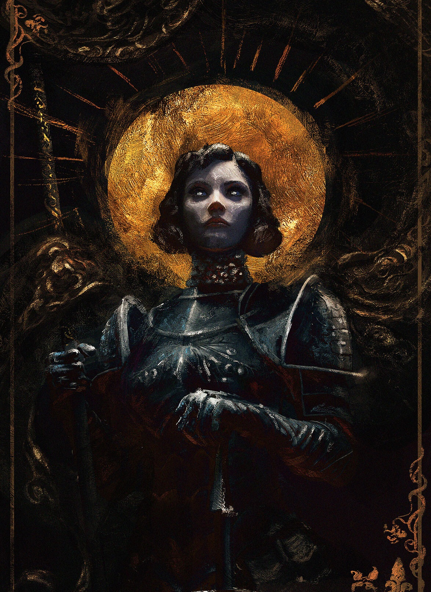

%%
[[Grevenna]]
[[Reanport]]
[[Gethricism]]
[[Rean]]
[[Knights of the Spring]]
[[Hannah of Krav]]
[[Wars of the Gryphon]]
%%

 <h4 class="wiki-header">Yelena</h4>
 

 <strong>Title</strong>
 of Dreva, Patron Saint of Reanport
 

 

 <strong>Represents</strong>
 Protection and Destruction
 

 

 <strong>Favoured Weapon</strong>
 Lucerne
 

 

 <strong>Culture</strong>
 <a href="Rean" class="internal-link">Reani</a> <a href="Human" class="internal-link">Human</a>
 

 

 <strong>Born</strong>
 576PA, Dreva
 

 

 <strong>Died</strong>
 621PA, <a href="Reanport" class="internal-link">Reanport</a>
 

 

 <strong>Cause of Death</strong>
 the Reanport uprising 45 years of age
 

 

 

 <strong>Canonised</strong>
 Conclave of 630PA, High-Bisop Jarnas I
 

 

 <strong>Venerated in</strong>
 <a href="Gethricism" class="internal-link">Gethricism</a>, <a href="Kethricism" class="internal-link">Kethricism</a>, <a href="Trinicism" class="internal-link">Trinicism</a>
 

 

 
 <small><i>Saint Yelena</i></small>

Saint Yelena of Dreva represents Protection and Destruction within the Gethric Canon, her favoured weapon is the Lucerne. Yelena was born a Reani human in Dreva in 576PA and died at the age of 45 in 621PA during the Reanport Uprising. She was canonised at the Conclave of 630PA by High-Bisop Jarnas I and is the patron Saint of <a href="Reanport" class="internal-link">Reanport</a>.

<h2>Life</h2>

Yelena was born in Dreva, in what is today <a href="Grevenna" class="internal-link">Grevenna</a>. Like the peoples of Hainach, southern Garmeley, Reanport and Grevenna, she belonged to the wider <a href="Rean" class="internal-link">Reani</a> culture. She was a hero of the late 6th and early 7th centuries PA and is most famous for slaying the Witch Bezelia, who during the rule of Grand Lady Elena II had established a domain of dark magic and occult tyranny in northern Grevenna, centred on her domain in the southern Edessa mountains. Bezelia seduced and subjugated many ogre tribes, laid curses upon land, animal and man, and secretly enslaved the people of Garal, a small town in the Garal Valley in western Grevenna, west of the River Pilv. Yelena journeyed into Edessa and slew her in 596PA.

Many tales are told of the journey and of Yelena's rivalry with the Witch, but the Gethric canon has largely stamped out the more unorthodox rumours concerning their relationship, just as various tellings among the clergy have long suppressed the accounts of Yelena's relations with other women.

Her unyielding fury and her unwillingness to tolerate the suffering of innocents brought her into conflict with kings and princes. In 621PA she fought for the people in the Reanport Uprising, which was actively supported by Grevenna and which brought an end to the du Rean royal line. She died in the uprising, impaled by a spear through the back of her neck. The maritime Republic of Reanport was formed the following year.

<h2>Canonisation and Depiction</h2>

Despite her conflicts with the crowned heads of her time, Yelena was recognised by the Church after her death as a heroic slayer of monsters and protector of the people, and she was canonised at the Conclave of 630PA. She is often depicted in dualistic images, clad in the cold armour of vengeance and the warding robes of kindness. She teaches that sometimes to save the good one must destroy evil, and sometimes to end evil one must turn from it and protect the good it seeks to annihilate.

<h2>Veneration</h2>

Yelena is venerated in all three major denominations of the faith and is the patron Saint of Reanport. She has long been a Saint of warriors. The <a href="Knights of the Spring" class="internal-link">Knights of the Spring</a>, founded around the 630s PA, are associated with her, and <a href="Hannah of Krav" class="internal-link">Hannah of Krav</a>, the Grevenni swordswoman of the Yellow War, was a lifelong admirer of the Saint, whose memory as a real person was still alive in Grevenna in her time. During the <a href="Wars of the Gryphon" class="internal-link">Wars of the Gryphon</a> the Paladin Vastilla of Vansel, a devout follower of Yelena, fought with a lucerne in the image of her Saint, and the wounds of the men and women around her were said to close in her presence. Many soldiers of fortune and warriors without liege lord or order turn to the worship of Yelena, seeing her perseverance in spite of a harsh world as an example to follow.
