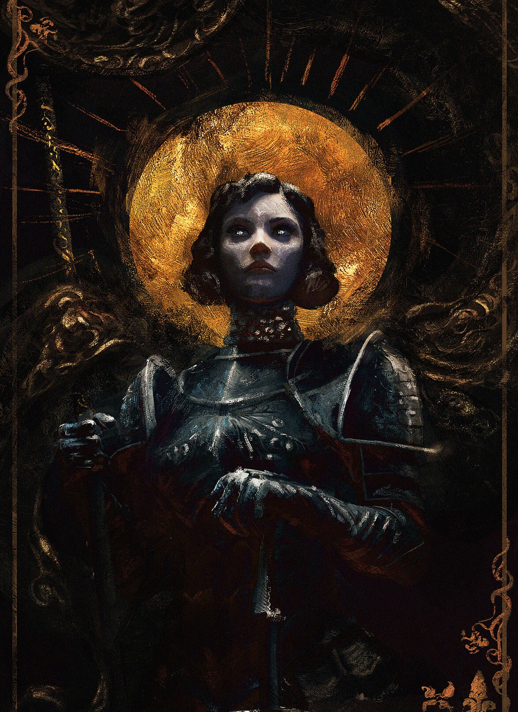

%%
[[Grevenna]]
[[Reanport]]
[[Gethricism]]
%%

 <h4 class="wiki-header">Yelena</h4>
 

 <strong>Title</strong>
 of Dreva, Patron Saint of Reanport
 

 

 <strong>Represents</strong>
 Protection and Destruction
 

 

 <strong>Favoured Weapon</strong>
 Lucerne
 

 

 <strong>Culture</strong>
 Reani <a href="Human" class="internal-link">Human</a>
 

 

 <strong>Born</strong>
 576PA, Dreva
 

 

 <strong>Died</strong>
 621PA, <a href="Reanport" class="internal-link">Reanport</a>
 

 

 <strong>Cause of Death</strong>
 the Reanport uprising 45 years of age
 

 

 

 <strong>Canonised</strong>
 Conclave of 630PA, High-Bisop Jarnas I
 

 

 <strong>Venerated in</strong>
 <a href="Gethricism" class="internal-link">Gethricism</a>, <a href="Kethricism" class="internal-link">Kethricism</a>, <a href="Trinicism" class="internal-link">Trinicism</a>
 

 

 
 <small><i>Saint Yelena</i></small>

Saint Yelena of Dreva represents Protection and Destruction within the Gethric Canon, her favoured Weapon is the Lucerne. Yelena was born a Reani human in 576PA and died at the age of 45 in 621PA, she was canonised at the Conclave of 630PA by High-Bisop Jarnas I.

Yelena is often depicted in dualistic images, clad in the cold armour of vengeance & the warding robes of kindness. She teaches us that sometimes to save the good one must destroy evil and sometimes to end evil one must turn from it and protect the good it seeks to annihilate.

Most famous for slaying the powerful Witch Bezelia who had secretly enslaved the people of Garal, Yelena was a hero during the 6th and 7th century PA. Her unyielding fury and unwillingness to tolerate innocents to suffer brought her into conflict with kings and princes but she was recognized as a heroic slayer of monsters and protector of the people by the church, following her death during the Reanport uprising. She is the patron Saint of <a href="Reanport" class="internal-link">Reanport</a>.
