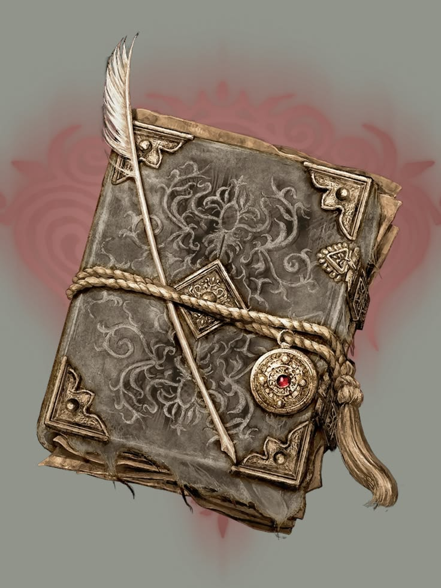

%%
[[Gethricism]]
[[Razmyr]]
[[Volboris]]
[[Gethric]]
[[Tronos]]
[[Church of Iztaw]]
[[Trinicism]]
[[Kethricism]]
[[Razmyrism]]
[[Diarism]]
[[The Incursion]]
[[Wermian Accords]]
[[Markur]]
[[Remembrance]]
%%

 <h4 class="wiki-header">The White Book</h4>
 

 <strong>Type</strong>
 Scripture
 

 

 <strong>Faith</strong>
 <a href="Gethricism" class="internal-link">Gethricism</a>
 

 

 <strong>Author</strong>
 <a href="Razmyr" class="internal-link">Saint Razmyr</a>, <a href="Volboris" class="internal-link">Saint Volboris</a> (Institutiones)
 

 

 <strong>Language</strong>
 Old Vihri, Wermian (the Prophet's words)
 

 

 <strong>Composed</strong>
 258PA to the early 4th century
 

 

 <strong>First compiled</strong>
 about 271PA
 

 

 

 <strong>Parts</strong>
 Vita flammae, Sedesarium, Pandecta, Institutiones Volboria
 

 

 <strong>Versions</strong>
 Trinic Book, Marble Book, Codex Razmyra
 

 

 <strong>Apocrypha</strong>
 the Apocryphae
 

 

 <strong>Related texts</strong>
 Divine Liturgy, Lex Novelis, Codex Vazenis
 

 

 
 <small><i>A modern version of the White Book</i></small>

The White Book is the holy scripture of <a href="Gethricism" class="internal-link">Gethricism</a> and the foundational text of the faith. Its author is Saint <a href="Razmyr" class="internal-link">Razmyr</a> the Soul Shepherd, companion of the Prophet <a href="Gethric" class="internal-link">Gethric</a> and one of the Iztaw Three, and the core of his writing is the words and prophecies of Gethric himself. In most versions the book is made up of four parts: the Vita flammae, a chronicle of the life of the Prophet and of the <a href="The Incursion" class="internal-link">Incursions</a>; the Sedesarium, which records the visions of Gethric that Razmyr received after the Prophet's death and his teaching on the soul and the Homestead Beyond; the Pandecta, a collection of tales of the early faithful; and the Institutiones Volboria, the letters in which Saint <a href="Volboris" class="internal-link">Volboris</a> set out the foundations of the Church.

The Institutiones are officially dated to 258PA, and Razmyr finished his own parts in the late 260s. The book is first known in its combined form around 271PA and grew with the Pandecta over the following half century, until Saint <a href="Tronos" class="internal-link">Tronos</a> of the Veil became the last author whose work was admitted. The Conclave of 555PA struck his more obscure writings from the book as the Apocryphae and fixed its text, and no church father or prophetic oracle has been added to it since. The book was written in Old Vihri, although the words of the Prophet are traditionally kept in the Wermian in which he spoke them.

The White Book is kept in churches throughout the Gethric world and read from at the Divine Mass, and its study is the foundation of clerical education in the <a href="Church of Iztaw" class="internal-link">Church of Iztaw</a>. It is the symbol of the academic side of the faith, and many hermits, priests, clerics and bishops have devoted their lives to its study alone. All three denominations hold it as scripture, but each keeps its own version. The Trinicists hold it to be the only divinely inspired text and the only infallible source of Gethric doctrine, and their Trinic Book, the Kheri Marble Book and the Codex Razmyra of the Razmyrists all differ from the White Book of Iztaw in the parts they keep.

<h2>Name</h2>

The book is named for the white flame of Gethric. The Vita flammae begins its account of the Prophet's deeds with the miracle of white flames by which the young farmer abjured a Daemon of the Abyss at Tawring in 227PA, and it ends with his death in the autumn of 240PA, when he burned in a white light and every creature summoned by the Wermian magi burned with him. The oldest copies of the book were also bound in white, and a plain white binding has remained the mark of the book ever since.

The four parts carry the names they were given in the early Church. Vita flammae means the life of the flame. The Sedesarium takes its name from the sitting at which Razmyr gave the speech it records, Pandecta means a gathering of all things, and the Institutiones Volboria are the instructions of Volboris, usually called simply the Institutiones.

<h2>Composition</h2>

Gethric left no writings of his own. His words and lessons were recorded by Razmyr, who had followed him since their fateful meeting during the Second Incursion and who could see the events of past and future. After Volboris proclaimed the Church at Iztaw in 241PA, Razmyr turned more and more to theology and the matter of the soul, while the organisation of the faithful fell to Volboris as the first High-Bisop. The White Book is the fruit of these years, and both founders are remembered in it, Razmyr as its author and Volboris as the writer of its fourth part.

The relationship between the two men is among the most discussed questions in the history of the early Church. They are said to have been as close as twin brothers in the womb when they were miles apart, and as bitter as oil and water when they stood near each other. The Council of 254 was the second-last meeting of the two before their final encounter in 270PA, and it began what the Church calls the great debates between them, nearly all records of which are kept secret in the vaults of the Church. The Doctrine of Human Exceptionalism was first raised at this council, although it is not known which of the two raised it, and the Doctrine has no place in the official parts of the White Book.

The Institutiones Volboria are the oldest part of the book, and the Church officially dates them to 258PA. Razmyr finished the Vita flammae and the Sedesarium in the late 260s. Around 271PA his student and copyist Radomir the Scribe joined the three works into a single book, the earliest known form of the White Book. The date and manner of Razmyr's death are unknown. The Church says only that he was called to the Prophet's side, presumably around 273PA. Volboris outlived him by about a decade and died in his sleep at Iztaw in 284PA.

After Razmyr's death Radomir began to gather the tales of the early faithful that became the Pandecta, and over the following decades early church fathers, theologians and clergy added to it. Wislava of the Morning, an early sister of the <a href="Sisterhood of the Morning" class="internal-link">Sisterhood of the Morning</a>, contributed the tales of the healings of Volboris, the only part of the book credited to a woman. The cautionary tales are attributed to Gostan of Zavlech, a Vihri theologian of the 290s, and Hadric of Uhl, an Urien father of the early 4th century, brought the tales of the Urien converts into the book after <a href="Urland" class="internal-link">Urland</a> made the faith its state religion in 306PA. The last of the authors was Tronos of the Veil, an Urien arcanist and the student and greatest devotee of Razmyr, who died in 323PA. After him no church father or prophetic oracle was ever admitted to the book.

The text was not yet fixed in these first centuries, and regional churches kept versions of their own, many with local tales in the Pandecta. The writings of Tronos, who had sought to commune with spirits, grew ever more contested, above all after the <a href="Wermian Accords" class="internal-link">Wermian Accords</a> of 536PA restricted the magical practices his research had touched. The Conclave of 555PA, which also canonised <a href="Tytus" class="internal-link">Tytus</a> of Pinopki as a symbol of the necessity of the Accords, struck his more obscure works from the book and fixed its text for the Church of Iztaw, bringing the regional versions to an end. The works it removed are known as the Apocryphae.

<h2>Contents</h2>

The White Book of Iztaw is divided into four parts. Razmyr's occult writings and the Apocryphae of Tronos are not counted among them.

<h3>Vita flammae</h3>

The Vita flammae, the first and longest part, is a chronicle of the life of Gethric and of the Incursions, and it is the core of Razmyr's work. It is divided into 77 chapters. Each chapter opens with a Prima Dicta, a saying of the Prophet quoted word for word, and is named after it. By tradition the sayings of the Prophet are kept in Wermian, the tongue in which Gethric spoke, while the rest of the text is in Old Vihri. The first chapter, which tells of the young farmer from the disputed Wermian territories, is headed "The furrow does not ask whose field it is."

The chronicle follows Gethric through the first miracle at Tawring ("I did not call the fire. I only would not run."), his meeting with Volboris ("Heal them first, and ask their names after."), his encounter with Razmyr ("If you have seen my end, then walk with me to it."), the duel at Garzo Hill with the Lidless Fiend ("Let it look. I have nothing hidden."), the arrival of the Urien Fleet at Trazlov and the speech at the Lehva Bank, from which comes the saying that "a mouse that means its word may move the mountain". It tells of the slaying of the Great Daemon Vazmoris at Tawring ("Despair is a well. Do not drink from it, and do not build beside it.") and ends with the death of the Prophet and the end of the Rubric in 240PA. The last Prima Dicta of the book, "Keep a candle lit, and I will find it.", is held to be the origin of the custom of lighting a candle for the Prophet. The Vita is a chronicle, and the voice of Razmyr himself is rarely heard in it.

<h3>Sedesarium</h3>

The Sedesarium records a speech that Razmyr gave over the course of a full day, and it is divided into the twelve hours it took, from the First Hour to the Twelfth. It is the part of the book in which Razmyr speaks in his own voice. The First Hour opens with the words "Sit, all of you, for this will take the day. I have walked behind the Prophet in my sleep, and I will tell you where the road goes and what it asks of those who walk it." Razmyr tells of the dreams in which he followed Gethric after the Prophet's death and of what Gethric showed him: the Homestead Beyond, the journey of the soul in this world and the next, the lessons of a righteous life and the power of the Oath. The speech ends with the ideals of remembrance, from which the old Rite of Remembrance descends.

Much of the Gethric teaching on the soul and the oaths is drawn from the Sedesarium, although the book holds no set formulas for oaths. The oaths sworn today are largely the work of later clerical liturgy, which is one reason the denominations swear them differently.

<h3>Pandecta</h3>

The Pandecta is a collection of tales and analogues of the early faithful, many of them written in a poetic Old Vihri. The tales are both heroic and cautionary, and each is named after the events it tells. Most of them were added after Razmyr's death, in the late 3rd and early 4th century, and they include the healings of Volboris as Wislava of the Morning told them and the conversions of the Urien after 306PA.

Among the best known is Insimir's Doubt, attributed to Gostan of Zavlech. The Paladin Insimir, who is said to have lived in the 280s and travelled southern Vihr, hears a bard sing of his own deeds under a garbled name and boasts that he would best this fraud. A latecomer among the listeners answers him, "But my lord, can't you see, this is Insimir", and the Paladin falls into madness and despair. The tale is read as a warning against mistaking hubris and self-love for faith.

Many tales of the Pandecta warn of arrogant or power-hungry mages and sorcerers. Others describe the benefits of magic and the divinity within, above all the Halderwork, which tells of the hero Halder, who built with his magic the Cathedral of the Future Flame that now stands in <a href="Uhl" class="internal-link">Uhl</a> and set out to defeat the monsters of the woods and swamps of the <a href="Gisvale" class="internal-link">Gisvale</a>. Kethric readers regard such tales with scepticism.

<h3>Institutiones Volboria</h3>

The Institutiones Volboria are 22 letters written by Volboris to his students and to the bishops of the young Church across the lands, on how to build the house of the Candleflame. They lay the foundations of the hierarchy of the clergy, of clerical law and of the examinations of clerical education, and the Church of Iztaw regards them as the charter of its institutions. The First Letter begins: "To my brothers in the faith, wherever this finds you: a house of the Candleflame is not built of stone but of those who come to sit in it. Gather them first. The stone can wait."

The Institutiones are part of most versions of the book, but their standing varies. The Trinic Book keeps little or nothing of them, the Marble Book keeps only some, and the Razmyrists give them less weight.

<h2>Language and translations</h2>

The White Book was written in Old Vihri, an old dialect of High Vihri that speakers of Vihri still understand with ease, and it is in Old Vihri that it is traditionally read at Mass. The sayings of the Prophet in the Vita flammae are kept in Wermian.

The Trinicist churches read the book in Meadi, Cevoli and Urien as well as in Old Vihri, and the Kherovan Church has its own version in Kheri. The Church of Iztaw has no quarrel with these translations for the present, but whether the Church should allow and oversee them is part of the debate over the scriptorium of the White Book. Some see translation as a gift that spreads the word of the Prophet, and others as a danger that opens the book to misinterpretation.

<h2>Versions</h2>

Since the Conclave of 555PA the Church of Iztaw has kept a single text of all four parts. The other denominations and movements of the faith hold the same book as scripture but keep versions of their own.

<h3>Trinic Book</h3>

The Trinic White Book, also called the Trinic Book or the New Book, is the version of the <a href="Trinicism" class="internal-link">Trinicist</a> churches. It keeps most of the Pandecta and the mythological stories of the faith, but it leaves out the clerical and institutional texts, keeping little or nothing of the Institutiones, along with several sources that entered the book long after the lifetime of the Prophet. In doing so it separates the faith from the Church, in keeping with the Trinfurt Articles of the <a href="The Great Schism" class="internal-link">Great Schism</a> of 764PA, which declared the White Book the only divinely inspired text and the only infallible source of Gethric doctrine and denied that the High-Bisop represented the Prophet on this plane.

<h3>Marble Book</h3>

The Marble Book is the Kheri version of the White Book, kept by the Kherovan Patriarchate. Its name is bound up with that of the Tribunal of the Marble Script of the <a href="Kherovan Inquisition" class="internal-link">Kherovan Inquisition</a>, which is charged with religious peace in Kherova. The Marble Book keeps only part of the Institutiones, the letters that concern the hierarchy and general authority of the clergy, and leaves out those that bind the Church to places such as Iztaw. In <a href="Kherova" class="internal-link">Kherova</a> the Codex Vazenis is held as scripture beside it.

<h3>Codex Razmyra</h3>

The Codex Razmyra is the scripture of <a href="Razmyrism" class="internal-link">Razmyrism</a>. It holds only what the Razmyrists take to be the original Vita flammae and Sedesarium, together with the other writings of Razmyr, and nothing by any other hand. Many of those writings are set down in Razmyr's own tongue, the script of the Shepherd, which most scholars cannot decipher, even those with arcane gifts. Some of the <a href="Broken Fingers" class="internal-link">Broken Fingers</a> can read the script, or say that they can, and call themselves the seers.

Razmyrists also study the works of Razmyr's closest students, among them Radomir and Tronos, and even the Apocryphae, which they measure against the works of Razmyr himself, although they do not hold Tronos to be a Saint. Their circles lean towards the learned and often meet in secret, and magical theory is among the matters they discuss.

<h2>Manuscripts and printing</h2>

Razmyr's original manuscript is kept in the deepest chamber of the Voldom at <a href="Iztaw" class="internal-link">Iztaw</a>, where Volboris himself rests. Before the age of print the book was copied by hand in the scriptoria of the Church and its monasteries. Outside the churches, only rich households owned a copy, and libraries often kept theirs chained to the shelves, as in the Grey Library of <a href="Niedrest" class="internal-link">Niedrest</a>.

The printing press, invented by Giulia Seberet in <a href="Albesan" class="internal-link">Albesan</a> in 859PA, changed this. The first printed editions were Trinic Books from Albesan and other western presses, and the Church of Iztaw began to print the book only around 875PA, as the industry spread east. By 903PA printed copies of the White Book circulated widely. Its many versions have made the book harder to print than the Mandukh of <a href="Zuhurism" class="internal-link">Zuhurism</a>, a single and much shorter text that has remained unchanged for centuries and became the most printed text in the world in 921PA. Counting all its versions, however, the White Book is probably the more widely circulated of the two, and printed copies are especially popular among the western Trinicists.

In Vihr the printing of the book has become the subject of the debate over the scriptorium of the White Book. At its heart is the question of how far the clergy should control the printing of the book and its translation, and Ras <a href="Vormil III" class="internal-link">Vormil III</a> has taken a traditionalist stance on it.

<h2>Use</h2>

A copy of the White Book is kept in every church, and the book is read from at the Divine Mass, the principal liturgy of the Church of Iztaw. The Divine Liturgy, the rite of the Mass, was written for the most part by Razmyr from the White Book, with a smaller share by Volboris, and it also includes the liturgy of the oaths, the Rite of Remembrance and the practice of Reaffirmation. The faithful of all denominations are encouraged to learn to read, so that they may discover the warmth of the book for themselves.

In the Church of Iztaw the White Book is at the heart of clerical education, and the clergy are examined on it in the Minor Cudra and the Maior Cudra. High Gethricism places particular value on the literal words of the Prophet and his Brotherhood as the book records them, often taking literal and perhaps outdated meanings from them.

<h2>Interpretation</h2>

Each denomination reads the book in its own way. <a href="Kethricism" class="internal-link">Kethricism</a> reads it through the Doctrine of Dualism. In the Kethric reading Razmyr's sight of past and future tempted him towards the arcane, and he overcame the temptation by giving up its use for himself and turning it wholly to the service of the Prophet, a true sacrifice. Tronos, who followed him in the study of the soul, is held to have fallen too far. Trinicists hold the book to be the only presently available source of divinely revealed knowledge, and read in it a Gethric enlightened through circumstance and character rather than a hero ordained at birth.

<a href="Diarism" class="internal-link">Diarists</a> hold the whole White Book to be scripture but give less weight to the Institutiones and the later tales of the Pandecta. Many of them see Saint Kalbin and Razmyr as similar figures, worldly prophets who shared the message of the Creator, and <a href="Perrin Diar" class="internal-link">Perrin Diar</a> himself read the Vita flammae as the life of the Creator made flesh in his On the One Flame.

<h3>Commentaries</h3>

The book has drawn commentary since the early centuries of the Church, and several High-Bisops of Iztaw are counted among its commentators. Morzin I wrote the Concordia, a reading of the Institutiones that argued for the independence of the Church from the crown in the years before the crisis of 377PA. Taromir I answered the Doctrine of Dualism in his Responsa, drawn from the Sedesarium. Servann II, High-Bisop in the 590s, wrote the Glossa Servanni, the first full commentary on all four parts, whose notes still fill the margins of the printed White Book of Iztaw and are studied for the Cudra.

Saint <a href="Palus" class="internal-link">Palus</a> Aergestes, the Father of the Accords, read the chapters of the Vita on the Incursion as a warning against unchecked magic in his Admonitiones, which are held to be the theological ground of the Wermian Accords. In the 8th century <a href="Joakim zi Szarbel" class="internal-link">Joakim zi Szarbel</a>, Bishop of Tlokyemy, read the Doctrine of Human Exceptionalism into the Vita and the Institutiones in his De Ordine Generum, On the Order of Kinds, which was cited in support of the <a href="Gethric Pogroms" class="internal-link">Gethric Pogroms</a>. It is honoured in Vihr and condemned in the west. <a href="Alfred the Younger" class="internal-link">Alfred the Younger</a>, Bishop of Szievek, wrote a commentary on the tales of mages in the Pandecta, the Halderwork among them, which is often read alongside his History of Magic.

<h2>Related texts</h2>

The White Book is the heart of the Gethric Liturgy, the accepted body of texts and rites of the faith. It is distinct from the Gethric Canon, the roll of the Saints together with the fundamental mythology of the faith, such as the retellings of the Incursions and the Homestead Beyond.

The Apocryphae are the works of Tronos that the Conclave of 555PA struck from the book, and they are rarely found outside secure Gethric libraries. They are critical of the Homestead Beyond itself and speak of souls as matter, building blocks like clay in the hands of those they call seers. Their most notorious claim, held to be beyond heresy even by many readers of the Apocryphae, is their description of Razmyr as the Maga Inus.

The occult writings of Razmyr, compiled for the most part in the Codex Razmyra, are not counted as part of the White Book. Neither are the musings attributed to him on which the concept of <a href="Remembrance" class="internal-link">Remembrance</a> draws, which stand outside the greater Gethric Liturgy.

The Lex Novelis of Saint <a href="Markur" class="internal-link">Markur</a> (610 to 690PA) is the nearest thing the book has to an addendum. It is a collection of divinations and cryptic readings of the White Book, of reality and of the future, written in Meadi and High Vihri, often changing between the two in the middle of a sentence, in a hand that few but his closest followers could decipher. It has never been admitted to the book and remains extremely hard to read.

The Codex Vazenis of Saint <a href="Vazena" class="internal-link">Vazena</a> of Kairos, which unites natural, spiritual and dwarven philosophy and provides the doctrinal basis of runebinding, is held as scripture in Kherova beside the Marble Book. It is kept by the Order of the White Hall in Kairos.

