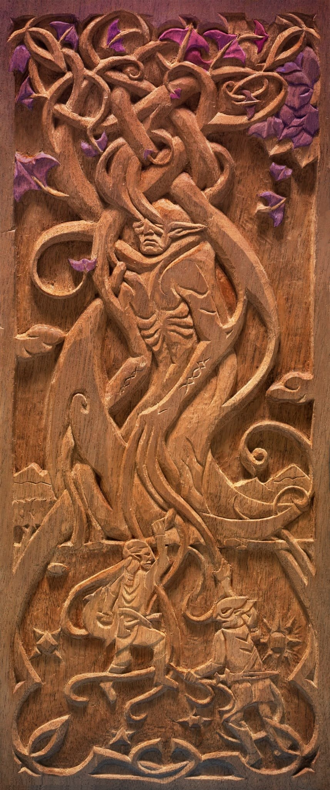
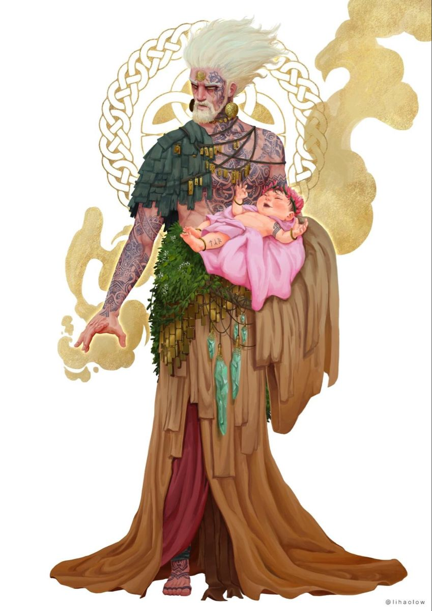

%%
[[Pehki]]
[[Nostroya]]
[[Ukiolla]]
[[Roygviil]]
[[Giantsrul]]
[[Forrvegur]]
[[Fey]]
[[Lempo]]
[[Crown of the World]]
[[Greater Spirit]]
[[Kindly Lords]]
[[Terem-Zal]]
[[Dulmic Gate]]
[[The Veil]]
[[Shifting]]
[[Great Eastern War]]
[[Grachy]]
[[Halgrach]]
[[Gethricism]]
[[Ferrki]]
[[Otso]]
[[Rynbrekka]]
[[Vunru]]
[[Yaalwe]]
[[Nyllena]]
[[Asza]]
[[Lotung]]
[[Ingele]]
%%

The Aeld Faith, long known as the Aeldcult and called the "Eldcult" by southerners, is the native faith of the <a href="Pehki" class="internal-link">Pehki</a> peoples of <a href="Nostroya" class="internal-link">Nostroya</a>. It grew out of the druidic practices of the Pehki and the traditions of the <a href="Giantsrul" class="internal-link">Giantsrul</a>, and it is a naturalistic faith that can be compared to other forms of spirit worship, such as the worship of the <a href="Kindly Lords" class="internal-link">Kindly Lords</a> or of the <a href="Terem-Zal" class="internal-link">Terem-Zal</a>. Where these traditions worship particular <a href="Greater Spirit" class="internal-link">Greater Spirits</a>, the Aeld Faith holds that the land itself has a single great consciousness, the Aeld, from which the gods themselves are said to have risen.

The Aeld Faith shares most of its gods with <a href="Forrvegur" class="internal-link">Forrvegur</a>, the old faith of the Bykmåli across the Torn Sea on <a href="Trykkerog" class="internal-link">Trykkerog</a>, and the two are often confused by outsiders. What sets the Aeld Faith apart is the Aeld itself, the living land that stands above the gods and at the centre of all worship, and the druid circles that speak for it.

<h2>Beliefs</h2>
<h3>The Aeld and the Land</h3>

The Aeld is the land in its entirety, the will of trees and rivers, the great host at whose table all creatures dine and the endless grove. It has a thousand titles, and it is the greater being that gives life and death their meaning. The gods of the faith are not its masters. They form a great pantheon of distant spiritual beings, raised up by the Aeld or even personifications of it, and they are worshipped more as its voices than as powers in their own right.

The faith teaches that nature is simply nature. Good and evil, and all judgements like them, are imposed upon the Aeld by mortals who are too feeble to understand the greater connection of all things, and the wise seek to understand the land rather than to judge it. The flood that drowns a village and the river that waters its fields are the same river.

<h3>The Fey</h3>

The <a href="Fey" class="internal-link">Fey</a> that walk the Aeldveil are held to belong to the land as much as any beast or tree, but they are feared rather than loved. The greater Fey lords, such as <a href="Lempo" class="internal-link">Lempo</a>, the Father of Moths, are the true villains of Pehki and Roymer mythology, and their danger is thought to lie in their power to manifest in the world of mortals and to influence it far more directly than the distant gods. The tale of Nissa, who was made Lempo's servant and bested him at the <a href="Crown of the World" class="internal-link">Crown of the World</a>, is told as a warning to this day.

<h3>The Ages of the World</h3>

The Pehki remember the same ages of the world as the Bykmåli of Trykkerog: the age in which the gods walked the earth, the age of the Great Ones, the Trolls, Giants and Wyrms, which the Pehki call the <a href="Giantsrul" class="internal-link">Giantsrul</a>, the Twilight of the World and the present age of mortals.

<h3>The Binding of the Gods</h3>

  
<small><i>The Binding of the Gods</i></small>

The Pehki remember the end of the first age as the Binding of the Gods, but where the Bykmåli tell of gods bound out of the world, the Aeld Faith teaches that the gods chose to leave it. When they ceased to walk the earth they returned into the Aeld from which they had risen and settled into the winds, the waters, the beasts and the peoples that are their domains, so that they now speak only through these and through dreams. The druids hold that the gods are nearer for it, not farther, since they dwell in everything the land holds. The powers that would not let go of their bodies are remembered as the greater Fey, and the Pehki say that this refusal is the root of their malice. Tradition dates the Binding to 550BA, when the worship of the Aeld is said to have begun, although the tales themselves speak of a long and slow withdrawal rather than a single day.

After the Binding the Giants alone remained, and their rule is remembered as the Giantsrul. They too waned and at last withdrew into the far north, beyond the Heavens Furrow, to places such as Srudheim at the top of the world. The Aeld itself has never spoken or shown itself, and the druids teach that it never will, for it is not a being that wakes but the land that holds all beings.

The traditional practice of the faith is generally counted as animism. The Pehki believe that every significant thing, whether rock, animal or plant, has a soul, and their teachings speak of a multitude of spirits besides the gods. The veneration of the dead and of animal spirits lies at the heart of daily worship, and the bond with the animals that sustain the people, above all bears, whales and reindeer, is among the most important duties of the faithful. Pehki custom forbids harming the plant life of the holy forests, and much of the finest timber of Nostroya stands untouched for this reason.

<h3>The Aeldveil</h3>

The Aeldveil, a stretch of dense forest between <a href="Ukiolla" class="internal-link">Ukiolla</a> and the Waelajokull, is the holiest place of the faith. It is still common practice to send elders who are ready for death out "into the veil" and to bury the fallen there. Many arcane scholars count the Aeldveil among the largest <a href="Dulmic Gate" class="internal-link">Dulmic Gates</a> known, but the druids have never permitted it to be studied. The protection of the Aeldveil from the southern heathens is known as the Great Promise, and it binds the Grand Princes of Ukiolla as much as the druids themselves.

<h2>Druids and Circles</h2>

The faith is extremely decentralised and is more an overarching grouping than a single church. The name may refer to the belief system of the Pehki as a whole, to the protectors of the Aeldveil, or specifically to the many druid circles throughout Nostroya. The druid circles are almost always led by women, in contrast to the clans of the Nostroyan tribes, which are ruled almost entirely by men. The druids commune with the land and are able to change it and its weather, and the lands around the River Asza are unnaturally fertile and warm for their climate, so that famine is almost unknown in Ukiolla. Like the druids of Ilrakhan elsewhere, they practise <a href="Shifting" class="internal-link">Shifting</a> and favour the bear of <a href="Otso" class="internal-link">Otso</a> and the eagle of <a href="Yaalwe" class="internal-link">Yaalwe</a>.

The office of the First Druid is as respected as that of the Grand Prince of Ukiolla, if not more. The First Druid leads the Aeldcircle, the union of the circles of the Aeldveil, and acts as the official representative of the veil to the Pehki people. She is traditionally married to the Halontsaari monarch of Ukiolla, which gives him legitimacy among his people. The present First Druid is Tarja Roglender.

Among the Roymer of the south, the Princes of <a href="Roygviil" class="internal-link">Roygviil</a> were attached to Yaalwe more closely than to any other god, and their wandering court was known as the Court of Winds. The southern groves were tended by circles of their own, which were less closely bound to the Aeldveil than those of the north.

<h2>History</h2>
<h3>Origins</h3>

The faith traces its roots to the druidism of the Pehki tribes and to the age of the Giantsrul, when the Giants of the north ruled both the spiritual and the material world. Missionaries tried to convert the Pehki and the Sehvki to <a href="Gethricism" class="internal-link">Gethricism</a> in the 4th century, but they failed quickly because of the deep roots of the faith in the smallest structures of the tribes. When the Grachi settled south of the Gior River, the Istrov Pact of 247PA bound them not to set foot in the sacred groves of the southern circles and to respect the land and its traditions.

<h3>The Splintering of the Circles</h3>

When war broke out between Roygviil and <a href="Halgrach" class="internal-link">Halgrach</a> in 487PA, the First Druid Asria Mikkavo declared that the Aeldcircle would remain neutral, despite the call to arms of Prince Usse of Roygviil, and the Principality of Ukiolla, whose ruler was bound to her, stayed its arms as well. Many severely criticised both her decision and the Grand Prince for following it, and her motives remain unknown outside the realm of speculation. Her stance caused the event known as the Splintering of the Circles, in which many druids, chief among them the isolated groves of the south that were not directly connected to the veil, rejected her and abandoned the united circle. Many druids of the splintered circles joined Roygviil and fought in the wars of the following centuries against the Grachi, and some still do.

<h3>The Southern Wars</h3>

The druids of the south paid dearly for their part in the wars. After the Day of the Elk in 601PA, King Vlad V of Halgrach had the southern groves burned, the beasts of the forests hunted and druidism outlawed, and in 628PA he and his two sons were killed by a circle of southern druids. When Royba fell to the Grachi and the Vihri in 690PA, the White Tower of Breel, an ancient place of Roymer worship of the Aeld, fell with it, and many Roymer fled north into Ukiolla. The wars made the faith a symbol of resistance against the Gethric Grachi, and every attempt at conversion from the south only hardened it.

<h3>The Great Eastern War</h3>

The Splintering has never healed. Tarja Roglender is recognised as the leader of the Aeldcircle, the symbolic head of the faith and the most influential figure among the druids of Nostroya, but the circles have only drifted further apart, including many within the veil itself. Following the Burning of the Alltree in 846PA and the outbreak of the still ongoing <a href="Great Eastern War" class="internal-link">Great Eastern War</a> between the Republic of <a href="Grachy" class="internal-link">Grachy</a> and Ukiolla, the Aeldcircle officially took the side of the Pehki people and Ukiolla and fights among them against the Republic. The last Roymer who still resist within Grachy and certain extremely militant circles nevertheless consider both the traditionalist Ukiollans and the Aeldcircle traitors to their people and to the land, who joined the fight only when it came to their own door.

<h2>Gods and Spirits</h2>

 
<small><i>Ferrki Livslenker</i></small>

The gods of the Aeld Faith are largely the same as those of Forrvegur, and some of them are known on Trykkerog by other names, but in Nostroya they are worshipped as distant voices of the Aeld rather than as lords holding court. Otso, Asza and Ferrki weigh most heavily among the Pehki.

<h3><a href="Ferrki" class="internal-link">Ferrki</a></h3>

The Livslenker, Shepherd of Men, First Druid and Peacespeaker, Ferrki has many names and is revered as the protector of family and children and as a walking avatar of the bond between mortals and the Aeld.

<h3><a href="Otso" class="internal-link">Otso</a></h3>

The mythological King of Giants and Bears, Otso is associated with the many facets of strength, from physical might to mental fortitude and communal effort.

<h3><a href="Rynbrekka" class="internal-link">Rynbrekka</a></h3>

The Old Mother and Swarmkeeper, Rynbrekka is one of the more important deities of the faith and is associated with fertility and war. She is often depicted with bees and flowers, and the Princes of Roygviil were elected at her festivals.

<h3><a href="Vunru" class="internal-link">Vunru</a></h3>

The manifestation of fury and vengeance, Vunru is the animal left with no way out, the rage that overcomes a warrior in battle and the endless fall into vengeance and hatred.

<h3><a href="Yaalwe" class="internal-link">Yaalwe</a></h3>

Usually portrayed as a giant eagle, Yaalwe is the lord of the winds and in folklore the husband of Nyllena. He is fickle and proud and the father of all winged beasts.

<h3><a href="Nyllena" class="internal-link">Nyllena</a></h3>

Known as the Saltmother, Nyllena is the weaver of ebb and flow, the Queen of the Waves and the personification of patience. She is the opposite of the restless Yaalwe, and when the two meet in love or in anger they summon storms.

<h3><a href="Asza" class="internal-link">Asza</a></h3>

The friend of man and patron of the harvest, Asza is the life giver of the land and the personification of the rivers of Nostroya, above all the river that bears her name. The Aeld Faith holds her to be the sister of Nyllena, while the Bykmåli of Trykkerog know her as Aske and make her the Saltmother's daughter.

<h3><a href="Lotung" class="internal-link">Lotung</a></h3>

The god of the moon and of secrecy, Lotung is closely associated with magic and knowledge, and is rarely portrayed with a face, but is instead shown veiled in ethereal robes.

<h3><a href="Ingele" class="internal-link">Ingele</a></h3>

Sometimes called Brokebeak or Longsleep, Ingele is associated with winter and death, but is notably seen as a positive force. In some tales Ingele is the force that turns the seasons, stirring them around and around like a bowl of soup.

