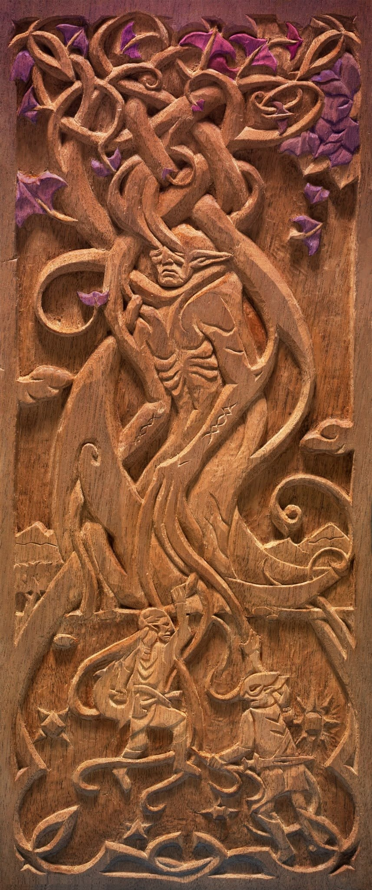

%%
[[Trykkerog]]
[[Bykmåli]]
[[Aeld Faith]]
[[Vignasoya]]
[[Free Jarldoms]]
[[Rensköldsvik]]
[[Hvirfill]]
[[Gethricism]]
[[Melmer]]
[[Fey]]
[[Lempo]]
[[Loomman]]
[[Giant]]
[[Fjorisjom Saga]]
[[Egill]]
[[Ylva]]
[[Toski]]
[[Vannsi Deep Worship]]
[[Great Kingdom of Skorland]]
[[Baeling Empire]]
[[Ferrki]]
[[Otso]]
[[Rynbrekka]]
[[Vunru]]
[[Yaalwe]]
[[Nyllena]]
[[Asza]]
[[Lotung]]
[[Ingele]]
%%

Forrvegur, roughly "the Old Road" in Bykmål, is the native faith of the <a href="Bykmåli" class="internal-link">Bykmåli</a> peoples of <a href="Trykkerog" class="internal-link">Trykkerog</a>. Southern and Gethric scholars commonly call it Bykmali Paganism and describe it as the collection of cults the islanders followed before most of them converted to the <a href="Gethricism" class="internal-link">Gethric</a> faith. It was once the faith of the whole island but is now a minority religion, kept above all by the Skori of <a href="Vignasoya" class="internal-link">Vignasoya</a> and the <a href="Free Jarldoms" class="internal-link">Free Jarldoms</a>, in the countryside of <a href="Rensköldsvik" class="internal-link">Rensköldsvik</a> and by rural communities in the swamps, hills, dales and mountain forests of the west and the far north.

Forrvegur worships largely the same gods as the <a href="Aeld Faith" class="internal-link">Aeld Faith</a> of Nostroya, and outsiders often mistake the two for one religion. It knows nothing of the Aeld as a single consciousness of the land, however, and where the Aeld Faith sees the gods as distant spiritual beings raised up by the land itself, the gods of the Old Road are close to mortals, quarrelsome and very much alive in their tales.

<h2>Beliefs</h2>
<h3>The Old Road</h3>

The name of the faith describes its heart. The world is held to be a road that the gods walked first, in the earliest age, and that the forefathers walked after them. Every mortal walks the same road in turn, and the dead have only gone on ahead. Forrvegur has no scripture and little doctrine of its own. Its teaching is the custom of the forefathers, the way things have always been done, and to break an old custom is to step off the road. Death is not feared as an ending but met as the moment one goes on ahead, which gives the cults of <a href="Ingele" class="internal-link">Ingele</a> their particular weight on the island.

<h3>The Gods</h3>

The gods of Forrvegur hold court in their own domains, removed from the world of mortals but never far from it. They marry and have children, feud with one another, make bets and strike bargains, and their quarrels are the stuff of countless tales. Mortals deal with them much as they would with powerful lords: gifts are given, oaths are sworn and favours are expected in return. A god may favour a mortal, as <a href="Nyllena" class="internal-link">Nyllena</a> chose <a href="Egill" class="internal-link">Egill</a> Foambeard, and a god may as easily turn away.

<h3>The Ages of the World</h3>

Forrvegur counts four ages of the world. In the Aldubyggja the gods walked the earth. After them awoke the Great Ones, the Trolls, <a href="Giant" class="internal-link">Giants</a> and Wyrms, who fought and ruled in an age of their own, the Aldudeila, raising halls and bringing down mountains. Then came the Twilight of the World, a semi-historic period that is commonly placed between the 3rd century BA and the 3rd century PA, when the Great Ones waned and mortals rose against them. The present age, the Aldumanja, is the age of mortals.

<h3>The Binding of the Gods</h3>

  
<small><i>The Binding of the Gods</i></small>

The Aldubyggja ended with the Binding of the Gods, which explains to the Bykmåli why the gods no longer walk among them. In the most common telling the gods were bound out of the world they had walked and confined to their own domains, Yaalwe to the winds and Nyllena to the sea, from where they can reach mortals only through storm and tide, offerings and dreams. The tales disagree on who or what bound them. Some speak of a bargain struck among the gods themselves, others of a price paid to the Great Ones, and many skalds say only that the world grew too narrow to hold them. No god, it is said, can walk the earth again without breaking the Binding and becoming something less than a god.

Not every power accepted the Binding. Some tales count Lempo, the Father of Moths, among those who refused it and kept their bodies, and hold that this is why the Fey lords can still meddle in the world while the gods cannot. The Binding is also said to mark the end of the Great Ones in the lands of mortals. The trueborn Giants lingered after the gods had gone, but they waned with every generation and slowly withdrew into the far north, to places such as Srudheim at the top of the world, where many Bykmåli believe they dwell still.

Not everyone tells the story in the same order. The firbolgs of Hvirfill, who read the True Stones, hold that the Giants came first and that the gods were born of them, and some of the oldest verses on the stones seem to give the Swarmkeeper Rynbrekka another name. The seers of Ingele, for their part, claim that the Binding has been loosening for generations, that the gods draw nearer and that the Fey lords grow bolder.

<h3>The Fey</h3>

The <a href="Fey" class="internal-link">Fey</a> are feared rather than worshipped. The lesser Fey are kept at bay with iron and appeased with offerings, but the greater Fey lords, such as <a href="Lempo" class="internal-link">Lempo</a>, the Father of Moths, are the true villains of the old tales, and Lempo is said to have deceived even the gods. Their danger lies in their power to manifest in the world of mortals and to influence it far more directly than the gods, who keep to their own courts.

<h2>Practice</h2>
<h3>Priests and Shamans</h3>

In the elder days, before men forged new steel and led hosts for jarls and crowns, druids were as common on Trykkerog as in Nostroya. Most of them were killed in the Twilight of the World, and the few who still practise their arts no longer call themselves druids. In their place Forrvegur is kept by shamans and priests, by circles bound to particular local communities and above all by worldly leaders. Jarls and householders lead the sacrifices at the Thing and in their own halls, and the oaths that bind the jarls of Vignasoya to their Korre are sworn under the rites of the old faith.

The seers of Ingele hold a place of their own. They read omens and soothsay the time and manner of a person's death, and many work to bring it about as foretold. In isolated communities children or the elderly may be expected to take their own lives when the omens call for it, and martial cults in the east of the island are said to sacrifice souls to Ingele to bargain for their own.

<h3>Holy Places</h3>

Forrvegur has no great temples. Its holy places are hills, groves, springs and stones, and the most famous of them is the Yaalpeak in the Stormlands of western Trykkerog, the goal of the dangerous pilgrimages undertaken by the followers of <a href="Yaalwe" class="internal-link">Yaalwe</a>. In <a href="Hvirfill" class="internal-link">Hvirfill</a> the Hevri keep the gods of the Old Road beside the True Stones, the rune stones said to have been carved by the Giants in their primordial war with the trolls. On the coasts the sea itself is holy to Nyllena, and in <a href="Zren" class="internal-link">Zren</a> the Bykmåli equate the Saltmother with Tunthelle of the <a href="Vannsi Deep Worship" class="internal-link">Vannsi Deep Worship</a>.

<h3>The Sagas</h3>

The tales of the gods and heroes are the closest thing Forrvegur has to scripture. The greatest of them is the <a href="Fjorisjom Saga" class="internal-link">Fjorisjom Saga</a>, the tale of four legendary heroes, among them <a href="Egill" class="internal-link">Egill</a> Foambeard, <a href="Ylva" class="internal-link">Ylva</a> Feathercall and <a href="Toski" class="internal-link">Toski</a> Ironhair, who venture through the lands of the north to hunt two giants and save the princess <a href="Gudrun" class="internal-link">Gudrun</a>. Its heroes are placed at the end of the Twilight of the World, and the royal houses of <a href="Baeling" class="internal-link">Baeling</a> and <a href="Juelfluk" class="internal-link">Juelfluk</a> still claim descent from them, although both have long since become Gethric.

<h2>History</h2>

Forrvegur was the faith of all the Bykmåli until the voyages of Saint <a href="Melmer" class="internal-link">Melmer</a> in the later 4th century began the conversion of the island to the faith of the Prophet. The Jueli of the Malksbay and the Olbellinge of Melmers Bay converted first, while the Skori of the western fjords resisted, and Melmer was slain on his last voyage in 386PA in the Swamps of Arel, deep in Skori territory. In 404PA the first Korre of Vignasoya was declared, and Vignasoya became the bulwark of the Old Road.

Under the <a href="Baeling Empire" class="internal-link">Baeling Empire</a> the Korres of Skeppbirk bent the knee and paid tribute but never gave up their gods, and Skeppbirk became the centre of the resistance of the wolfsmen against Baeling rule. The <a href="Great Kingdom of Skorland" class="internal-link">Great Kingdom of Skorland</a> of the 7th century was a realm of the old faith, and its Great Thing at Mannelik was held under its rites. Since then the Gethric church has slowly gained ground even in the towns of the Wolfsbay, but the countryside of the west and the far north still keeps to the Old Road.

<h2>Gods</h2>

Most of the gods of Forrvegur are known by the same names as in the Aeld Faith, but some carry names of their own in Bykmål. <a href="Yaalwe" class="internal-link">Yaalwe</a>, <a href="Nyllena" class="internal-link">Nyllena</a> and <a href="Ingele" class="internal-link">Ingele</a>, the gods of storm, sea and death, weigh most heavily on Trykkerog.

<h3><a href="Ferrki" class="internal-link">Ferrki</a></h3>

The Livslenker and Shepherd of Men, Ferrki is the protector of family and children.

<h3><a href="Otso" class="internal-link">Otso</a></h3>

The King of Giants and Bears, Otso stands for strength in all its forms and above all the strength of a community held together by its leader. He is revered beside the True Stones of Hvirfill and in the small communities of the wilds.

<h3><a href="Rynbrekka" class="internal-link">Rynbrekka</a></h3>

The Old Mother and Swarmkeeper, Rynbrekka is the goddess of fertility and war, depicted with bees and flowers.

<h3><a href="Vunru" class="internal-link">Villdy</a></h3>

Known in Nostroya as Vunru, Villdy is fury and vengeance, the animal left with no way out and the rage that overcomes a warrior in battle.

<h3><a href="Yaalwe" class="internal-link">Yaalwe</a></h3>

The lord of the winds and the great eagle, Yaalwe is fickle and proud and the father of all winged beasts. His followers are seldom organised and band together at most for the pilgrimages to his holy sites. He preaches individualism and a truthful ferocity, and his enemies are those who lie to others as much as to themselves.

<h3><a href="Nyllena" class="internal-link">Nyllena</a></h3>

The Saltmother, wife of Yaalwe and Queen of the Waves, Nyllena is the weaver of ebb and flow and the personification of patience. When she and her restless husband meet in love or in anger they summon storms, and the sailors of the island give her more offerings than any other god.

<h3><a href="Asza" class="internal-link">Aske</a></h3>

Known in Nostroya as Asza, Aske is the goddess of rivers and the harvest and a guide to those who travel unfamiliar lands. Where the Aeld Faith makes her the sister of Nyllena, Forrvegur holds her to be the Saltmother's daughter and a lesser being than her mother.

<h3><a href="Lotung" class="internal-link">Lölkyng</a></h3>

Known in Nostroya as Lotung, Lölkyng is the god of the moon and of secrecy, closely tied to magic and knowledge and seldom shown with a face.

<h3><a href="Ingele" class="internal-link">Ingele</a></h3>

Called Brokebeak and Longsleep, Ingele is the god of winter and death, who waits at the end of every mortal's road. On Trykkerog Ingele is the patron of the seers and of the death cults of the island.

