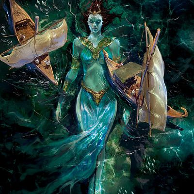

%%
[[Aeld Faith]]
[[Forrvegur]]
[[Nyllena]]
%%

  
<small><i>Asza of the Rivers</i></small>

Asza is the goddess of rivers and the harvest, the curves of every river and a guide for those who travel unfamiliar lands. She is elevated above all in the <a href="Aeld Faith" class="internal-link">Aeld Faith</a> of Nostroya, where she personifies the rivers of the land and is held to be the sister of <a href="Nyllena" class="internal-link">Nyllena</a>. In <a href="Forrvegur" class="internal-link">Forrvegur</a>, the old faith of Trykkerog, she is known as Aske and is held to be a daughter of the Saltmother and a lesser being than her mother.
