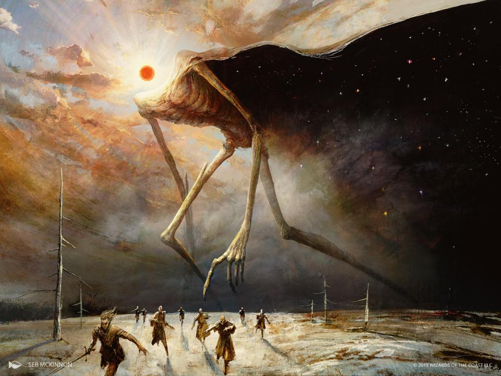
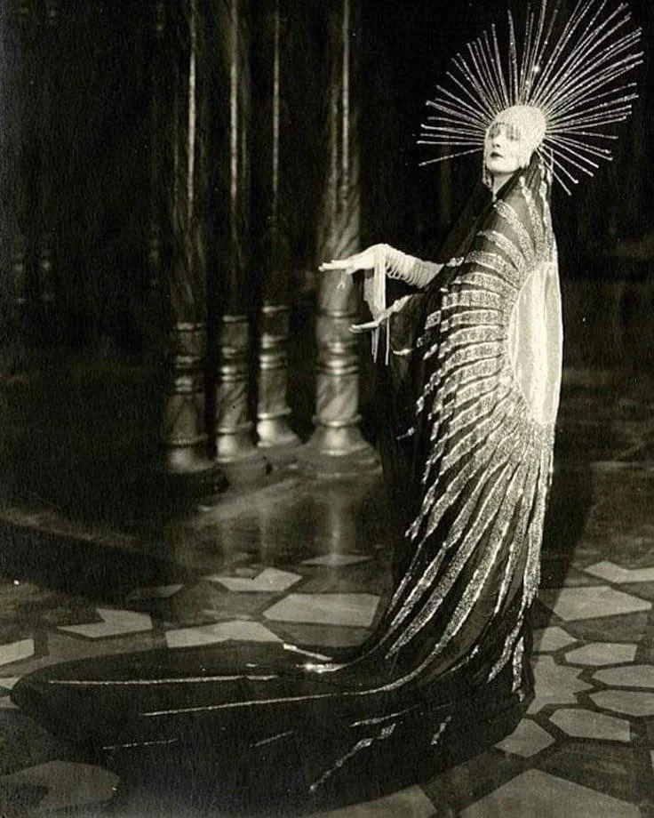

%%  
[[Vimgalab Monsis]]  
[[Nessos]]  
[[Hastermon Temple]]  
[[Organius of Aviv]]  
[[Melgard]]  
[[Mirel]]  
[[Cirinzel]]  
[[Uriston]]  
[[Zuhuri Holy Wars]]  
[[League of Aviv]]  
[[Labella]]  
[[Balerey]]  
[[Khulki]]  
[[Vigzil]]  
[[Gaal]]  
[[Gavivag Isle]]  
[[Eye of Zuhur]]  
[[Plašato]]  
[[Xolor]]  
[[Terem-Zal]]  
[[Veziva]]  
[[The Sun]]  
%%  

   
<small><i>Mural of Pen Zuhur at the Vimgalab Monsis</i></small>  

  

Zuhurism, also called Pagrinism and in the southern dialect Zuhirism, is a monotheistic religion that comprises the spiritual, cultural and legal traditions that arose among the <a href="Pagri" class="internal-link">Pagri</a> of the Pagri Valley in eastern Nirydia. It is one of the largest religions of the subcontinent and a fervent faith with many militant aspects. Its adherents worship a single benevolent and all-knowing god, Pen Zuhur, whose name means "Lord of all that exists" in Old Pagri, and who is hailed as the supreme ruler of the universe. Though it began as a faith of the Pagri around Lake Pag, Zuhurism has long since spread to the <a href="Gorati" class="internal-link">Gorati</a>, the Terenni and the Shirin of <a href="Vigzil" class="internal-link">Vigzil</a>, often through war, and it rejects the distinctions of race found in many similar traditions, so that it is now practised by many of the peoples of the subcontinent and beyond.
  
<h2>Beliefs</h2>  

Zuhurists hold that Pen Zuhur dwells within <a href="The Sun" class="internal-link">the Sun</a>, and that the world is everything his light touches. Darkness is not a rival power but the absence of his gaze, and the great beasts and witch kings of Zuhuri legend are its servants. Pen Zuhur, a decidedly male figure, is usually portrayed as a noble elder in long robes, either with suns in place of his eyes or with the sun for a head. At the end of days, known as the Dawning, he is to step out of the Sun and embrace his children, bringing those who served him faithfully into an eternal afterlife, while those who turned away from him remain behind in a cooling dark.
  

Central to the faith is the teaching that any being which turns its face to the sun is a child of Pen Zuhur, whatever its kind, and it is from this that Zuhurism draws its openness to all peoples. The same teaching holds that what is marked in the flesh, such as disfigurement, mutation or unnatural hunger, is a shadow cast by turning away from the god. Zuhurists have therefore been largely indifferent to differences of species while treating those they consider shadowed with great harshness, most infamously in the purges of the <a href="Xolor" class="internal-link">Xolor</a>, whom the faithful declared a shadow on Pen Zuhur's visage.
  
<h2>The Mandukh</h2>  

The teachings of Zuhurism are codified in the Mandukh, a collection of religious laws, histories and teachings, sometimes called the holy text or the Mandukhi scriptures. It is named after Ineria Mandukh Gilraman, who is often regarded as the most important prophet of the faith and who codified the scriptures in 315PA. His Six Ways, the largest section of the Mandukh, discuss the nature of the world and the soul and set out six paths of a righteous life: the Way of Light, which is truth; the Way of the Hearth, which is family and lineage; the Way of the Sword, which is just war; the Way of the Open Hand, which is hospitality and alms; the Way of the Road, which is pilgrimage; and the Way of Dusk, which is a good death. The Mandukh is published only in Old Pagri, the liturgical language of the faith.
  

   
<small><i>Gorati Priestess of Pen-Zuhur</i></small>  

  
<h2>Holy Sites</h2>  

Zuhurism encourages pilgrimage, and the classic tradition recognises four great holy sites. The <a href="Vimgalab Monsis" class="internal-link">Vimgalab Monsis</a> in <a href="Nessos" class="internal-link">Nessos</a>, built between 630 and 668PA, is the largest religious complex in the world. The Spring of Light lies in Spring Valley, the central valley of the Templi Heights between <a href="Mirel" class="internal-link">Mirel</a> and <a href="Balerey" class="internal-link">Balerey</a>; the Heights were the main theatre of the Holy Wars, and the spring is today under the guardianship of Mirel. <a href="Hastermon Temple" class="internal-link">Hastermon Temple</a> in <a href="Gorat" class="internal-link">Gorat</a> stands on the hill where the prophet Hastermon is said to have kept a vigil of fourteen days and nights in the 4th century BA, until he reached communion with Pen Zuhur and his eyes opened as rays of light that blessed the hill forever. The Pagale Monastery stands on Lonely Peak, north of the Alev swamps in the east of the Motherlands, within the borders of <a href="Girdineux" class="internal-link">Girdineux</a>; because no Zuhuri realm holds it, it is sometimes called the lost mountain. A pilgrim who has visited all four is honoured as having walked the Four Lights.
  

The Pagri church also counts a fifth holy site, the Great <a href="Organius of Aviv" class="internal-link">Organius of Aviv</a> in <a href="Melgard" class="internal-link">Melgard</a>, a vast shaft that descends for kilometres beneath the city into the Underlands. On its walls hangs the inner city of Aviv, a holy and forbidden city within the city, and at its bottom lies the precious Avivium ore. No one knows who made the Organius, and it is counted among the wonders of the world. Some scholars hold that it was the work of Nirydian dwarves who abandoned it at least two thousand years ago, and that a <a href="Terem-Zal" class="internal-link">Terem-Zal</a> lies at its centre.
  
<h2>Practice</h2>  

Zuhurists pray facing the sun at dawn, at noon and at dusk, for which they are called Sun Worshippers or, colloquially, Yellow Eyes. The greatest feast of the year falls on the longest day, while the longest night is kept as a vigil in memory of the fourteen days of Hastermon. The dead are laid out beneath the open sky with their faces turned towards the sunrise. The faith reckons time by the sun, and divination is held to be the highest gift that Pen Zuhur grants, though how freely it may be practised differs from church to church.
  

The faithful keep their own reckoning of time, the Zuhuri Calendar, a solar calendar of 400 days that begins each year on the longest day and counts its years from 624BA, when Pen Zuhur was first worshipped around Lake Pag. Its seasons, the Four Lights, are proclaimed by the Sunpriests once observed, and through trade it has been adopted by many peoples of southern Nirydia beyond the faith (see <a href="Calendars" class="internal-link">Calendars</a>).

<h2>Churches</h2>

Zuhurism has no single head. Its churches recognise one another but have long quarrelled over primacy, each centred on a holy site of its own. The Pagri church, the oldest, is centred on the Organius of Aviv, and some of its members blind themselves in the service of the god, the blinded seers being the most revered diviners of the faith. The Terenni church is centred on the Vimgalab Monsis, which many regard as the spiritual centre of the modern faith. The Gorati church is centred on Hastermon Temple, whose priests and monks guard the site fiercely and whose highest-ranking members wear sun masks of brass and gold; it rarely practises ritual blinding and restricts divination almost entirely to the shrines and temples of its Sunpriests, and some of the Gorati call themselves the first children of Zuhur. The Shirin of Vigzil follow the teachings of <a href="Khulki" class="internal-link">Khulki</a>, who read the faith above all as a rejection of the hunger for power, and keep his notation cards as sacred relics. Smaller Zuhuri communities are tolerated in the western lands of <a href="Gaal" class="internal-link">Gaal</a> and live along the southern coast of the Durenni Sands and on the Pepper Islands.
  
<h2>Orders and Schools</h2>  

Among the many institutions of the faith, the Burning Cassiori of Melgard are a militant order of knights and pyromancers, fanatically devoted to Pen Zuhur. The Raymakers are a collective of permanent pilgrims who walk from holy site to holy site across all of Nirydia; many of them show an affinity for magic, and many also a touch of madness, and they are treated with fear and respect wherever they pass. The School of the Prokuliani in Terennis rejects much of the teaching of the Mandukh, regarding it as the work of a mortal and a product of its time, and opposes its publication in Old Pagri alone. In recent years the Solarists have arisen among the Pagri, who use sun magic and artificery to build wings and barks capable of flight; these work only with a mage aboard and only in sunlight, but are nonetheless extremely powerful. The Gorati regard flight as a taboo that encroaches on Pen Zuhur's own domain, and view the Solarists with suspicion.
  
<h2>History</h2>  

Zuhurism was first practised by the then nomadic Pagri around Lake Pag in the early 7th century BA, and over the following centuries developed into an organised faith. It spread south across the Gavivag Bay to the Gorati at an early date, where Hastermon kept his vigil in the 4th century BA. In 315PA Ineria Mandukh Gilraman codified the Mandukh. In the 460s the Seventeen Sons of Gav raised the <a href="Eye of Zuhur" class="internal-link">Eye of Zuhur</a> on <a href="Gavivag Isle" class="internal-link">Gavivag Isle</a> as an offering to Pen Zuhur, a vast dome that gathers the light of the sun and casts it out as a ray of destruction across the surrounding waters. The working took weeks to complete, and all of the brothers gave their lives in it except the seventeenth son, Miodas. In the 7th century the faith crossed into the <a href="Twintail Imperium" class="internal-link">Twintail Imperium</a>, where Khulki's embrace of Zuhurism and rejection of <a href="Lakalism" class="internal-link">Lakalism</a> sparked the Great Rebellion of 612 to 627PA, after which his followers founded Vigzil.
  

The security of pilgrims and of the holy sites led to the <a href="Zuhuri Holy Wars" class="internal-link">Zuhuri Holy Wars</a>. The First Holy War, begun in 620PA, was fought against the Peruxae witches of <a href="Sihilixar" class="internal-link">Sihilixar</a>; it burned down the southern forest, now known as the Ashlands, and led to the creation of Volun's Ward, a magical barrier that brings nightmares and curses upon any who enter the forest. The Second and Third Holy Wars, begun in 645PA and 701PA, were fought against the heresy of Umo, the realm that preceded <a href="Uriston" class="internal-link">Uriston</a> and Nessos, which in its later years fell under the witch king Zologos, who commanded undead hordes and crowned himself the reborn Pen Zuhur; he fell at the end of the Third Holy War. The Fourth Holy War was declared in 751PA by the <a href="League of Aviv" class="internal-link">League of Aviv</a> against <a href="Labella" class="internal-link">Labella</a>, which threatened to lay claim to the Spring of Light. The Fifth Holy War, begun in 777PA, grew out of a dispute over the rights of pilgrims in southern Labella and the petitions of wealthy pilgrims and traders to force open the road west, and became an effort to convert Labella by force. When Labella appealed to the Twintail Imperium for help, Gaal in turn sent help to the League, turning a regional war of faith into the first clash between the two great powers of Nirydia, which ended with the defeat of the League at the Battle of Minea in 792PA. From 784PA to 868PA Zuhurists carried out the purges of the Xolor, whom they also blamed for the plague known as the Dance of Husks, which ravaged the Pagri and the Gorati in 846PA. In the 870s the Zuhuri realms of <a href="Plašato" class="internal-link">Plašato</a> and Cirinzel fought the Gavivag War over Gavivag Isle and its Eye, which ended with Plašato in possession of the island at Cirinzel's doorstep.
  
<h2>Spread</h2>  

Today Zuhurism is the dominant faith of the Pagri Valley, including <a href="Melgard" class="internal-link">Melgard</a>, <a href="Mirel" class="internal-link">Mirel</a> and <a href="Cirinzel" class="internal-link">Cirinzel</a>, of the Terenni lands around Nessos, of Gorat and of Vigzil. Beyond these heartlands it is tolerated in Gaal and practised by communities in the Durenni Sands and the Pepper Islands. In Gorat the faith has shaped the high art of the <a href="Veziva" class="internal-link">Veziva</a>, whose practitioners favour the magic of fire, light and the sun.
  
