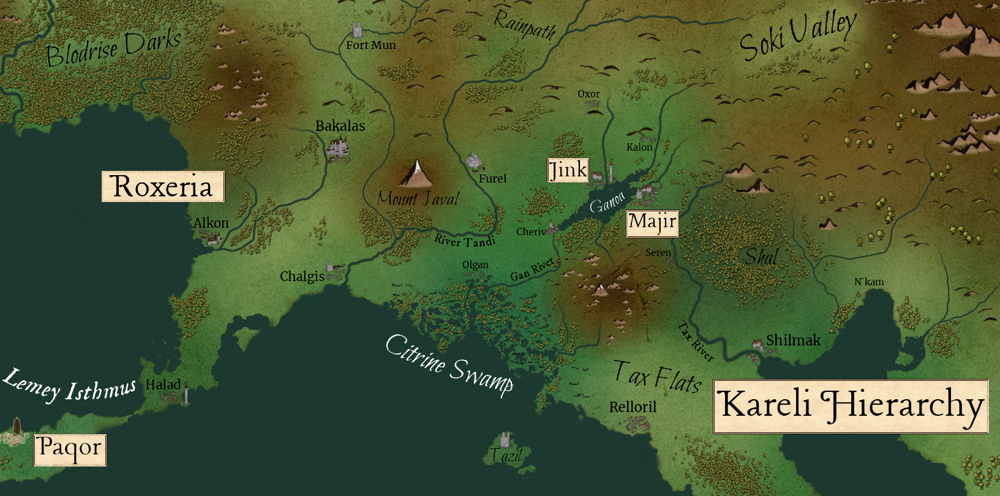

%%  
[[Jink]]  
[[Majir]]  
[[Ganoan]]  
[[Ganoan Dye]]  
[[Para]]  
[[Karaluk]]   
[[Javalim]]  
[[Kethricism]]  
[[Ekkam]] 
[[Roxeria]]  
[[Mystics Guild]]  
[[Ral]]  
[[White Sister]]  
[[Goash Mab]]  
%%  

The Ganoa Valley is a fertile valley in southern Nirydia, centred on Lake Ganoa and lying between <a href="Roxeria" class="internal-link">Roxeria</a> to the west and the <a href="Kareli Hierarchy" class="internal-link">Kareli Hierarchy</a> to the south. It is the homeland of the <a href="Ganoan" class="internal-link">Ganoans</a>, the human and Bihra peoples of the lake, and is shared between two rival city states, <a href="Jink" class="internal-link">Jink</a> on the northern shore and <a href="Majir" class="internal-link">Majir</a> on the southern. The valley is known above all as the only source of <a href="Ganoan Dye" class="internal-link">Ganoan Dye</a>, the living colour, whose wealth has made it one of the richest and most contested corners of the south.
  
<h2>Geography</h2>  

Lake Ganoa lies at the heart of the valley, fed by rivers that run down from the north, with the farmland and plantations of the valley floor spread along its shores. Beneath its waters lie the flower fields, the only place in the known world where the Ganoan Flower blooms. The valley is bounded in the west by the Tandi River, which comes down all the way from the unruly Kolrog Highlands in the north and forms the border with <a href="Roxeria" class="internal-link">Roxeria</a>, whose easternmost city, Furel, stands on its western bank with Mount Javal beyond. In the east the valley is bounded by the Tax River, beyond which lie the woods of Shal and, to the north-east, the Soki Valley, and by the Ganoan Mountains, a small range south of the lake. The lake drains southward through the Gan, which runs from Lake Ganoa down into the Citrine Swamp, and to the south the land falls away into the swamp and towards the coast of the <a href="Kareli Hierarchy" class="internal-link">Kareli Hierarchy</a>. The northern side of the valley holds the vast majority of its farmsteads and is held by Jink, while the southern side, held by Majir, is dominated by the Parabol Domes. The mines of the valley lie along its rivers, the greatest of them being the Silverpit downstream on the Gan, and the village of Cheriv lies south-west of the lake.
  

  

<small><i>Map of the Ganoa Valley & Roxeria in the year 927PA</i></small>
<h2>History</h2>  

The lake shores were settled by the Bihra in the era of Anator-Bihr, and later formed part of the lands ruled by <a href="Azuvke" class="internal-link">Azuvke</a> during its Golden Age. In 433PA the <a href="Ekkam" class="internal-link">Omna of Ekkam</a> retook the valley from Azuvke and founded Jink on the northern shore. When Ekkam fell to the <a href="Luchun Khaganate" class="internal-link">Luchun Khaganate</a> in 551PA the valley passed to the Khans of the Steppe, whom the Ganoans served for well over a century. In the years after 564PA kethric Kheri fleeing the <a href="Revolution of Rox" class="internal-link">Revolution of Rox</a> settled around the lake. When <a href="Gaden" class="internal-link">Gaden</a> of Drizan defeated Luchun at Verivale in 671PA, Jink regained its independence and became the centre of the valley.
  

For more than two centuries Jink ruled the valley, and its families ran the ferry and trading post on the southern shore that would become Majir. In the 820s the Parabol Domes were built there and the making of Ganoan Dye made the southern shore a city, but most of its wealth flowed north. Riots broke out in Majir in the summer of 893PA, and by winter mercenaries ringed the lake and the valley was at war. The war ended with the truce of 895PA, which made Majir a free city in control of the southern side of the valley and left Jink with the northern. In the decades since, the two cities have been bound together in a careful peace, strained by the rise of the radicals in Majir, the question of escaped slaves and, since the late 910s, the preaching of the <a href="White Sister" class="internal-link">White Sister</a>.
  
<h2>Peoples</h2>  

The Ganoans make up most of the valley's people. Ganoan Humans form the larger part of the population, while the Ganoan Bihra have shared the lake with them for centuries and long run most of its ferries and pilots. Both speak Ganoan Lihbare, a dialect of Lihbare, though the two shores have each developed words of their own. The valley is also home to a sizeable kethric community descended from the refugees of the Revolution of Rox, to small clans of <a href="Ral" class="internal-link">Ral</a> shifters, who keep to themselves, to the flower divers, who harvest the fields beneath the lake and are counted a people apart, and to small and isolated clans of <a href="Peruxa" class="internal-link">Peruxa</a> and goblins said to live in the Ganoan Mountains. The plantations of the north are worked by slaves, orcs, Bihra and humans, who are marked with the Master's Seal.
  
<h2>Economy</h2>  

The wealth of the valley rests on Ganoan Dye. The flowers are harvested by divers under rights held in Jink, and are processed in the Parabol Domes of Majir, which also leave behind the hallucinogenic residue known as <a href="Para" class="internal-link">Para</a>, one of the two most important drugs of the south. The Domes poison the air of the southern shore, and the lives of their workers are short and rough. Beyond the dye, the valley lives from its farms, from the rice and cotton of the slave plantations of the north, the largest of which belong to <a href="Goash Mab" class="internal-link">Goash Mab</a>, from the ferries and trade of the lake, and from its mines. Jink holds a monopoly over medicine and many science-based industries, which Majir badly needs, while Majir holds the Domes and the mines it seized in the war, so that each city depends on the other in ways neither can easily escape. The valley is also a meeting point of trade from the north. Caravans of goblins from <a href="Pintrixaz" class="internal-link">Pintrixaz</a> and of the Steppe Bihra come down from the steppe by the Rainpath, the road through the valleys of the upper Tandi, and unlike Roxeria, which refuses all trade with the Steppe Bihra, the cities of the lake deal with them openly.
  
<h2>Religion</h2>  

Most of the valley follows the <a href="Karaluk" class="internal-link">Karaluk</a>. Jink and the villages of the lake honour Ginyaka the Mother, while Majir has made Mupat of the Deathwind its own since the war. The valley is also, together with the Citrine Swamp, the heartland of the sect that reveres the One of the <a href="Javalim" class="internal-link">Javalim</a> as an unborn sixth Great. Both cities are known for their tolerance, and followers of other schools of the <a href="Vas Ira" class="internal-link">Vas Ira</a>, of the Javalim, of <a href="Zuhurism" class="internal-link">Zuhurism</a> and of <a href="Kethricism" class="internal-link">Kethricism</a> live on both shores. The greatest festival of the valley is the Hunger, held in autumn when the turning of the leaves is taken as a good omen for the year's dye.
  
<h2>Politics</h2>  

Jink is ruled by a handful of patrician families through the Archon and the Lords of the Council, while Majir is governed by two elected Consuls, its elections steered by the gangs of the city. The truce of 895PA remains the foundation of the valley's peace, but in Majir the radicals led by Sar Damok are gaining ground on the moderates, and many believe that Jink, far the richer of the two, could win a second war if provoked. The <a href="Mystics Guild" class="internal-link">Mystics Guild</a>, whose chamber in the valley is the Twin Spires, is needed by both cities and trusted by neither. Beyond the valley, Roxeria and the Kareli Hierarchy both court the two cities, and rumours tell of Azuvke seeking allies on the lake for a new war against Roxeria.
  
<h2>Places of Note</h2>  

Jink, on the northern shore, is the older and richer of the two cities, known for the Temple of Ginyaka and the cats sacred to her. Majir, on the southern shore, is the city of the Parabol Domes and of the burned Hall of Ginyaka. The flower fields lie beneath the lake between the two. The Silverpit, the greatest mine of the valley, lies downstream on the Gan and has been held by Majir since the war. Cheriv, south-west of the lake, is the home of the White Sister and of much of her following. The Ganoan Mountains south of the lake are little visited, and the Tandi and Tax rivers mark the valley's borders to the west and east. Among the smaller towns of the valley are Oxor and Kalon to the north of the lake, Seren to the south near the Tax, and Olgan on the Gan at the edge of the Citrine Swamp.
  
