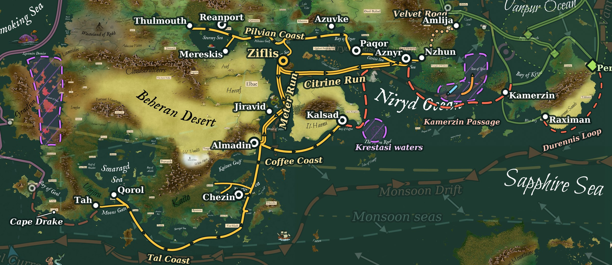

%% [[Ziflis]] [[Grand Ziflis Company]] [[Elbae]] [[Jiravid]]  [[Kareli Hierarchy]] [[Velvet Caravan]] [[Strait of Horad]] [[Wars of Elbae Aggression]] [[Risen Reef]] [[Great Elbae Golomid War]]  [[Winds and Currents]] [[Vanpur Pepper Trade]] [[Smoking Sea Trade]] [[Il Haena]]%%

  <small><i>The lanes of the Ziflis Trade</i></small> 
  
The Ziflis Trade is the great network of sea lanes that binds Behera and Nirydia to the rest of Ilrakhan, and one of the most important trading networks in the world. It takes its name from <a href="Ziflis" class="internal-link">Ziflis</a>, the island trade city in the middle of the Sunny Sea within the <a href="Elbae" class="internal-link">Elbae Sultanate</a>, where the lanes from the Niryd Ocean, the Strait of Meter and the Purple Sea all meet. The city is the seat of the <a href="Grand Ziflis Company" class="internal-link">Grand Ziflis Company</a>, which dominates the Trade, and through the Company the Sultanate has made the flow of Nirydian and Beheran goods into Ilrakhan one of the foundations of its power.
 
The Trade lives by the monsoon. The western Niryd Ocean is the calm, fair-weather side of its basin, and its winds reverse every half-year with a regularity that sailors can plan a life around. Every lane of the Trade is sailed one way in one monsoon and the other way in the next, and its rhythm has shaped the calendars, fortunes and politics of every port along it.
 <h2>The Grand Ziflis Company</h2> 
The roots of the Company reach back to the Fraternity of the Islands, a group of traders closely tied to the ports of Kulum, Thulmouth and Reanport. Almost a century later, in the middle of the eighth century, the Sultanate brought its leading overseas merchants together in Ziflis as a regulated company in the nature of a guild, and in 754 PA Sultan Fasmer I granted it its official charter. The charter was given during the first of the <a href="Wars of Elbae Aggression" class="internal-link">Wars of Elbae Aggression</a>, and the Company was built as the commercial instrument to exploit the control of the Horad Isthmus that the war was meant to win.
 
The Company today trades across the Stormy Sea, the ports of Nirydia, <a href="Il Haena" class="internal-link">Il-Haena</a> and southern Behera. In return for privileges granted to the local nobilities, its merchants pay no fees in the ports of Reanport, Aznyr, Azuvke, Thulmouth, Edgral and New Kulum. Its second largest outpost after Ziflis is at Almadin, through which almost the entire trade of nations such as the Yorgosi Marival and the Empire of Pravazik flows into the Sultanate and greater Ilrakhan. In the Purple Sea it keeps commercial relations with the Yppori ports, such as Koshtir, and the other successor states of the Purple Empire of Naigan. The most important goods it brings into Behera and Ilrakhan are the coffee of the Kingdom of the Qarzi and the spices of Far Nirydia and southern Behera.
 
The Company is led by Headmaster Usval al Hamon. It employs hundreds of individual merchants and several regional governors, and it plays a large part in the colonisation of southern Behera and Il-Haena. A dedicated representative of the Company advises the Sultanate's Asafi of Economy directly, and the boundary between the policy of the state and the business of the Company has become hard to draw. Sultan Fasmer II has invested heavily in it since taking the White Chair in 897 PA. Since the discovery of Sirenna in 924 PA the goods of the far south have grown very valuable to it, and its relations with the Yppori have become both more profitable and more tense as elven colonial ambitions in the new world gather pace.
 <h2>The Monsoon Relay</h2> 
In winter the monsoon blows from the north-east, and ships sail west and south. The fleets of Aznyr come west to Ziflis, and the ships of Ziflis run south through the Strait of Meter toward the Purple Sea. In summer the monsoon blows from the south-west, and the movement reverses: the ships of the Purple Sea come north to Ziflis, and the ships of Ziflis sail east to Aznyr. South of Behera the winds run the other way round, and the lanes along Tal are sailed east in winter and west in summer.
 
A ship from either end of the Trade reaches Ziflis on one monsoon and must wait there for the other to carry it home. The fleets of the east and the south meet in its harbour, sell what they have carried and load what the other side has brought, and the warehouses of Ziflis hold cargo from one season to the next. This relay is the foundation of the city's wealth. Between the monsoons come a few weeks of shifting, uncertain winds, when ships lie in port and the harbours of the Trade are at their fullest.
 <h2>The Company Runs</h2> 
The great ships of the Company do not hug the coasts. With the monsoon behind them they sail straight across open water on two runs, while the smaller traders of the coasts work the shores in short hops from port to port.
 
The Citrine Run joins Ziflis to Aznyr, one of the largest cities in the world and the capital of the <a href="Kareli Hierarchy" class="internal-link">Kareli Hierarchy</a>. It passes south of the Qahori Archipelago, crosses the Citrine Sea and rounds into the Jade Sea, about 3,700 km in 20 to 30 days. Company ships sail it east in summer and west in winter.
 
The Meter Run joins Ziflis to Almadin, the gate of the Purple Sea and the Company's second outpost. It runs down the Beheran side of the Strait of Meter and calls at <a href="Jiravid" class="internal-link">Jiravid</a>, the capital of the Sultanate and one of the largest cities in the known world, about 2,400 km in 15 to 20 days. Company ships sail it south in winter and north in summer.
 
The Company keeps its open-water runs in the calm western half of the Niryd Ocean. The eastern Niryd is struck by storms in late summer, and the direct line from the Citrine Sea south to the Bay of Coffee now passes the Risen Reef.
 <h2>The Coastal Lanes</h2> 
From Aznyr the Pilvian Coast lane runs west round the peninsula of Paqor and along the northern shore of the Niryd Ocean past Azuvke and the Bay of Kulum. It then enters the Pilvian Gulf and passes through the <a href="Strait of Horad" class="internal-link">Strait of Horad</a>, which sailors also call the Horad Crossing, into the Stormy Sea. The strait was once the Horad Isthmus, the land bridge between the Stormy Sea and the Pilvian Gulf over which the Sultanate fought all three Wars of Elbae Aggression. At the end of the Third War the Ruby Eye of Karajal, Jurahim al-Biad, completed an invocation the Sultan had ordered abandoned, sank the isthmus and killed thousands on both sides. The Treaty of Danipol of 815 PA ended the wars without the territory the Sultanate had sought, but the strait that replaced the isthmus entrenched Elbae commercial dominance more thoroughly than any victory could have done. It now serves as a canal, and ships pass through it in the shadow of its cliffs, under fortifications held by the Sultanate's Dusk Army.
 
The strait is the only way by sea into the Stormy Sea, and every ship bound for its three great ports, Reanport, Mereskis and Thulmouth, must pass through it. The whole coast from Aznyr to Reanport is about 6,200 km, a voyage of some 60 to 85 days for a coasting trader, and it is sailed west in winter and east in summer. Short links join it to Ziflis in the south and to Mereskis.
 
From Almadin the Coffee Coast lane runs east along the south coast of Il-Haena into the wealthy Bay of Coffee and to Kalsad, its most important port, about 2,500 km in 25 to 35 days. Another lane runs south from Almadin through the Purple Sea past Chezin, with short links into the Bay of Anpon for Koshtir and Rikarma. It leaves the Purple Sea through the Ashen Strait and follows the coast of Tal west along the south of Kaito, then turns north through Moons Gate into the Smaragd Sea to Qorol and Tah. From Almadin to Moons Gate the voyage is about 6,200 km and takes some 60 to 85 days. The trade of the Purple Sea flows north along these lanes to Almadin and Ziflis, and from Tah a dangerous lane continues west round Cape Drake into the Bay of Geol and the <a href="Smoking Sea Trade" class="internal-link">Smoking Sea Trade</a>.
 <h2>The Velvet Road</h2> 
The Sea of Spores cuts the Niryd Ocean off from the seas to the east, and the trade between the two landmasses runs overland instead. The Velvet Road leaves the coast at Amlija in Gorat and crosses the hills into the valley of the Ranchil, the great river that comes down from the Limsul Peaks. It follows the river down to Nzhun, the only trade port of the Mogyri, and from Nzhun almost all of its trade gathers in Aznyr across the Jade Sea. The road is about 1,300 km long, a journey of some 45 to 65 days by caravan. Some of its trade also turns inland through southern Nirydia.
 
The road is travelled by the <a href="Velvet Caravan" class="internal-link">Velvet Caravan</a>, a loose organisation of traders sometimes called the Velvet Guild or the Velvet Combine, which carries goods from Nirydia to the Jade Sea and the ports of Ilrakhan. Travel along it is dangerous, through inhospitable country, under the threat of the Limsul raiders and in contact with the mysterious Mogyr of the Yl-Lhatsi Clans, but as long as the Sea of Spores stays closed it remains the lifeline between the two landmasses. At Amlija the road meets the <a href="Vanpur Pepper Trade" class="internal-link">Vanpur Pepper Trade</a>, whose westbound cargoes enter the Ziflis Trade by this route.
 <h2>Closed Waters and Dangerous Lanes</h2> 
The <a href="Sea of Spores" class="internal-link">Sea of Spores</a> is closed to shipping. Corrosive, toxic spores rise from the central mountains of Drizan, and the monsoon carries them over the water in both halves of the year, north-east onto the Living Coast in summer and south-west over the waters south of Drizan in winter.
 
The Kamerzin Passage is the one way by sea between the Vanpur Ocean and the Niryd that avoids both the Sea of Spores and the long voyage round Durennis. Ships pass through the narrow channel at Kamerzin and then sail west past the south of Drizan, but this last leg is treacherous. The winter monsoon that would carry a ship west also carries the spores over the same water, and in summer the leg must be sailed against the monsoon, with storms in late summer. Ships coming east in early summer have the best of it. The longer way round, past the empty, harsh south coast of Durennis, is sailed only rarely.
 
East of the Bay of Coffee lies the <a href="Risen Reef" class="internal-link">Risen Reef</a>, which the coral magic of the <a href="Golomid" class="internal-link">Golomid Empire</a> raised to the surface south of Il-Haena in 857 PA. Seen from the surface it is an archipelago of coral, but it is only the crown of corals thousands of metres tall, slowly waving in the currents below. Relations between the Reef and the traders of the Niryd soured within a few years, and after Elbae traders stranded on the Reef were never heard from again, the Sultanate and the Golomid fought the <a href="Great Elbae Golomid War" class="internal-link">Great Elbae Golomid War</a> from 871 to 893 PA. It ended inconclusively in the Peace at Algolom, and the Golomid have since kept amicable terms with the seafarers of the Sultanate. The waters around the Reef, out to about a day's sail, are still held by the <a href="Krestasi" class="internal-link">Krestasi</a>, and trade near it remains sparse and risky. Before the Reef rose, ships from Aznyr could run straight down the east coast of Il-Haena to the Bay of Coffee. Now much of that trade goes the long way round through the Strait of Meter and Ziflis.
